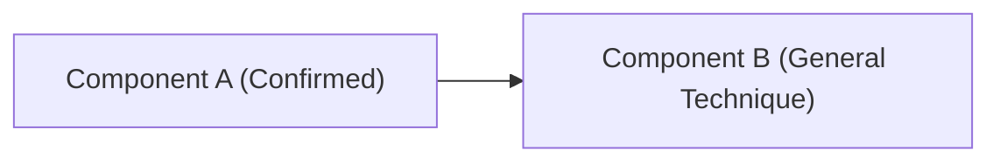

# Contributing to How AI & Tech Giants Scale

## Welcome to the Project

This repository publishes first-principles system design breakdowns, GPU kernel rooflines, and hardware memory math from frontier AI companies and high-concurrency distributed systems. It is written for Staff Engineers, Distributed Systems Architects, and AI Infrastructure Builders. Our credibility depends entirely on technical accuracy: **every single factual claim, benchmark metric, and architectural choice must be traceable to a verified public source or marked as a mathematical derivation.**

---

## 🛠️ Ways to Contribute

Contributions are prioritized from simplest to most comprehensive:

1. **[Report an Outdated or Inaccurate Metric](.github/ISSUE_TEMPLATE/bug-or-correction.md)**: No code required. If an exchange bulletin, whitepaper revision, or benchmark changes a number, open a correction report.
2. **Add or Improve a Primary Source**: Replace secondary news summaries with direct links to academic papers, engineering blogs, SEC filings, or conference recordings.
3. **Fix Formatting, Broken Links, or Mermaid Rendering**: Fix typos, contrast issues in dark-mode diagrams, or dead URLs.
4. **Improve a Derived-Math Section**: Clarify arithmetic, correct tensor dimension formulas, or expand roofline models while stating all assumptions.
5. **[Propose a New Case Study](.github/ISSUE_TEMPLATE/request-case-study.md)**: Open an issue first before writing code. Case studies require maintainer alignment on scope and source availability.
6. **Author a Full Case Study**: Once a proposal is approved, draft a complete breakdown following our article standard.

---

## 🎯 Our Accuracy Rules

These rules are strictly enforced during pull request review. Contributions that violate them will not be merged.

1. **Public Primary Sources Only**: Every factual or numeric claim must cite a public primary source: company engineering blogs, peer-reviewed papers, official documentation, recorded conference talks (e.g., AWS re:Invent, QCon), or regulatory filings. Third-party content farms, aggregator newsletters, and AI-generated summaries are **not** acceptable sources.
2. **First-Principles Math Must Be Labeled**: Any calculation performed by the author must be labeled `(derived)` with the underlying formula, input assumptions, and step-by-step arithmetic shown.
3. **Unconfirmed Claims Must Be Explicitly Scoped**: Any detail reported by credible external sources but not confirmed by the company's engineers must be marked `(unverified / reported)` or omitted.
4. **General Techniques vs. Proprietary Code**: Open-source solutions (e.g., PagedAttention, M/M/c priority queueing) must be explicitly labeled: `(general technique, not <Company>'s confirmed internal design)`.
5. **Three-Layer Architectural Framing**: System blueprints must classify components into:
   - `Confirmed`: Documented publicly by the company's engineering team.
   - `Reported`: Documented by reputable third parties or regulatory filings.
   - `General Technique`: Industry-standard engineering pattern solving the problem.
6. **Real Public Incidents Only**: Outage post-mortems must analyze verified, public events with published post-mortems or status logs. Never invent hypothetical downtime scenarios or attribute unverified root causes. Clearly specify whether the incident was caused by an architectural defect, abuse, or third-party infrastructure.
7. **Metric Scoping and Observation Dates**: Always state the exact scope and observation date (e.g., "59 million peak simultaneous active playback sessions on November 19, 2023, not cumulative tournament reach"; "p99 latency under peak load, not average").
8. **Zero Confidential or NDA Material**: Do **not** submit internal documents, proprietary leaks, or confidential information covered by employer non-disclosure agreements. We analyze only what is publicly discoverable.

---

## 🤖 Using AI Tools to Draft

You may use AI tools (such as Claude, ChatGPT, or Gemini) to assist with drafting, structuring, or coding. However, **you remain personally accountable for every sentence and citation in the pull request**:

- You must personally open and read every primary source URL cited in your contribution.
- AI hallucinations (e.g., fabricated paper titles, fake GitHub repositories, or non-existent conference talks) will result in immediate closure of the pull request.
- In your pull request description, you will be asked to confirm that you verified all links manually.

---

## 📋 The Case Study Standard

Every flagship breakdown adheres to a rigorous, consistent master structure (1,800 to 2,500 words). Pull requests for new case studies must include all thirteen elements:

1. **YAML Front Matter**: Includes `title`, `description` (150–160 characters), `keywords`, `date`, and `last_verified: YYYY-MM-DD`.
2. **Search-Intent H1**: Clear, descriptive title optimized for technical search intent.
3. **Status Update Box (`> [!IMPORTANT]`)**: 4–5 bullet points covering the current year's verified ground truth (model versions, active market share, mergers).
4. **Executive Summary (`> [!NOTE]`)**: TL;DR containing 4–5 bullets, each pairing an architectural takeaway with a verified or derived number.
5. **Human Hook**: A 3-sentence opening highlighting the real-world scale tension.
6. **Problem & Constraints Table**: Structured matrix mapping system metrics to production targets and citations.
7. **Native Visual Blueprint**: A dark-mode-safe Mermaid.js diagram with components explicitly labeled by layer.
8. **Core Mathematical & Algorithmic Foundations**: First-principles mathematical derivations labeled `(derived)` and accompanied by executable Python or pseudo-code reference implementations.
9. **Production Post-Mortem**: A detailed breakdown of a real, public failure mode, including root cause and lessons learned.
10. **Architectural Trade-Off Analysis**: A comparative matrix evaluating design alternatives (Option A vs. Option B).
11. **When NOT to Copy This Design**: Explicit engineering scenarios and anti-patterns where the architecture is overkill.
12. **Frequently Asked Questions**: Exactly 5 practical technical questions phrased as real search queries.
13. **References & Footer**: Numbered primary sources with direct URLs, closing with `Authored by @saurabh-vision`.

<details>
<summary><strong>Click to view the Markdown Article Skeleton Template</strong></summary>

```markdown
---
title: "How <System> Works: <Core Architectural Breakthrough>"
description: "<Actionable 150-160 character summary of the engineering challenge and solution.>"
keywords:
  - <primary keyword>
  - <secondary keyword>
date: YYYY-MM-DD
last_verified: YYYY-MM-DD
---

# How <System> Works: <Core Architectural Breakthrough>

> [!IMPORTANT]
> **Status Update: Architecture Evolution & Disclosed Realities (<Month Year>)**  
> - <Bullet 1: Ground truth current status>
> - <Bullet 2: Corporate/stack changes>

> [!NOTE]
> **TL;DR**
> - **<Takeaway 1>**: <Insight with verified number> [1].
> - **<Takeaway 2>**: <Insight with derived formula> (derived).

<Human Hook: 3 sentences on why traditional system design fails here.>

---

## 1. Production Scale and Operational Realities

| Metric / Dimension | Production Target / Observed Value | Source / Classification |
| :--- | :--- | :--- |
| **<Dimension 1>** | <Value> | Confirmed (<Citation>) [1] |

---

## 2. High-Level System Architecture



---

## 3. Core Mathematical and Algorithmic Foundations

### 3.1. <Derivation Title> (derived)
$$\text{Formula} = \dots$$

---

## 4. Production Post-Mortems: Real Incidents and Bottlenecks

### Incident 1: <Name of Real Public Outage>

---

## 5. Architectural Implementation

```python
# Reference implementation illustrating core concurrency or data structure
```

---

## 6. Architectural Trade-Off Analysis

| Architectural Decision | Option A | Option B | Selected Strategy & Justification |
| :--- | :--- | :--- | :--- |

---

## 7. When NOT to Copy This Design

---

## 8. Frequently Asked Questions

### 1. <Question phrased as search query>?
<Direct technical answer.>

---

## 9. References & Verification Sources

1. **Author** (Year). *"Title."* Publisher / Conference. Available at: <URL>

---

Authored by @saurabh-vision
```
</details>

---

## ✍️ Technical Style Guide

- **Writing Tone**: Confident, respectful, and direct. Avoid marketing hype (*"insanely fast"*, *"revolutionary"*). Never include put-downs of other open-source projects or commercial products.
- **Acronyms**: Define all acronyms on first use: *Multi-Head Latent Attention (MLA)*, *Grouped-Query Attention (GQA)*, *Time-to-First-Token (TTFT)*.
- **Headings**: Use full, descriptive phrases for all headings (e.g., `## 3. Core Mathematical and Algorithmic Foundations`, not `## Math`).
- **LaTeX Math**: Use GitHub-supported math syntax: inline math with `$...$` and display math blocks with `$$...$$`. Write literal dollar signs as `\$`.
- **Mermaid Diagrams**: Ensure high contrast in both light and dark GitHub themes. Use explicit node fills (`#1e3a5f`, `#2d3748`) and light text (`#fff`) with clean stroke colors.
- **Units & Numbers**: Use standard abbreviations with spaces: $100\text{ms}$, $500\text{ T/s}$, $104.4\text{ Tbps}$, $16.58\text{B}$. Format large numbers with comma separators ($4{,}096\text{ tokens}$).

---

## 💡 How to Propose a New Case Study

Before drafting a new article, [open a Proposal Issue](.github/ISSUE_TEMPLATE/request-case-study.md) containing:
1. System or company name.
2. The core scaling tension (e.g., GPU memory wall, 1M req/s flash bursts).
3. Summary of what is publicly documented vs. what is only inferred.
4. **At least 5 candidate primary sources** (whitepapers, engineering blog posts, conference talks).

Maintainers review proposals on a best-effort basis. Topics with insufficient primary documentation may be declined to preserve technical integrity.

---

## 🔄 Pull Request Workflow

1. **Fork and Branch**: Create a feature branch with a descriptive name (`docs/deepseek-fp8-scaling` or `fix/zerodha-market-share`).
2. **Atomic Commits**: Keep pull requests focused on a single article, derivation, or correction.
3. **Commit Convention**: Follow Conventional Commits:
   - `docs(study): add <System> architecture breakdown`
   - `fix(metric): update UPI monthly transaction volume for Oct 2024`
   - `refactor(math): correct KV cache bytes formula in DeepSeek breakdown`
4. **Complete the Checklist**: Fill out all items in [`.github/PULL_REQUEST_TEMPLATE.md`](.github/PULL_REQUEST_TEMPLATE.md).
5. **Review Phases**: Reviews examine primary sources first, mathematical proofs second, and prose formatting third. Unsourced claims will block merging.

---

## ⚖️ Corrections Policy

We welcome corrections from community members and engineers at the featured companies:
- To correct a metric, [open a Correction Issue](.github/ISSUE_TEMPLATE/bug-or-correction.md) citing a public primary source.
- Company engineers are kindly asked to cite public documentation or blog posts so all claims remain publicly verifiable.
- Verified corrections are merged promptly, credited in the commit history, and reflected in the article's `last_verified` date.

---

## 📜 Licensing and Ethics

- All contributions are submitted under the repository's [MIT License](LICENSE).
- You confirm that you wrote the content yourself and did not copy copyrighted text from paid paywalls or commercial books.
- Short quotations from research papers are permitted when accompanied by formal academic attribution.
- Original diagrams are preferred; third-party diagrams must have compatible open-source licenses.

---

## 🤝 Code of Conduct and Help

We are committed to providing a welcoming, harassment-free environment for all contributors. Please review our [Code of Conduct](CODE_OF_CONDUCT.md).

For questions regarding research sources, mathematical derivations, or proposal alignment, open a discussion in [GitHub Issues](https://github.com/saurabh-vision/how-ai-companies-scale/issues).
