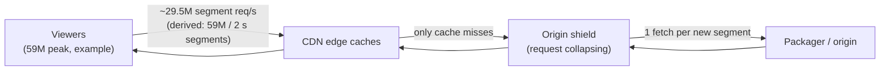

# How AI & Tech Giants Scale: System Design Case Studies

Sourced case studies with worked math on AI inference and large-scale distributed systems: what companies have publicly said, what we can derive from first principles, and what is only a general technique.

---

## What Makes This Different

- **Every number is sourced or marked `(derived)`.** Each article lists its references, and calculations show their assumptions.
- **Three-layer labels.** Every architecture is split into what the company confirmed, what third parties reported, and what is a general technique.
- **Worked math.** Memory footprints, bandwidth, queueing and latency budgets are derived step by step.
- **Real public incidents and limits only.** Post-mortems come from public sources. Where no public root cause exists, the article says so.

---

## How to Read the Labels

| Label | Meaning |
| :--- | :--- |
| **Confirmed** | Stated in an official engineering blog, paper, documentation, or conference talk. |
| **Reported** | Documented by credible third parties or benchmarks, not confirmed by the company. |
| **General technique** | A standard industry pattern that shows how this class of problem is solved. It is not a claim about the company's internals. |
| **`(derived)`** | Our own calculation, with formulas and assumptions shown. |
| **`(unverified)`** | Circulating claim without a primary source. Marked, not endorsed. |

---

## Start Here

1. **[DeepSeek-V3 / R1: MoE Serving with Multi-Head Latent Attention](ai-architectures/deepseek-moe-mla-serving.md)**
   *Key insight:* MLA caches a compressed latent per token. Using the published config, that is about 70.3 KB/token versus about 4.0 MB/token for a hypothetical 128-head MHA cache with the same dimensions, roughly 98% smaller `(derived)`. The DeepSeek-V2 paper's own figure is 93.3% versus DeepSeek 67B.

2. **[Disney+ Hotstar: Live Streaming at 59M Peak Concurrency](scale-classics/hotstar-concurrency.md)**
   *Key insight:* 59 million peak concurrent viewers at an assumed 1.5 to 1.77 Mbps average works out to roughly 88.5 to 104.4 Tbps of egress `(derived)`. See the article for the concurrency definition and source.

3. **[Cursor: Codebase Indexing and Speculative Edits](ai-architectures/cursor-codebase-indexing.md)**
   *Key insight:* Cursor reports about 1,000 tokens/second for Fast Apply on a fine-tuned 70B model, using the existing file as a speculative prior. Codebase indexing is a separate system built on Merkle-tree hashing and a vector database.

---

## Master Architecture Index

### Pillar 1: AI Systems (Inference, GPUs and Retrieval)

| # | System | What You Will Learn | Key Techniques Covered | Article |
| :-: | :--- | :--- | :--- | :-: |
| 01 | **Cursor** | How a code editor indexes a large codebase and speeds up edits | Merkle-tree sync / AST chunking / speculative edits | [Read](ai-architectures/cursor-codebase-indexing.md) |
| 02 | **DeepSeek-V3 / R1** | Why the KV cache dominates serving memory and how MLA shrinks it | Multi-Head Latent Attention / fine-grained MoE / DualPipe | [Read](ai-architectures/deepseek-moe-mla-serving.md) |
| 03 | **Perplexity** | How an answer engine combines retrieval, reranking and citations, and what is public vs inferred | Retrieval / reranking / citation grounding | [Read](ai-architectures/perplexity-realtime-rag.md) |
| 04 | **Groq** | Why decoding is memory-bandwidth-bound and how an SRAM-based, statically scheduled chip attacks it | Roofline math / on-chip SRAM / deterministic scheduling | [Read](ai-architectures/groq-lpu-architecture.md) |
| 05 | **ElevenLabs** | How a real-time voice agent spends its latency budget | Streaming TTS / WebSockets / latency budgets | [Read](ai-architectures/elevenlabs-voice-streaming.md) |
| 06 | **OpenAI / ChatGPT** | KV cache sizing, batching and prompt caching, as public techniques | GQA / continuous batching / prefix caching | [Read](ai-architectures/openai-chatgpt-serving.md) |
| 07 | **FLUX & Midjourney** | Why diffusion serving is a queueing and scheduling problem | Flow-matching transformers / guidance distillation / GPU queues | [Read](ai-architectures/midjourney-flux-queues.md) |

### Pillar 2: Scale Systems (Concurrency and Distributed Systems)

| # | System | What You Will Learn | Key Techniques Covered | Article |
| :-: | :--- | :--- | :--- | :-: |
| 08 | **UPI / NPCI** | How a real-time payment network stays correct across many banks without two-phase commit | Idempotency / timeouts / deemed-approved / reversals / reconciliation | [Read](scale-classics/upi-npci-switch.md) |
| 09 | **IRCTC Tatkal** | Why booking bursts break lock-heavy designs and how the general solutions work | Admission control / atomic inventory / hold-with-expiry | [Read](scale-classics/irctc-tatkal-concurrency.md) |
| 10 | **Zerodha Kite** | How a lean stack handles the market-open burst | Go / PostgreSQL / Redis / binary tick streaming | [Read](scale-classics/zerodha-kite-engine.md) |
| 11 | **Discord** | Moving trillions of messages from Cassandra to ScyllaDB | ScyllaDB / Rust data services / request coalescing | [Read](scale-classics/discord-scylladb-migration.md) |
| 12 | **Disney+ Hotstar** | Live-streaming concurrency math and how engineers prepared for peaks | CDN cache math / pre-scaling / load testing / load shedding | [Read](scale-classics/hotstar-concurrency.md) |
| 13 | **Figma** | A C++/WebAssembly editor in the browser and server-authoritative multiplayer sync | WebAssembly / WebGPU / per-property last-writer-wins | [Read](scale-classics/figma-wasm-canvas.md) |

---

## Illustrative Blueprint: Origin Shielding for Live Video

*General technique, not a confirmed design of any specific company. Request rates are derived from stated assumptions.*

The point of the diagram: the origin load depends on the cache-miss rate, not the viewer count. The Hotstar article shows the math for different hit ratios.

---

## Who This Is For

- **For:** Engineers and architects who want the numbers behind production systems: latency, memory, concurrency and failure modes.
- **Not for:** Readers who want a quick interview cheat sheet without derivations.

---

## Accuracy Policy

These articles are drafted with AI assistance. The maintainer checks the key claims against the cited sources, but errors are still possible, and company details change over time. Each article carries a last-verified date.

If you spot a wrong number, an outdated claim or a broken source:

1. Open a report with the [correction template](.github/ISSUE_TEMPLATE/bug-or-correction.md).
2. Link the primary source and state the metric definition and date.
3. Verified corrections are fixed in public commits, on a best-effort basis.

---

## Stay Updated

Get an email when a new case study or correction is published: [Substack](https://substack.com/@howsystemsscale).

---

## Roadmap

Planned topics, no dates:

- vLLM and SGLang serving internals
- ClickHouse at Cloudflare
- WhatsApp messaging infrastructure

Suggestions are welcome through the [case study request template](.github/ISSUE_TEMPLATE/request-case-study.md).

---

## Contributing and License

Please read the [Contribution Guidelines](CONTRIBUTING.md) and the [Code of Conduct](CODE_OF_CONDUCT.md) before opening a pull request.

Licensed under the [MIT License](LICENSE).

---

Authored by [@saurabh-vision](https://github.com/saurabh-vision)