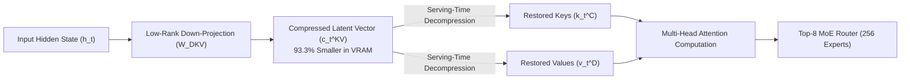

# How AI & Tech Giants Scale ⚡

> Production-tested architecture case studies, GPU pipeline mechanics, latency post-mortems, and mathematical breakdowns from frontier AI companies and ultra-high-concurrency distributed systems.

---

## 🎯 Engineering Rigor Standard

Most system design resources are stuck in 2017—teaching generic concepts like *"How to design Pastebin"* or *"What is CAP theorem"* using outdated textbook bullet points.

This repository is built for **Staff Engineers, Distributed Systems Architects, and AI Infra Builders**. Every case study adheres to three strict rules:
1. **No Marketing Fluff**: Dissecting real whitepapers, verified engineering post-mortems, and production kernel implementations.
2. **Concrete Math & System Metrics**: Latency budgets ($\text{p99} \le 100\text{ms}$), memory math (KV cache bytes/token), GPU VRAM formulas, and network IOPS.
3. **Native Visual Blueprints**: Dark-mode-first Mermaid.js architectural sequence diagrams and data flows.

---

## 🗺️ Master Architecture Tracker

### 🤖 Pillar 1: Modern AI Giants (Inference, GPU & RAG)
| # | Company / System | Core Architectural Breakthrough | Primary Tech Stack | Status |
| :-: | :--- | :--- | :--- | :-: |
| 01 | **Cursor** | Local Merkle AST indexing & edge speculative decoding | Tree-sitter / BLAKE3 / Rust / Micro-LSP | [👉 Read Breakdown](ai-architectures/cursor-codebase-indexing.md) |
| 02 | **DeepSeek-V3 / R1** | 671B MoE serving via Multi-Head Latent Attention (MLA) | MLA / DeepSeekMoE / DualPipe / FP8 | [👉 Read Breakdown](ai-architectures/deepseek-moe-mla-serving.md) |
| 03 | **Perplexity** | Live web search + cross-encoder reranking in < 800ms | Parallel Crawlers / Cross-Encoders / RAG | [👉 Read Breakdown](ai-architectures/perplexity-realtime-rag.md) |
| 04 | **Groq** | 500+ Tokens/sec inference using LPU on-chip SRAM | Deterministic Compiler / SRAM / LPUs | [👉 Read Breakdown](ai-architectures/groq-lpu-architecture.md) |
| 05 | **ElevenLabs** | Ultra-low-latency neural voice streaming (<150ms) | Streaming Vocoders / Edge Buffers | `Coming Next` |
| 06 | **OpenAI / ChatGPT** | Stateful WebSockets & KV Cache eviction at scale | PagedAttention / Triton / GPU Clusters | `Coming Soon` |
| 07 | **Midjourney / FLUX**| Distributed multi-node GPU queues for Diffusion | PyTorch / Custom Scheduler / S3 | `Coming Soon` |

### 🏛️ Pillar 2: Scale Heavyweights (Concurrency & Distributed Systems)
| # | Company / System | Core Architectural Breakthrough | Primary Tech Stack | Status |
| :-: | :--- | :--- | :--- | :-: |
| 08 | **UPI Central Switch** | 15B txn/mo across 500+ banks without 2PC deadlocks | Stateless Switch / Kafka / Aerospike | [👉 Read Breakdown](scale-classics/upi-npci-switch.md) |
| 09 | **IRCTC Tatkal** | 1.5M tickets booked in 10-minute lock-heavy bursts | In-Memory Data Grids / Hazelcast | [👉 Read Breakdown](scale-classics/irctc-tatkal-concurrency.md) |
| 10 | **Zerodha Kite** | 15% of Indian retail trading volume at 9:15 AM open | Minimalist Go / Postgres / Zero ORM | [👉 Read Breakdown](scale-classics/zerodha-kite-engine.md) |
| 11 | **Discord** | 4 Trillion messages: migrating from Cassandra to ScyllaDB | ScyllaDB (C++) / Elixir / Rust | `Coming Soon` |
| 12 | **Disney+ Hotstar** | 59M concurrent live cricket streams on cellular edge | Multi-CDN / S3 / Kafka | `Coming Soon` |
| 13 | **Figma** | Browser-based collaborative canvas using Wasm & CRDT | WebAssembly / WebSockets / Rust | `Coming Soon` |

---

## 📐 Featured Architecture Blueprint: DeepSeek-V3 MLA Engine

[👉 Deep-Dive: Read how DeepSeek compresses KV Cache & eliminates auxiliary loss](ai-architectures/deepseek-moe-mla-serving.md)

---

## 🤝 Contributing
Have insights into a production architecture or want to fix an outdated metric?
Check out our [Contribution Guidelines](CONTRIBUTING.md) to submit a new case study or diagram.

---

## 💼 Sponsorship & Partnerships
Reach senior backend engineers, distributed systems architects, and AI founders.  
For featured architecture partner slots, see [SPONSORS.md](SPONSORS.md).

---

## 📄 License
This project is licensed under the [MIT License](LICENSE).
