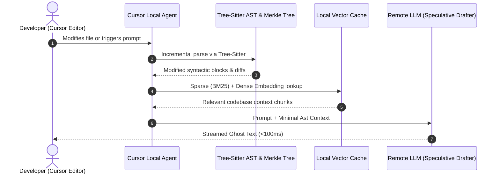

# How AI & Tech Giants Scale ⚡

> Visual architecture breakdowns, GPU pipeline mechanics, latency post-mortems, and engineering war stories from modern AI startups and high-concurrency distributed systems.

---

## 🎯 Why This Repository Exists

Most system design resources are stuck in 2017—teaching generic concepts like *"How to design Pastebin"* or *"What is CAP theorem"* using outdated diagrams.

Modern engineering has evolved into two high-stakes battlegrounds:
1. **The AI Scale Frontier**: Running trillion-parameter models, sub-second live RAG pipelines, speculative decoding, and managing massive GPU clusters under strict latency budgets (<500ms).
2. **The High-Concurrency Classics**: Coordinating multi-bank payment switches, processing millions of orders at stock market open, and eliminating JVM garbage collection pauses under multi-terabyte workloads.

This repository bridges both worlds with **production-tested architecture case studies**, native Mermaid diagrams, and real post-mortems.

---

## 🗺️ Master Architecture Tracker

### 🤖 Pillar 1: Modern AI Giants (Inference, GPU & RAG)
| # | Company / System | Core Architectural Problem | Primary Tech Stack | Status |
| :-: | :--- | :--- | :--- | :-: |
| 01 | **Cursor** | Local codebase indexing & instant autocomplete | AST / Speculative Decoding / Rust | [Read Study](ai-architectures/cursor-codebase-indexing.md) |
| 02 | **Perplexity** | Live web search + reranking + RAG in < 800ms | Parallel Crawlers / Cross-Encoders | `Coming Soon` |
| 03 | **DeepSeek** | 671B MoE serving at 1/10th cost via MLA & FP8 | Multi-head Latent Attention / MoE | `Coming Soon` |
| 04 | **Groq** | 500+ Tokens/sec inference using LPU on-chip SRAM | Deterministic Compiler / SRAM | `Coming Soon` |
| 05 | **ElevenLabs** | Ultra-low-latency neural voice streaming (<150ms) | Streaming Vocoders / Edge Buffers | `Coming Soon` |
| 06 | **OpenAI / ChatGPT** | Stateful WebSockets & KV Cache eviction at scale | PagedAttention / GPU Clusters | `Coming Soon` |
| 07 | **Midjourney / FLUX**| Distributed multi-node GPU queues for Diffusion | PyTorch / Custom Scheduler / S3 | `Coming Soon` |

### 🏛️ Pillar 2: Scale Heavyweights (Concurrency & Distributed Systems)
| # | Company / System | Core Architectural Problem | Primary Tech Stack | Status |
| :-: | :--- | :--- | :--- | :-: |
| 08 | **UPI Central Switch** | 15B txn/mo across 500+ banks without 2PC deadlocks | Stateless Switch / Kafka / Oracle | [Read Study](scale-classics/upi-npci-switch.md) |
| 09 | **IRCTC Tatkal** | 1.5M tickets booked in 10-minute lock-heavy bursts | In-Memory Data Grids / Hazelcast | `Coming Soon` |
| 10 | **Zerodha Kite** | 15% of Indian retail trading volume at 9:15 AM open | Minimalist Go / Postgres / Zero ORM | `Coming Soon` |
| 11 | **Discord** | 4 Trillion messages: migrating from Cassandra to ScyllaDB | ScyllaDB (C++) / Elixir / Rust | `Coming Soon` |
| 12 | **Disney+ Hotstar** | 59M concurrent live cricket streams on cellular edge | Multi-CDN / S3 / Kafka | `Coming Soon` |
| 13 | **Figma** | Browser-based collaborative canvas using Wasm & CRDT | WebAssembly / WebSockets / Rust | `Coming Soon` |

---

## 📐 Preview: How Cursor Indexes Codebases Locally

[👉 Read Full Case Study: How Cursor Works Under the Hood](ai-architectures/cursor-codebase-indexing.md)

---

## 🤝 Contributing
Have insights into an architecture or want to fix an outdated metric?
Check out our [Contribution Guidelines](CONTRIBUTING.md) to submit a new case study or diagram.

---

## 💼 Sponsorship & Partnerships
Reach thousands of senior backend engineers, distributed systems architects, and AI founders.  
For featured architecture partner slots, see [SPONSORS.md](SPONSORS.md).

---

## 📄 License
This project is licensed under the [MIT License](LICENSE).
