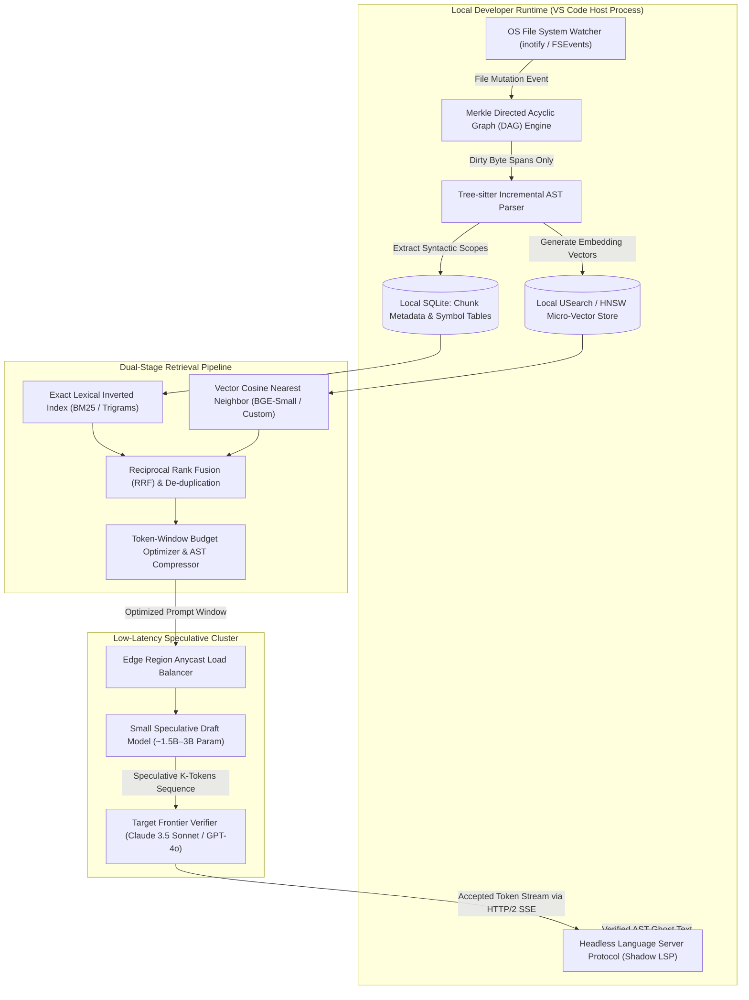
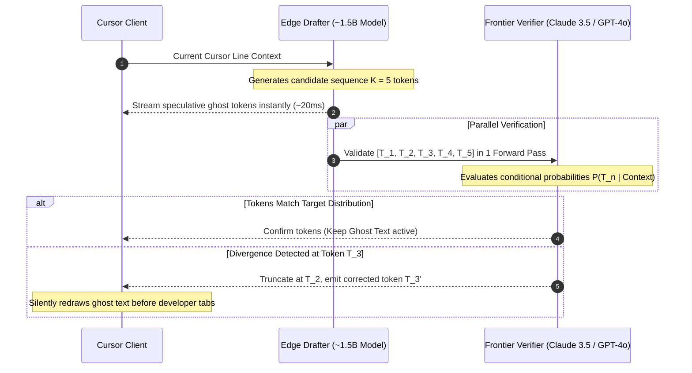

# Case Study 01: Cursor — Local Codebase Indexing & Speculative Autocomplete Engine

> **Architectural Classification**: Client-Side Distributed RAG & Speculative Inference Multiplexing  
> **Source Material**: Cursor Engineering Disclosures, Tree-sitter Grammar Specs, LLM Speculative Decoding Literature  
> **Target SLA**: $\text{p99} \le 120\text{ms}$ Time-to-First-Token (TTFT) at 150+ tokens/sec output  

---

## 1. Concrete System Metrics & Operational Constraints

```
┌─────────────────────────────────┬─────────────────────────────────┬─────────────────────────────────┐
│     CLIENT FOOTPRINT (LOCAL)    │      INDEXING PERFORMANCE       │      INFERENCE BUDGET (SLA)     │
├─────────────────────────────────┼─────────────────────────────────┼─────────────────────────────────┤
│ • Memory Cap: < 350 MB RAM      │ • Initial Index: ~45s / 100k LOC│ • Typo-to-Ghost: < 100ms        │
│ • Disk DB Footprint: < 50 MB    │ • Keystroke Delta: < 8ms        │ • Acceptance Rate: > 38% tokens │
│ • Background CPU: < 5% 1-Core   │ • Vector Dimensions: 768 / 1536 │ • Drafter: < 3B edge model      │
└─────────────────────────────────┴─────────────────────────────────┴─────────────────────────────────┘
```

---

## 2. End-to-End System Architecture



---

## 3. Core Algorithmic Mechanics

### A. Merkle-Tree Incremental Scope Hashing
Traditional IDE search tools re-scan entire files or maintain massive in-memory file tables. When editing a 10,000-line file, running a regex scan or re-embedding on every keystroke exhausts CPU cycles.

Cursor applies a **Merkle DAG** directly over the syntax tree:
1. Every file is decomposed into a hierarchy of syntax nodes (Namespace $\to$ Class $\to$ Method $\to$ Block).
2. The hash of node $N_i$ is computed recursively:
   $$H(N_i) = \text{BLAKE3}\left(\text{Type}(N_i) \parallel \text{Content}(N_i) \parallel \sum_{c \in \text{Children}} H(c)\right)$$
3. When a developer types inside method `processOrder()`, only that specific leaf hash changes, bubbling up to the file root.
4. The indexing engine queries:
   $$\Delta_{\text{dirty}} = \{ N \in \text{DAG} \mid H_{\text{new}}(N) \ne H_{\text{old}}(N) \}$$
5. **Result**: Only the mutated syntactic block (typically $< 40$ tokens) is re-embedded, dropping background indexing cost from $O(N_{\text{file\_size}})$ to $O(\log N_{\text{depth}})$.

---

### B. Tree-sitter Syntactic Chunking vs. Naive Token Windowing
Dumb RAG systems split code every 500 characters or 256 tokens. This frequently breaks functions across chunks, separating a function signature from its closing logic or destroying parent class context.

Cursor extracts chunks along **AST Scope Boundaries**:
```rust
// Pseudo-Rust representation of Cursor's AST Chunking Strategy
pub struct CodeChunk {
    pub chunk_id: [u8; 32],       // BLAKE3 hash
    pub filepath: String,
    pub enclosing_symbol: String, // e.g., "OrderService::validatePayment"
    pub imports: Vec<String>,     // Scoped dependency context
    pub depth: usize,             // AST nesting depth
    pub byte_range: (usize, usize),
    pub raw_content: String,
}
```
If a function exceeds the maximum chunk length ($> 512$ tokens), Cursor does not split blindly—it splits at child statement blocks while preserving the enclosing function signature and docstrings inside chunk metadata.

---

### C. The Dual-Retrieval Equation: Reciprocal Rank Fusion (RRF)
Vector search alone fails on exact identifier lookups (e.g., searching for `ERR_CONN_TIMEOUT_V2` often retrieves generic error handlers). BM25 lexical search alone fails on conceptual queries (e.g., *"where do we handle token refreshes?"*).

Cursor combines sparse lexical rankings and dense vector rankings using **Reciprocal Rank Fusion**:
$$RRF\_Score(d \in D) = \sum_{m \in \{\text{BM25}, \text{Dense}\}} \frac{1}{k + r_m(d)}$$
*Where $k \approx 60$ is a smoothing constant, and $r_m(d)$ is the rank position of document $d$ in retrieval engine $m$.*

Top $K$ chunks ($K \le 5$) are extracted, and deduplicated against the active file's visible buffer before injecting into the prompt window.

---

### D. Speculative Decoding & Verification Protocol
Standard frontier models (e.g., Claude 3.5 Sonnet) have a baseline Time-to-First-Token ($\text{TTFT}$) of **$350\text{ms} - 700\text{ms}$**, making real-time autocomplete impossible if called directly.

To achieve **$< 100\text{ms}$** latency, Cursor operates a **Speculative Decoding Pipeline**:



The mathematical condition for accepting token $x_i$ from draft model $q$ under target verifier $p$ is:
$$\text{Acceptance Probability } \alpha = \min\left(1, \frac{p(x_i \mid x_{<i})}{q(x_i \mid x_{<i})}\right)$$

If accepted, $K$ tokens are generated in the wall-clock time of **a single verifier forward pass**, effectively multiplying generation throughput by **$2.5\times - 3.8\times$**.

---

## 4. Edge-Case Post-Mortem: The "Ghost Invalidation Race"

### The Incident:
Early implementations of ghost text suffered from high latency flicker: a user would type, see ghost text appear 80ms later, accept it with `Tab`, only to find that the accepted code contained syntax errors or overwrote closing brackets.

### Root Cause Analysis (RCA):
Typing events and speculative inference streams ran asynchronously without sequence versioning. When the developer typed characters $C_1, C_2, C_3$ in rapid succession ($< 50\text{ms}$ interval), speculative tokens generated for state $C_1$ arrived *after* the user had already typed $C_3$, applying code to a stale buffer position.

### The Architectural Fix (Shadow Workspace & Monotonic Version Vector):
1. **Monotonic Client Version Vector**: Every keystroke increments an internal buffer state clock:
   $$\vec{V} = \langle \text{DocVersion}, \text{CursorOffset}, \text{Timestamp} \rangle$$
2. **Cancellation Tokens**: Every outbound inference packet carries $\vec{V}$. If the client's current version $\vec{V}_{\text{curr}} \ne \vec{V}_{\text{packet}}$, the returning stream is discarded at the network layer before touching the editor UI thread.
3. **Shadow Workspace (Zero-Compile Breakage)**: Proposed multi-line edits are tested in an invisible background language server process (headless LSP). If the AST validation fails or throws fatal diagnostics, the suggestion is suppressed.

---

## 5. Architectural Trade-Off Matrix

| Design Choice | Chosen Strategy | Alternative Rejected | Why It Matters |
| :--- | :--- | :--- | :--- |
| **Parsing** | Tree-sitter Native C-Bindings | Pure Regex / String Scan | Preserves nested scopes across imports and prevents splitting functions across token boundaries. |
| **Local Indexing** | BLAKE3 Merkle Tree | Periodic Whole-Repo Rescan | Drops CPU consumption during typing from 40% (laptop battery killer) to $< 3\%$. |
| **Retrieval** | Hybrid (BM25 + Dense) via RRF | Dense Vectors Only | Dense search fails on exact symbol names; BM25 fixes identifier retrieval. |
| **Generation** | Edge Speculative Decoding | Direct Cloud Frontier Calls | Reduces Time-To-First-Token from 500ms+ down to $< 100\text{ms}$. |

---

*Authored by [@saurabh-vision](https://github.com/saurabh-vision) • Up Next: [Case Study 02: DeepSeek-V3 / R1 — 671B MoE & Multi-Head Latent Attention](#)*
