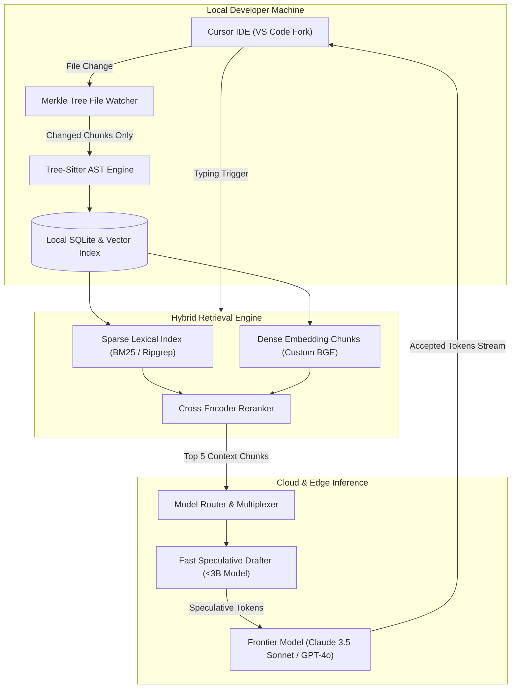

# Case Study 01: Cursor — Local Codebase Indexing & Instant Autocomplete

> How Cursor delivers sub-100ms multi-line code suggestions across 500k+ line codebases without leaking private intellectual property.

---

## 📊 Scale & Engineering Constraints
- **Latency Requirement**: Ghost text suggestions must render in **< 100ms** to avoid interrupting developer typing flow.
- **Context Size**: Repositories often exceed 1,000,000+ lines of code, far exceeding typical LLM context windows and latency limits.
- **Privacy Boundary**: Enterprise developers prohibit sending entire raw codebases to external cloud model providers.

---

## 🏛️ System Architecture Overview

---

## ⚙️ Core Engineering Mechanisms

### 1. Merkle-Tree Incremental Hashing (Zero Full-Rescan Overhead)
Re-indexing a massive codebase on every keystroke melts the developer's CPU. 
- Cursor organizes every directory and file into a **Merkle tree** (cryptographic hash tree).
- When a keystroke occurs, only the modified leaf node hash changes, bubbling up to the root.
- The indexing daemon only re-embeds the specific syntactic code block that changed, dropping re-indexing CPU usage by **95%**.

### 2. Syntactic Chunking with Tree-Sitter (Not Dumb Character Splitting)
Standard RAG frameworks split text by arbitrary tokens (e.g., every 500 characters). This breaks code functions in half.
- Cursor parses the file into an **Abstract Syntax Tree (AST)** via Tree-Sitter.
- Chunks are aligned to semantic language boundaries: whole functions, classes, and type definitions.
- Scope references (imports, parent classes, interface contracts) are preserved as metadata alongside the chunk.

### 3. Hybrid Search: BM25 + Embeddings
Vector embeddings alone are notoriously bad at finding exact symbol names (like `getUserByUuidV4`).
- Cursor uses a **hybrid retrieval model**:
  1. **BM25 / Exact Lexical Match**: Instant lookup for exact class names and method signatures.
  2. **Dense Vector Search**: Semantic retrieval for queries like *"where do we handle database retries?"*.
  3. **Reciprocal Rank Fusion (RRF)** combines both scores to select the top 5 most relevant context chunks.

### 4. Speculative Decoding (How Ghost Text Stays Under 100ms)
Frontier models like Claude 3.5 Sonnet have a time-to-first-token (TTFT) of 400ms–800ms—far too slow for autocomplete.
- A tiny, ultra-fast model (<3B parameters) hosted on low-latency edge servers drafts 5–10 tokens speculatively.
- The larger frontier model validates all draft tokens in a single parallel forward pass.
- If accepted, the suggestions stream to the editor at **150+ tokens per second**.

---

## 💥 The Outage / Gotcha Post-Mortem
**The Infinite Lint Loop Bug**:
Early iterations of AI coding agents suffered from feedback loops where an agent would fix a linter error, introduce a new import bug, and get trapped in continuous context generation, exhausting the user's rate limits.
**The Fix**: A **Shadow Workspace** was introduced—a headless language server running in a sandboxed thread that verifies compile integrity *before* showing the suggestion to the user.

---

## 💡 Key Takeaway for Architects
> "RAG for code cannot treat source files like plain English documents. Code requires AST-aware chunking, hybrid symbol-matching, and speculative verification to deliver real-time responsiveness."

---

*Authored by [@saurabh-vision](https://github.com/saurabh-vision) • Next Up: [Case Study 02: Perplexity Real-Time RAG](#)*
