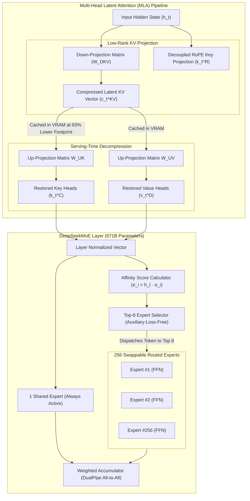
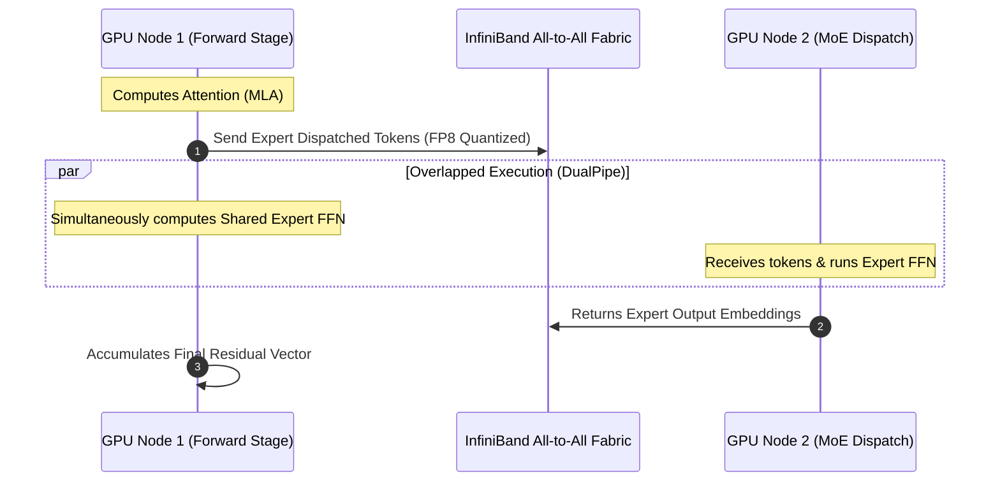

# Case Study 02: DeepSeek-V3 / R1 — 671B MoE Serving & Multi-Head Latent Attention (MLA)

> **Architectural Classification**: Massive Mixture-of-Experts (MoE) Distributed Serving & KV Cache Compression  
> **Source Material**: DeepSeek-V3 Technical Report, DeepSeek-R1 Architecture Paper, vLLM / SGLang Kernel Implementations  
> **Target Scale**: 671 Billion Total Parameters (37 Billion Active per Token) running on FP8 cluster interconnects  

---

## 1. Concrete System Metrics & Operational Constraints

```
┌─────────────────────────────────┬─────────────────────────────────┬─────────────────────────────────┐
│       PARAMETER TOPOLOGY        │      KV CACHE COMPRESSION       │     DISTRIBUTED CLUSTER SCALE   │
├─────────────────────────────────┼─────────────────────────────────┼─────────────────────────────────┤
│ • Total Params: 671 Billion     │ • Traditional MHA: ~166 GB/user │ • Experts: 256 Routed + 1 Shared│
│ • Active / Token: 37 Billion    │ • DeepSeek MLA: ~11 GB/user     │ • Routing: Top-8 Greedy Router  │
│ • Precision: FP8 Mixed Precision│ • Memory Reduction: ~93.3%      │ • Pipeline: DualPipe Overlapping│
└─────────────────────────────────┴─────────────────────────────────┴─────────────────────────────────┘
```

---

## 2. End-to-End Inference & Attention Architecture



---

## 3. Deep Architectural Breakthroughs

### A. Multi-Head Latent Attention (MLA): The KV Cache Bottleneck Solution
In traditional Multi-Head Attention (MHA) or Grouped-Query Attention (GQA), serving long-context prompts ($> 32\text{k}$ tokens) causes the Key-Value (KV) cache to explode in GPU VRAM.

#### The Traditional Bottleneck:
For a sequence length $L$, number of layers $n_{\text{layers}}$, number of KV heads $n_{\text{heads}}$, and head dimension $d_{\text{head}}$, memory per user is:
$$\text{Memory}_{\text{MHA}} = 2 \times n_{\text{layers}} \times n_{\text{heads}} \times d_{\text{head}} \times L \times \text{BytesPerParam}$$
At 128k context, this requires **hundreds of gigabytes per single request**, saturating GPU High Bandwidth Memory (HBM).

#### DeepSeek’s Solution (Low-Rank Joint Compression):
Instead of storing multi-head keys and values directly in VRAM, DeepSeek compresses Keys and Values into a single **low-rank latent vector** $c_t^{KV}$:
$$c_t^{KV} = W_{DKV} h_t$$
*Where $W_{DKV} \in \mathbb{R}^{d_c \times d}$, with compressed dimension $d_c \ll n_{\text{heads}} \times d_{\text{head}}$.*

During inference, only $c_t^{KV}$ is stored in the KV cache! During computation:
$$k_t^C = W_{UK} c_t^{KV}, \quad v_t^D = W_{UV} c_t^{KV}$$

Because of matrix associativity in attention:
$$q_t^T k_i = q_t^T (W_{UK} c_i^{KV}) = (q_t^T W_{UK}) c_i^{KV}$$
The model can absorb $W_{UK}$ into the Query projection matrix $W_Q$ at inference time, meaning **Value and Key expansion never needs to be materialized in memory**!

**Result**: KV cache memory footprint is reduced by **93.3%**, allowing an 8x larger batch size on the same GPU cluster.

---

### B. DeepSeekMoE: Fine-Grained Expert Segmentation
Standard MoE architectures (like Mixtral 8x7B) use 8 coarse experts and route to 2. DeepSeek introduces **Fine-Grained Expert Specialization**:
- Instead of 8 large experts, DeepSeek deploys **256 routed experts + 1 isolated shared expert**.
- Total routed parameters: **643 Billion**. Shared parameters: **28 Billion**.
- Each token selects **Top-8 experts** from 256.

```
Coarse MoE (Mixtral 8x7B):
Token ────> [Expert 1 (Huge)] or [Expert 2 (Huge)]

DeepSeekMoE (256 Experts):
Token ────> [Shared Expert (Common Knowledge)] (Always Active)
      └───> [Exp #12] + [Exp #47] + [Exp #89] + ... + [Exp #241] (Specialized)
```

#### Why the Shared Expert Matters:
In traditional MoE, generic linguistic rules (e.g., punctuation, basic syntax) are redundantly learned across multiple experts. By isolating 1 shared expert that processes *every single token*, specialized experts are freed up to learn domain-specific math, reasoning, or code patterns without redundant overlap.

---

### C. Auxiliary-Loss-Free Load Balancing
Traditional MoE models use heavy auxiliary loss functions during training to force equal expert utilization. If an expert gets slightly more tokens, the penalty forces routing to other experts.
- **The Problem**: Auxiliary loss degrades model reasoning capability because tokens are routed to suboptimal experts purely to balance load.
- **DeepSeek's Solution**: DeepSeek-V3 removes auxiliary balancing loss during routing. Instead, it introduces dynamic **expert-level bias terms** $b_i$:
  $$s_{i,t} = \text{Softmax}(h_t^T e_i + b_i)$$
  If expert $i$ is overloaded across an inference batch, its bias $b_i$ is decremented dynamically by the scheduler without modifying model weights.

---

### D. DualPipe & FP8 Mixed-Precision Infrastructure
Running 671B parameters across distributed GPU nodes requires inter-GPU communication across NVLink and InfiniBand switches.



By overlapping the communication of routed tokens with the computation of dense attention and shared experts (**DualPipe algorithm**), GPU idle time (communication bubble) drops from **35% down to under 5%**.

---

## 4. Architectural Trade-Off Matrix

| Design Choice | DeepSeek-V3 / R1 | Traditional MoE (Mixtral / Llama MoE) | Impact on Production |
| :--- | :--- | :--- | :--- |
| **Attention Engine** | Multi-Head Latent Attention (MLA) | Multi-Head / Grouped-Query (MHA/GQA) | 93% smaller KV cache; enables 128k context on commodity cluster. |
| **Expert Granularity** | 256 Routed Experts + 1 Shared | 8 Coarse Routed Experts | Higher parameter efficiency; isolated general knowledge in shared expert. |
| **Routing Algorithm** | Bias-Adjusted Auxiliary-Loss-Free | Penalty-Based Auxiliary Loss | Eliminates expert collapse without hurting reasoning accuracy. |
| **Quantization** | Native FP8 Cluster Computation | FP16 / BF16 Activation Transfer | Halves cross-node network traffic on InfiniBand switches. |

---

*Authored by [@saurabh-vision](https://github.com/saurabh-vision) • Next Up: [Case Study 03: Perplexity — Real-Time RAG & Citation Reranking Engine](#)*
