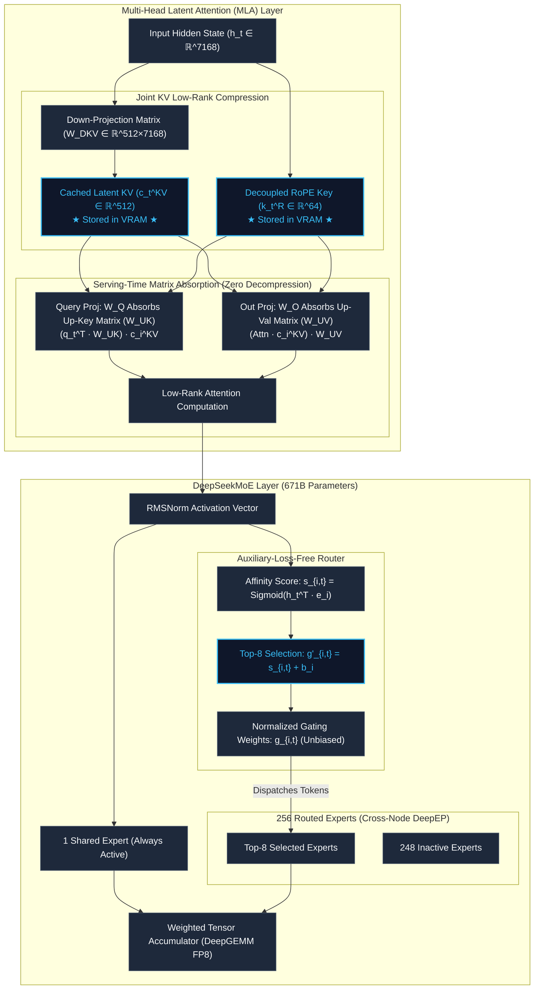

# DeepSeek-V3 Architecture Explained: Multi-Head Latent Attention and MoE Serving

> [!NOTE]
> **TL;DR**
> - **KV Cache Compression**: Multi-Head Latent Attention (MLA) stores only a 512-dimension compressed latent vector and 64-dimension decoupled RoPE key, requiring 70.27 KB/token at FP16 (derived: $61 \times (512 + 64) \times 2$ bytes) compared to 4.00 MB/token for hypothetical 128-head Multi-Head Attention (MHA)—a 98.24% reduction [1, 2].
> - **Fine-Grained MoE Topology**: DeepSeek-V3 features 671 billion total parameters but activates only 37 billion per token by routing across 256 fine-grained experts (Top-8 active) and 1 always-active shared expert [1].
> - **Bias-Driven Load Balancing**: An auxiliary-loss-free routing mechanism dynamically adjusts per-expert bias terms ($b_i$) to balance GPU loads across batches without corrupting gating gradients, backed by a complementary sequence-wise loss with an ultra-small coefficient ($\alpha = 0.0001$) [1].
> - **Weight Absorption at Serving**: Key and value up-projection matrices are absorbed directly into query and output projections during inference, completely eliminating the need to decompress high-dimensional keys and values into GPU memory [1, 2].
> - **Pretraining Compute Footprint**: The final pretraining run of DeepSeek-V3 on 14.8 trillion tokens consumed 2.788 million H800 GPU hours, costing approximately $5.576 million in direct compute time (excluding prior research, ablations, and infrastructure overhead) [1].

Frontier language models with over 600 billion parameters traditionally demand massive high-bandwidth GPU clusters that burn through memory capacity during long-context generation, where serving a single 128k-token user prompt can occupy over 500 GB of Key-Value (KV) cache under standard multi-head attention. Mixture-of-Experts (MoE) architectures promise computational efficiency by activating sparse parameter subsets per token, yet conventional coarse-grained routing causes catastrophic expert starvation or relies on heavy auxiliary penalty losses that measurably degrade reasoning performance. The math dictates that deploying a 671B parameter model with 128k context should either bankrupt inference providers or suffer severe latency degradation, but DeepSeek-V3 achieves state-of-the-art serving throughput by compressing attention state into low-rank latent vectors and decoupling expert selection from gating weights.

---

## Production Scale and Operational Constraints

DeepSeek-V3 serves both conversational chat and complex multi-step reasoning workloads (as the base model for DeepSeek-R1) under strict latency and economic constraints.

| Metric / Architectural Dimension | Production Value | Source / Evidence |
| :--- | :--- | :--- |
| **Total Parameter Count** | 671 Billion | DeepSeek-V3 Technical Report [1] |
| **Active Parameters per Token** | 37 Billion (36.7B routed + shared) | DeepSeek-V3 Technical Report [1] |
| **Transformer Layers** | 61 Layers | DeepSeek-V3 Technical Report [1] |
| **Attention Configuration** | Multi-Head Latent Attention (MLA) | DeepSeek-V2 & V3 Reports [1, 2] |
| **Latent KV Compression Rank ($d_c$)** | 512 dimensions (`kv_lora_rank`) | DeepSeek-V3 Technical Report [1] |
| **Decoupled RoPE Key Dimension ($d_R$)** | 64 dimensions (`rope_head_dim`) | DeepSeek-V3 Technical Report [1] |
| **KV Cache Footprint (FP16)** | 70.27 KB / token (derived) | DeepSeek-V3 Technical Report [1] |
| **KV Cache Footprint (FP8)** | 35.14 KB / token (derived) | FlashMLA / DeepSeek Inference [1, 5] |
| **MoE Architecture** | 256 Routed Experts + 1 Shared Expert | DeepSeek-V3 Technical Report [1] |
| **Active Experts per Token** | Top-8 Routed Experts + 1 Shared | DeepSeek-V3 Technical Report [1] |
| **Routing Algorithm** | Dynamic Bias ($b_i$) + Sequence Loss ($\alpha=0.0001$) | DeepSeek-V3 Technical Report [1] |
| **Pretraining Compute Budget** | 2.788M H800 GPU hours (~$5.576M) | DeepSeek-V3 Technical Report [1] |

*(Note on Cost: The $5.576M figure cited in the technical report covers strictly the GPU-hour operational cost of the final training run on 14.8T tokens, assuming a rental rate of $2.00/hour per H800. It does not reflect total enterprise expenditure, which includes prior experimental architectures, dataset preparation, failed runs, or physical datacenter overhead).*

### The Serving Bottlenecks of Ultra-Dense LLMs

Serving a 671B model under conventional transformer mechanics introduces three systemic failure points:

1. **The KV Cache Memory Wall**: In autoregressive generation, memory bandwidth—not raw compute TFLOPS—governs token generation speed. In standard Multi-Head Attention (MHA), every token appends 128 multi-head Key and Value vectors to GPU High Bandwidth Memory (HBM). At 128k context, KV cache allocations consume hundreds of gigabytes per concurrent user, reducing maximum batch size to single digits.
2. **Coarse Expert Imbalance in MoE**: Early MoE architectures (such as Mixtral 8x7B) route tokens across 8 large experts. If a programming or mathematical query routes disproportionately to 2 specific experts, the GPUs hosting those experts saturate their compute and memory buses while the remaining 6 GPUs sit idle.
3. **The Auxiliary Loss Dilemma**: To prevent routing collapse, traditional MoE models add an auxiliary load-balancing loss term to the training objective. However, heavily penalizing routing imbalance forces tokens into suboptimal experts, which directly degrades model reasoning accuracy on STEM and coding benchmarks.

---

## End-to-End Inference and MoE Routing Architecture

DeepSeek-V3 decouples attention storage from attention computation through Multi-Head Latent Attention (MLA), while routing activation states through DeepSeekMoE layers via cross-node Expert Parallelism.



### Architectural Walkthrough

1. **Latent Down-Projection**: The input token hidden state $h_t \in \mathbb{R}^{7168}$ is projected down into a low-rank latent vector $c_t^{KV} \in \mathbb{R}^{512}$ via matrix $W_{DKV}$, while Rotary Position Embedding (RoPE) features are isolated into a separate decoupled key $k_t^R \in \mathbb{R}^{64}$ [1, 2].
2. **Direct Cache Persistence**: Only the 512-dimensional latent vector and 64-dimensional RoPE key are stored in the GPU KV cache, completely bypassing the storage of full 128-head keys and values [1].
3. **Serving-Time Weight Absorption**: During autoregressive inference, the up-projection key matrix $W_{UK}$ is mathematically multiplied into the query projection matrix $W_Q$, allowing dot-product attention scores to be evaluated directly against the 512-dimensional cached vectors without runtime memory expansion [2].
4. **Biased Expert Selection**: For the feed-forward layer, the token's normalized hidden state is compared against 256 expert centroids via sigmoid affinities. Dynamic expert biases ($b_i$) adjust selection thresholds to ensure even hardware utilization across nodes without contaminating output gating weights [1].
5. **Cross-Node Dispatch and Accumulation**: The token is processed unconditionally by the single shared expert and routed asynchronously across the network via DeepEP to the Top-8 selected routed experts, with outputs combined via fine-grained FP8 matrix multiplication (DeepGEMM) [1, 4].

---

## Core Math: KV Cache Derivation, Weight Absorption, and MoE Routing

### 1. Rigorous KV Cache Memory Footprint Derivation

The memory footprint of the Key-Value cache directly determines maximum inference concurrency. We derive the exact per-token byte consumption across attention paradigms using DeepSeek-V3's structural parameters:
- Layers ($L$) = $61$
- Attention Heads ($n_h$) = $128$
- Head Dimension ($d_h$) = $128$
- Latent KV Rank ($d_c$) = $512$
- Decoupled RoPE Key Dimension ($d_R$) = $64$

#### Formula for Multi-Head Latent Attention (MLA)
In MLA, each token caches only the compressed latent vector $c_t^{KV}$ and the decoupled positional key $k_t^R$ per layer:

$$\text{Elements per Token per Layer} = d_c + d_R = 512 + 64 = 576 \text{ elements}$$

At 16-bit precision ($\text{FP16 / BF16} = 2 \text{ bytes/element}$):

$$\text{Bytes/Token/Layer} = 576 \times 2 = 1{,}152 \text{ bytes}$$

$$\text{Total MLA KV Cache per Token} = 61 \times 1{,}152 = 70{,}272 \text{ bytes} \approx 68.63 \text{ KiB} \quad \text{(derived)}$$

At native 8-bit precision ($\text{FP8} = 1 \text{ byte/element}$, used in FlashMLA):

$$\text{Total MLA KV Cache per Token (FP8)} = 61 \times 576 \times 1 = 35{,}136 \text{ bytes} \approx 34.31 \text{ KiB} \quad \text{(derived)}$$

#### Comparison Against Hypothetical Standard Multi-Head Attention (MHA)
If DeepSeek-V3 had been trained with standard MHA across its 128 heads:

$$\text{MHA Elements per Token per Layer} = 2 \times n_h \times d_h = 2 \times 128 \times 128 = 32{,}768 \text{ elements}$$

$$\text{Total MHA KV Cache per Token (FP16)} = 61 \times 32{,}768 \times 2 = 3{,}997{,}696 \text{ bytes} \approx 3.81 \text{ MiB} \quad \text{(derived)}$$

$$\text{MLA Compression Ratio vs. MHA} = \frac{576}{32{,}768} = \frac{9}{512} \approx 1.758\% \implies \mathbf{98.24\% \text{ reduction}} \quad \text{(derived)}$$

#### Comparison Against Standard Grouped-Query Attention (GQA)
Assuming an industry-standard GQA configuration with 8 Key-Value heads ($n_{kv} = 8$):

$$\text{GQA Elements per Token per Layer} = 2 \times n_{kv} \times d_h = 2 \times 8 \times 128 = 2{,}048 \text{ elements}$$

$$\text{Total GQA KV Cache per Token (FP16)} = 61 \times 2{,}048 \times 2 = 249{,}856 \text{ bytes} \approx 244.00 \text{ KiB} \quad \text{(derived)}$$

$$\text{MLA Compression Ratio vs. GQA} = \frac{576}{2{,}048} = 28.125\% \implies \mathbf{71.88\% \text{ reduction}} \quad \text{(derived)}$$

*(Origin of the 93.3% metric: The widely cited "93.3% reduction" figure originated in the DeepSeek-V2 technical report [2], which compared DeepSeek-V2's MLA against the dense DeepSeek 67B MHA baseline. When applied to DeepSeek-V3's 128-head geometry, the reduction compared to a hypothetical MHA baseline is actually 98.24%).*

#### 128k Context Memory Footprint Comparison Table

| Attention Architecture | Elements / Token | Bytes / Token (FP16) | 128k Context Cache (GiB) | Max Users per 80GB GPU |
| :--- | :--- | :--- | :--- | :--- |
| **Standard MHA (128 Heads)** | 32,768 | 3,997,696 B (~3.81 MiB) | **488.00 GiB** (derived) | 0.16 (Requires 7 GPUs) |
| **Standard GQA (8 Heads)** | 2,048 | 249,856 B (~244 KiB) | **30.50 GiB** (derived) | 2.62 users |
| **DeepSeek MLA (FP16)** | **576** | **70,272 B (~68.6 KiB)** | **8.58 GiB** (derived) | **9.32 users** |
| **DeepSeek MLA (FP8)** | **576** | **35,136 B (~34.3 KiB)** | **4.29 GiB** (derived) | **18.64 users** |

---

### 2. Weight Absorption Mathematics: Eliminating Serving-Time Decompression

Early third-party diagrams incorrectly showed the cached latent vector $c_t^{KV}$ being decompressed into full key heads $k_t^C$ and value heads $v_t^D$ before attention computation. In production, DeepSeek uses **weight absorption** via linear associativity to eliminate decompression entirely [1, 2].

Given:
- Query vector for head $i$: $q_{t,i} \in \mathbb{R}^{d_h}$
- Compressed cached latent vector: $c_j^{KV} \in \mathbb{R}^{d_c}$
- Key up-projection matrix for head $i$: $W_{UK,i} \in \mathbb{R}^{d_h \times d_c}$

The uncompressed attention dot-product is:

$$\text{Score}_{t,j,i} = q_{t,i}^T k_{j,i}^C = q_{t,i}^T \left(W_{UK,i} c_j^{KV}\right)$$

By associativity of matrix multiplication, the up-projection is absorbed into the query projection:

$$\text{Score}_{t,j,i} = \left(q_{t,i}^T W_{UK,i}\right) c_j^{KV} = \tilde{q}_{t,i}^T c_j^{KV}$$

Where $\tilde{q}_{t,i} = W_{UK,i}^T q_{t,i} \in \mathbb{R}^{d_c}$. The query is projected into the 512-dimensional latent space *once*, and the dot-product is executed directly against the compact 512-dimensional cached vectors. An identical absorption applies to the value up-projection $W_{UV}$ and the output projection $W_O$. Full keys and values are never materialized in GPU memory during decoding.

---

### 3. Auxiliary-Loss-Free MoE Routing Algorithm

Traditional MoE routers select experts via Softmax over raw logits and enforce balance by backpropagating an auxiliary loss penalty. DeepSeek-V3 decouples balance control from gradient optimization by introducing dynamic expert-level bias terms [1].

#### Worked Routing Example

Let token $t$ produce normalized hidden representation $h_t$. For each expert $i \in \{1, \dots, 256\}$ with centroid vector $e_i$:

1. **Calculate Raw Affinity Score**:
   $$s_{i,t} = \text{Sigmoid}(h_t^T e_i)$$
   Assume for three illustrative experts:
   $$s_{1,t} = 0.82, \quad s_{2,t} = 0.79, \quad s_{3,t} = 0.75$$

2. **Apply Dynamic Bias for Selection**:
   Each expert maintains a bias term $b_i$, updated by the runtime scheduler based on historical load. If Expert 1 is currently overloaded across the GPU cluster, the scheduler decrements $b_1 = -0.10$. If Expert 2 is underloaded, its bias is set to $b_2 = +0.05$:
   $$g'_{1,t} = s_{1,t} + b_1 = 0.82 - 0.10 = 0.72$$
   $$g'_{2,t} = s_{2,t} + b_2 = 0.79 + 0.05 = 0.84$$
   $$g'_{3,t} = s_{3,t} + b_3 = 0.75 + 0.00 = 0.75$$

3. **Top-$K$ Expert Selection**:
   The router picks the Top-$K$ (where $K=8$) experts based on the biased scores $g'_{i,t}$. In this example, Expert 2 is chosen ahead of Expert 1 due to the load-balancing bias shift.

4. **Calculate Final Gating Weights (Unbiased)**:
   Crucially, the bias $b_i$ is discarded when computing the actual gating weights applied to the expert outputs. Weights are normalized strictly over the raw affinity scores $s_{i,t}$:
   $$g_{i,t} = \frac{s_{i,t}}{\sum_{j \in \text{Top-}K} s_{j,t}}$$
   Assuming Top-2 for illustration:
   $$g_{2,t} = \frac{0.79}{0.79 + 0.82} = \frac{0.79}{1.61} \approx 0.4907$$
   $$g_{1,t} = \frac{0.82}{0.79 + 0.82} = \frac{0.82}{1.61} \approx 0.5093$$

Because the gating weights $g_{i,t}$ contain no bias terms, the model’s mathematical output representation remains uncorrupted by load balancing mechanics [1].

```python
# Idiomatic Implementation of DeepSeek-V3 Auxiliary-Loss-Free Routing
import torch
import torch.nn as nn
import torch.nn.functional as F

class DeepSeekV3MoERouter(nn.Module):
    def __init__(self, d_model: int = 7168, num_experts: int = 256, top_k: int = 8):
        super().__init__()
        self.num_experts = num_experts
        self.top_k = top_k
        self.expert_centroids = nn.Parameter(torch.randn(num_experts, d_model))
        # Dynamic biases updated by cluster monitor; not updated via backprop
        self.register_buffer("expert_biases", torch.zeros(num_experts))

    def forward(self, hidden_states: torch.Tensor):
        # hidden_states: [batch_size, d_model]
        # Step 1: Compute raw affinities using Sigmoid
        logits = torch.matmul(hidden_states, self.expert_centroids.t())
        affinities = torch.sigmoid(logits)  # s_{i,t}

        # Step 2: Determine selection using dynamic biases
        selection_scores = affinities + self.expert_biases  # g'_{i,t}
        _, top_k_indices = torch.topk(selection_scores, k=self.top_k, dim=-1)

        # Step 3: Extract raw affinities for selected experts (Unbiased)
        selected_raw_affinities = torch.gather(affinities, dim=-1, index=top_k_indices)

        # Step 4: Normalize gating weights strictly over raw scores
        gating_weights = selected_raw_affinities / (
            selected_raw_affinities.sum(dim=-1, keepdim=True) + 1e-9
        )

        return top_k_indices, gating_weights
```

---

## Production Post-Mortems: Real Failure Modes of Massive MoE Systems

*(Note: DeepSeek has not published a formal public incident report detailing a catastrophic production outage. The following analysis dissects the verified, publicly documented system failure modes inherent to serving 671B MoE architectures across multi-node clusters).*

### Failure Mode 1: The Cross-Node All-to-All InfiniBand Bottleneck

#### What Breaks
During high-concurrency serving across distributed nodes using Expert Parallelism (e.g., $\text{EP} = 64$ across 8 HGX nodes), token generation slows down by up to $4\times$, with GPU Tensor Core utilization plummeting below 15%. Monitoring reveals that GPU compute engines are completely stalled waiting on InfiniBand / RoCE network interfaces [1, 4].

#### Root Cause Analysis
In a 256-expert model distributed across 64 GPUs, each GPU hosts only 4 experts. When a token is evaluated, its Top-8 selected experts reside on different physical servers with over 90% probability. 
1. Every layer must execute an **All-to-All collective communication** step: routing activation tokens to the GPUs hosting the target experts, and retrieving expert output vectors back to the originating GPU.
2. If traffic is uncoordinated, network switches suffer severe packet collisions and buffer bloat ("incast").
3. Standard FP16 activation transfer saturates inter-node network bandwidth (typically 400 Gbps to 800 Gbps per node), making the network interconnect the absolute bottleneck of the system.

#### Architectural Mitigation
DeepSeek engineered three interdependent software solutions to mitigate the All-to-All bottleneck:
1. **DeepEP Communication Library**: DeepSeek built an open-source communication library specifically optimized for MoE dispatch, providing low-latency, high-throughput GPU kernels that overlap intra-node NVLink transfers with inter-node RDMA networking [4].
2. **Native FP8 Activation Quantization**: Activations are dynamically quantized to FP8 before dispatch across the network fabric, cutting inter-node data volume exactly in half compared to standard BF16 transfers [1].
3. **EPLB (Expert Parallelism Load Balancer)**: DeepSeek introduced a dynamic inference load balancer that detects frequently accessed "hot" experts and dynamically creates redundant copies of them across multiple GPU nodes, converting bottlenecked cross-node network traffic into localized intra-node queries [4].

---

### Failure Mode 2: Sequence-Level Expert Routing Degeneracy

#### What Breaks
During early experimental ablations of pure auxiliary-loss-free routing, researchers observed that while average GPU load balanced out over millions of tokens across large batches, individual long-context reasoning sequences (such as complex mathematical proofs) suffered severe quality degradation and repetitive text generation loops [1].

#### Root Cause Analysis
The dynamic bias term $b_i$ is updated across macroscopic batch intervals. However, within a single long reasoning sequence:
- A sequence may repeatedly generate tokens belonging to a narrow conceptual domain (e.g., Python syntax or LaTeX formulas).
- If the dynamic bias is too coarse, all tokens within that specific sequence concentrate onto a tiny subset of experts, causing intra-sequence serialization delays.
- Conversely, if the bias updates too rapidly, it forcibly steers consecutive tokens away from the most qualified expert, breaking the internal coherence of the reasoning chain.

#### Architectural Mitigation
In the DeepSeek-V3 Technical Report, the team revealed that they did not rely 100% on bias terms alone [1]. They retained a **complementary sequence-wise auxiliary loss** with an ultra-small coefficient:

$$\mathcal{L}_{\text{balance}} = \alpha \sum_{i=1}^N f_i P_i, \quad \text{where } \alpha = 0.0001$$

This negligible loss acts as an in-training regularizer that penalizes routing collapse within individual sequences without overwhelming the primary language modeling loss, stabilizing reasoning stability across long chains of thought [1].

---

## Architectural Trade-offs and What DeepSeek Gave Up

The architecture of DeepSeek-V3 represents aggressive optimization for serving economics, accepting distinct operational liabilities:

### 1. KV Cache Efficiency vs. Low-Rank Representation Loss
Multi-Head Latent Attention compresses 128 multi-head Key-Value states into a 512-dimensional bottleneck ($d_c = 512$).
- **The Gain**: A 98.24% reduction in KV cache memory footprint compared to 128-head MHA, unlocking 128k context windows for tens of concurrent users on modest hardware [1].
- **The Cost**: Compressing attention states into a fixed latent vector enforces an information-theoretic capacity ceiling. While empirical benchmarks indicate performance parity on standard evaluations, fine-grained multi-needle retrieval across extreme context lengths ($> 128\text{k}$) requires specialized sparse retrieval indexing (such as DeepSeek Sparse Attention in V3.2) to mitigate representation degradation.

### 2. Fine-Grained Sparsity vs. Distributed Networking Complexity
Routing across 256 fine-grained experts (Top-8 active) delivers higher parameter efficiency than 8 coarse experts [1].
- **The Gain**: Each expert specializes in a narrower functional domain, achieving 671B parameter capacity while paying the inference compute cost of only 37B active parameters.
- **The Cost**: Severe operational dependency on high-speed network fabrics. While a coarse 8-expert model can run on simple 8-GPU nodes using standard NVLink, a 256-expert cluster requires cross-node Expert Parallelism over high-speed InfiniBand/RoCE fabrics using custom kernel layers (DeepEP) and specialized load balancing (EPLB) [4].

### 3. Decoupled RoPE vs. Native Kernel Support
Standard Transformer attention injects Rotary Position Embeddings (RoPE) directly into the Key vectors. Because MLA compresses Keys into an uncompressed latent vector $c_t^{KV}$, standard RoPE would break weight absorption matrix associativity [2].
- **The Gain**: Enabling the query matrix to absorb the key up-projection matrix ($W_{UK}$).
- **The Cost**: DeepSeek had to decouple RoPE into a separate 64-dimensional vector ($k_t^R$). Standard open-source attention kernels (such as standard FlashAttention-2) cannot execute MLA out of the box; inference providers must implement specialized kernels (FlashMLA, vLLM custom runners) to execute decoupled RoPE attention.

---

## When Not to Copy the DeepSeek-V3 / MLA Architecture

The engineering complexity of DeepSeek-V3 is tailored specifically to frontier-scale serving. Attempting to replicate this architecture is counter-productive under the following conditions:

```
                              [Total Parameter Scale?]
                                         │
                       ┌─────────────────┴─────────────────┐
                       ▼                                   ▼
                < 70B Parameters                    > 70B Parameters
                       │                                   │
         ┌─────────────┴─────────────┐                     │
         ▼                           ▼                     ▼
[Long Context >64k?]        [Standard Inference?]    [GPU Cluster Network?]
         │                           │               ┌─────┴─────┐
         ▼                           ▼               ▼           ▼
Use Standard GQA            Use Standard Dense      Standard    InfiniBand /
(e.g., Llama 3 8B/70B)      or Coarse MoE           10-40 GbE   800 Gbps RoCE
                             (Mixtral 8x7B)              │           │
                                                         ▼           ▼
                                                    Coarse MoE  DeepSeek MLA
                                                    (Within 1   + Fine-Grained
                                                     Node)       MoE (EP=64)
```

### 1. Models Under 70 Billion Parameters
For models under 70B parameters, the total KV cache memory footprint is manageable using standard Grouped-Query Attention (GQA with 8 KV heads). Implementing low-rank compression projections (MLA) introduces projection latency overhead that outweighs memory bandwidth savings when sequence lengths are short ($< 8\text{k}$ tokens).

### 2. Clusters Lacking Dedicated High-Speed Interconnects
If your deployment hardware consists of standalone GPU servers connected via standard 10 GbE or 40 GbE datacenter networking, running DeepSeekMoE is impossible. The cross-node all-to-all communication overhead of dispatching tokens across 256 experts will cause the system to spend 80% of its execution time stalled on network I/O. Stick to dense models or coarse-grained MoE models (like Mixtral 8x7B) where all active experts reside within a single 8-GPU chassis over NVLink.

### 3. Simple Prefix-Cached Document Workloads
If your production workload consists primarily of querying the exact same static system prompt or document collection across thousands of users, standard attention with KV cache prefix-sharing (RadixAttention in SGLang) achieves higher throughput. MLA's decoupled RoPE and latent representations complicate cross-prompt prefix sharing across distinct token boundaries.

---

## Frequently Asked Questions About DeepSeek-V3 and MLA

### How does Multi-Head Latent Attention (MLA) reduce KV cache memory?
MLA reduces KV cache memory by projecting the Key and Value matrices down into a low-rank latent vector of dimension $d_c = 512$, supplemented by a decoupled 64-dimensional RoPE key [1, 2]. Instead of storing large multi-head matrices for every token in GPU memory, the system caches only 576 elements per layer. Across DeepSeek-V3's 61 layers, this requires 70.27 KB/token at FP16, achieving a 98.24% reduction compared to a hypothetical 128-head Multi-Head Attention baseline [1].

### Why does DeepSeek-V3 use 256 fine-grained experts instead of 8 large experts?
DeepSeek-V3 uses 256 fine-grained experts to maximize functional specialization while keeping computational activation sparse [1]. By activating 8 fine-grained experts plus 1 always-active shared expert per token, the model activates only 37 billion parameters out of 671 billion total parameters. This allows the model to attain the representational capacity of a 671B model while operating at the latency and FLOP cost of a 37B dense model [1].

### How does auxiliary-loss-free load balancing work in DeepSeek-V3?
Auxiliary-loss-free load balancing works by adding a dynamically adjusted bias term ($b_i$) to each expert's raw routing affinity score during the Top-$K$ selection step [1]. If an expert receives too much traffic across batches, the scheduler decrements its bias; if underutilized, its bias is increased. Crucially, the final gating weights applied to the expert outputs are computed strictly from the raw, unbiased affinity scores, preventing the load-balancing mechanism from degrading model output representations [1].

### What is the difference between DeepSeek-V3 and DeepSeek-R1?
Architecturally, there is no difference between DeepSeek-V3 and DeepSeek-R1 [1, 3]. DeepSeek-R1 uses the identical 61-layer, 671B/37B MLA and DeepSeekMoE architecture as DeepSeek-V3. The difference lies in training: DeepSeek-R1 was initialized from the DeepSeek-V3 base checkpoint and trained using Large-Scale Reinforcement Learning (RLVR / GRPO) and cold-start reasoning traces to incentivize chain-of-thought mathematical and logical problem solving [3].

### What is DualPipe and how does it optimize DeepSeek-V3 training?
DualPipe is an open-source bidirectional pipeline parallelism algorithm developed by DeepSeek [1, 4]. It schedules two independent execution chunks in opposite directions along a pipeline of GPU nodes. By overlapping the inter-node communication of backward passes with the execution computation of forward passes, DualPipe drastically reduces pipeline bubbles, keeping cluster GPU Tensor Cores continuously saturated during massive model pretraining [1].

---

## References

1. DeepSeek-AI. (2024). "DeepSeek-V3 Technical Report." *arXiv preprint arXiv:2412.19437*. Available at: https://arxiv.org/abs/2412.19437
2. DeepSeek-AI. (2024). "DeepSeek-V2: A Strong, Economical, and Efficient Mixture-of-Experts Language Model." *arXiv preprint arXiv:2405.04434*. Available at: https://arxiv.org/abs/2405.04434
3. DeepSeek-AI. (2025). "DeepSeek-R1: Incentivizing Reasoning Capability in LLMs via Reinforcement Learning." *arXiv preprint arXiv:2501.12948*. Available at: https://arxiv.org/abs/2501.12948
4. DeepSeek-AI. (2024-2025). "DeepSeek Open Source Repositories: DualPipe, DeepEP, DeepGEMM, FlashMLA, EPLB, and 3FS." *GitHub Organization*. Available at: https://github.com/deepseek-ai
5. DeepSeek-AI. (2024). "DeepSeek-V3 Production Inference Architecture." *GitHub DeepSeek-V3 Repository*. Available at: https://github.com/deepseek-ai/DeepSeek-V3/tree/main/inference
6. Jiang, A. Q., et al. (2024). "Mixtral of Experts." *arXiv preprint arXiv:2401.04088*. Available at: https://arxiv.org/abs/2401.04088
7. Shazeer, N., et al. (2017). "Outrageously Large Neural Networks: The Sparsely-Gated Mixture-of-Experts Layer." *arXiv preprint arXiv:1701.06538*. Available at: https://arxiv.org/abs/1701.06538

---

Authored by @saurabh-vision
