# How ElevenLabs Streams Low-Latency Neural Audio for Real-Time Voice Agents

> [!IMPORTANT]
> **Status Update: Models, Latency Tiers, and Voice Agent Platform (October 2026)**  
> ElevenLabs provides high-fidelity speech synthesis, voice cloning, and a turnkey Conversational AI agent platform.
> - **Model Lineup & Latency Claims**: The low-latency lineup is anchored by **Eleven Flash v2 / v2.5**, which advertises a raw model inference latency of **~75ms** (with server-side median latency measuring **~100ms** on warm streaming connections across 32 languages) [1, 2]. The **Eleven Turbo v2.5** model operates at **~100–150ms** server latency, whereas the flagship **Eleven Multilingual v2** prioritizes long-form prosody at higher latency (**400–800ms** TTFB), making it unsuited for conversational voice bots [2, 4].
> - **Real-World TTFB vs. Server Latency**: Independent benchmarks (e.g., Artificial Analysis TTS Leaderboard) show that real-world end-to-end Time-to-First-Audio (TTFA) across public internet transit hovers between **135ms and 250ms** for Flash models [4]. Full end-to-end voice agent conversational turnaround (including user speech endpointing, speech-to-text, LLM generation, and network transit) operates at **500ms to 900ms** [derived].
> - **API Latency Controls**: The streaming WebSocket API exposes explicit latency-tuning parameters: `optimize_streaming_latency` (tiers 0 to 4, where tier 4 disables text normalization for maximum speed) and `chunk_length_schedule` (character thresholds before audio synthesis begins) [1].
> - **Misuse & Regulatory Safeguards**: Following high-profile political deepfake robocalls (such as the January 2024 New Hampshire primary incident where an automated voice clone of President Biden was traced to an ElevenLabs account and promptly banned), ElevenLabs deployed its public **AI Speech Classifier**, **Voice Captcha** biometric verification for voice cloning, and enterprise zero-retention modes [5].

> [!NOTE]
> **TL;DR**
> - **The Voice Latency Budget**: Human conversational turn-taking requires responses within **500ms to 800ms**. If an agent takes longer than 1 second to respond, humans perceive the interaction as broken. Real-time voice is not just a model quality problem; it is an end-to-end pipeline orchestration problem across VAD, STT, LLM, and TTS [derived].
> - **Streaming Overlap**: Waiting for an LLM to generate a complete paragraph before sending text to TTS introduces multi-second delays. Streaming TTS consumes partial LLM token streams over bidirectional WebSockets, synthesizing audio on incremental sentence chunks so that audio playback starts while the LLM is still generating downstream tokens [1].
> - **Real-Time Factor (RTF)**: For audio streaming without playback stutter, the generation speed must strictly exceed playback speed ($\text{RTF} = \frac{T_{\text{gen}}}{T_{\text{audio}}} < 1.0$). At $\text{RTF} = 0.20$, a 0.5-second first chunk is synthesized in **100ms**, allowing client playback to begin almost immediately [derived].
> - **Prosody vs. Latency Trade-off**: High-quality natural intonation requires lookahead context across future words. Forcing TTS to generate audio on tiny 3-word chunks drops Time-to-First-Byte (TTFB) to $<100\text{ms}$ but causes flat pitch, clipped cadence, and unnatural sentence endings [1].
> - **Interruption & Timestamp Alignment**: When a user barges in, already-generated audio is wasted. ElevenLabs returns character-level alignment timestamps (`character_start_times_seconds`), allowing the client to truncate audio playback and report to the LLM the exact character position where the user interrupted [1, 3].

Building a real-time conversational voice agent is one of the most unforgiving challenges in modern AI infrastructure. In text interfaces, users comfortably tolerate a 1.5-second wait for an LLM to output its first token; in voice conversation, a 1-second pause feels like an eternity of awkward silence. While marketing teams often tout ultra-fast TTS models as a silver bullet, speech synthesis is only one link in a fragile, multi-hop latency chain. Delivering a sub-second voice agent requires pipelined token streaming, dynamic chunk scheduling, and tight coordination between audio playback buffers and cancellation signals.

---

## Production Scale and Latency Dimensions

Operating low-latency neural speech synthesis requires balancing model inference speed against acoustic fidelity across global network edges.

| Metric / Dimension | Production Target / Observed Value | Source / Classification |
| :--- | :--- | :--- |
| **Eleven Flash v2.5 Model Latency** | ~75ms (raw model inference) | ElevenLabs Official Docs [1, 2] |
| **Server-Side Median Latency** | ~100ms (streaming WebSocket) | ElevenLabs Official Benchmark [1] |
| **Independent Network TTFB (Flash)** | 135ms – 250ms (real-world network) | Artificial Analysis TTS Arena [4] |
| **Turbo v2.5 Latency** | ~100ms – 150ms | ElevenLabs Official Docs [2] |
| **Multilingual v2 Latency** | 400ms – 800ms (high quality) | ElevenLabs Official Docs [2] |
| **Target Human Conversational Turn** | 500ms – 800ms (end-to-end) | Conversational Psychology SLA [derived] |
| **Audio Output Formats** | Linear PCM (16/24/44.1kHz), $\mu$-law 8kHz, MP3 | ElevenLabs API Documentation [1] |
| **Supported Languages (Flash)** | 32 languages | ElevenLabs Model Specifications [2] |
| **Concurrency Tiers** | 2 to 100+ concurrent streams | ElevenLabs Pricing & Limits [1] |
| **Safety Forensics** | AI Speech Classifier & Voice Captcha | ElevenLabs Trust & Safety [5] |

---

## Architectural Separation: Confirmed, Reported, and Generic Designs

To understand the mechanics of streaming voice systems, we must explicitly categorize components into confirmed API parameters, reported third-party metrics, and generic neural audio techniques:

```mermaid
sequenceDiagram
    autonumber
    actor User as Human Speaker
    participant VAD as Edge VAD & Turn Detector [Confirmed / Generic]
    participant STT as Streaming STT (Whisper / Deepgram) [Reported]
    participant LLM as Fast LLM (Groq / Claude 3.5 Haiku) [Reported]
    participant Chunker as Text Chunker & Token Accumulator [Confirmed]
    participant TTS as ElevenLabs Flash TTS (WebSocket) [Confirmed]
    participant Player as Client Audio Buffer & Speaker [Confirmed]

    rect rgb(25, 45, 65)
        Note over User,Player: Pipeline 1: User Speaks -> STT -> LLM Token Generation
        User->>VAD: Speaks: "What is the capital of France?"
        VAD-->>STT: Continuous Audio Chunks (Linear PCM)
        STT-->>LLM: Streaming Partial Transcripts
        Note over VAD: Detects End of Speech (200ms Silence Floor)
        STT->>LLM: Finalized Transcript ("What is the capital of France?")
        LLM-->>Chunker: Streaming Output Tokens ("The", " capital", " of", " France", " is", " Paris.")
    end

    rect rgb(35, 65, 45)
        Note over Chunker,Player: Pipeline 2: Chunk Scheduling -> Flash TTS -> Audio Stream
        Chunker->>TTS: 1. Send Text Chunk ("The capital of France is Paris.") + flush: true
        Note over TTS: Flash Model Synthesizes Audio (75ms Server-Side Inference)
        TTS-->>Player: 2. Audio Chunks (PCM 24kHz / MP3) + Alignment Timestamps
        Player->>User: 3. Plays Audio over Speaker (< 650ms End-to-End Turnaround)
    end

    rect rgb(65, 30, 35)
        Note over User,TTS: Pipeline 3: Interruption (Barge-In) Handling
        User->>VAD: Interrupts: "Wait, tell me about Germany instead!"
        VAD->>Player: Cancel Playback (Clear Local Audio Jitter Buffer)
        VAD->>TTS: Close WebSocket / Abort Generation Frame
        VAD->>LLM: Truncate Context at Last Heard Character Timestamp
    end
```



### Architectural Walkthrough (5 Core Stages):
1. **Voice Activity Detection & Endpointing (Confirmed / Generic)**: The client's microphone audio passes through a local Voice Activity Detector (VAD). When the user stops speaking, the VAD enforces a silence threshold (typically 150–250ms) to ensure the user is not merely pausing for breath before declaring an "end-of-turn" event [3].
2. **Streaming Speech-to-Text (Reported)**: Streaming audio is continuously transcribed by high-speed ASR models (such as Deepgram Nova-2 or ElevenLabs STT). By transmitting partial transcripts, the system finalizes the transcript within ~100–150ms of speech cessation.
3. **LLM Token Ingestion & Sentence Chunking (Confirmed)**: An ultra-fast LLM (e.g., Groq Llama-3 or Claude 3.5 Haiku) emits tokens with a Time-to-First-Token (TTFT) of $<100\text{ms}$. Rather than forwarding single tokens to the TTS engine (which would degrade audio prosody), a client-side chunker accumulates tokens until crossing the configured `chunk_length_schedule` threshold or encountering punctuation (`.`, `,`, `?`, `\n`) [1].
4. **WebSocket TTS Synthesis & Alignment (Confirmed)**: The accumulated text is dispatched over an open bidirectional WebSocket connection to ElevenLabs Flash v2.5. The model synthesizes the first audio chunk in ~75–100ms and streams raw audio packets accompanied by character alignment arrays (`character_start_times_seconds`) [1].
5. **Playback Jitter Buffering & Barge-In Cancellation (Confirmed)**: The client buffers ~50ms of incoming audio in an AudioContext ring buffer to prevent network underrun stutters before routing to speakers. If the VAD detects new user speech while the audio is playing, playback is instantly halted, the TTS stream is cancelled, and the client reports the exact character index reached so the LLM context remains accurate [1, 3].

---

## Core Mathematics of Real-Time Voice Latency

### 1. Voice-Agent End-to-End Latency Budget

A human-like conversational experience requires an end-to-end turnaround latency under $T_{\text{target}} \le 800\text{ ms}$.

The sequential components contributing to the latency chain are:

| Stage | Component / Operation | Typical Latency Range | Assumptions / Notes |
| :--- | :--- | :--- | :--- |
| **$t_1$** | **Speech Silence Detection (VAD)** | 150ms – 250ms | Silence window required to avoid cutting off user mid-thought [3]. |
| **$t_2$** | **STT Finalization** | 100ms – 150ms | Time for streaming ASR to finalize the last audio frame [4]. |
| **$t_3$** | **LLM Time-to-First-Token (TTFT)** | 80ms – 150ms | Fast inference provider (e.g., Groq / Cerebras / Claude Haiku) [4]. |
| **$t_4$** | **Text Chunking Buffer** | 40ms – 80ms | Time to accumulate first 15–20 characters for prosody context [1]. |
| **$t_5$** | **TTS Server Inference (Flash v2.5)** | 75ms – 100ms | ElevenLabs official server-side generation time [1]. |
| **$t_6$** | **Network Transit (2 $\times$ RTT)** | 60ms – 100ms | Client $\to$ Server $\to$ Client over WebSocket / WebRTC [4]. |
| **$t_7$** | **Client Playback Jitter Buffer** | 40ms – 60ms | Minimal buffer to prevent audio underrun pops [derived]. |

#### Naive Sequential Sum:
$$T_{\text{sequential}} = \sum_{i=1}^{7} t_i = 200 + 120 + 100 + 50 + 85 + 80 + 50 = 685 \text{ ms (derived)}$$

#### The Power of Pipelined Streaming Overlap:
In an optimized system, stages do not execute strictly sequentially:
- The streaming STT emits partial words while the user is finishing their last syllable.
- The LLM begins generating tokens on preliminary sentence hypotheses.
- The TTS WebSocket is pre-connected, eliminating connection handshake latency.

Because $t_4$ (chunk accumulation) overlaps directly with LLM generation speed, the critical path is:

$$T_{\text{effective}} = t_1 + t_2 + t_3 + t_5 + t_6 + t_7 \approx 200 + 100 + 90 + 80 + 70 + 50 = 590 \text{ ms (derived)}$$

This proves that even with a **75ms TTS model**, the total conversational delay hovers around **~600ms**, highlighting that speech-to-text endpointing ($t_1$) and network hops ($t_6$) represent larger portions of the latency budget than the TTS model itself.

---

### 2. Real-Time Factor (RTF) and Chunk Size Dynamics

The Real-Time Factor (RTF) measures the computational efficiency of speech generation:

$$\text{RTF} = \frac{T_{\text{generation}}}{T_{\text{audio}}}$$

For streaming audio to play without interruption, the model must synthesize speech faster than it is consumed:

$$\text{RTF} < 1.0$$

If $\text{RTF} \ge 1.0$, the client’s audio playback buffer will drain to zero, causing an **audio underrun** (perceived as stuttering or robotic robotic pops).

#### First-Chunk Latency vs. Prosody Context:
Suppose an optimized Flash model operates at $\text{RTF} = 0.20$ (i.e., generating 1.0 second of audio requires 200ms of GPU compute).

Let $D_{\text{chunk}}$ be the duration of the first synthesized audio chunk in seconds. The compute delay $T_{\text{compute}}$ before the first chunk is dispatched is:

$$T_{\text{compute}} = D_{\text{chunk}} \times \text{RTF}$$

- **Case A: Large Context Chunk ($D_{\text{chunk}} = 2.0\text{ seconds}$)**:
  $$T_{\text{compute}} = 2.0 \times 0.20 = 0.400 \text{ s} = 400 \text{ ms}$$
  *Result*: The model captures complete sentence prosody, but the user experiences an initial 400ms delay.
- **Case B: Small Streaming Chunk ($D_{\text{chunk}} = 0.5\text{ seconds}$)**:
  $$T_{\text{compute}} = 0.5 \times 0.20 = 0.100 \text{ s} = 100 \text{ ms}$$
  *Result*: The user hears audio in 100ms, but the model has only 2–3 words of lookahead context, risking disjointed intonation.

#### The `chunk_length_schedule` Trade-Off:
ElevenLabs addresses this dynamic using an incremental character schedule (e.g., `[120, 160, 250, 290]`):
- The first audio burst is generated on a smaller character threshold to minimize initial Time-to-First-Audio.
- Subsequent bursts buffer larger text blocks while the user is already listening to the first chunk, allowing downstream audio to regain full sentence-level prosodic coherence without stalling playback.

---

### 3. Audio Data Math: Codec Bandwidth and First-Chunk Byte Sizes

The choice of `output_format` impacts both network transit time and memory serialization.

For uncompressed Linear PCM audio (16-bit signed little-endian, mono):
$$\text{Bit Depth} = 16 \text{ bits} = 2 \text{ bytes per sample}$$

$$\text{Byte Rate} = \text{Sample Rate} \times 2 \text{ bytes/sample}$$

| Audio Format | Sample Rate | Bit Depth | Raw Byte Rate | Network Bitrate | First 250ms Chunk Size |
| :--- | :--- | :--- | :--- | :--- | :--- |
| **`pcm_16000`** | 16,000 Hz | 16-bit | $32{,}000 \text{ B/s}$ | $256 \text{ kbps}$ | **$8{,}000 \text{ bytes}$** ($8.0\text{ KB}$) |
| **`pcm_24000`** | 24,000 Hz | 16-bit | $48{,}000 \text{ B/s}$ | $384 \text{ kbps}$ | **$12{,}000 \text{ bytes}$** ($12.0\text{ KB}$) |
| **`pcm_44100`** | 44,100 Hz | 16-bit | $88{,}200 \text{ B/s}$ | $705.6 \text{ kbps}$ | **$22{,}050 \text{ bytes}$** ($22.05\text{ KB}$) |
| **`ulaw_8000`** | 8,000 Hz | 8-bit ($\mu$-law) | $8{,}000 \text{ B/s}$ | $64 \text{ kbps}$ | **$2{,}000 \text{ bytes}$** ($2.0\text{ KB}$) |
| **`mp3_44100_128`** | 44,100 Hz | Compressed | $16{,}000 \text{ B/s}$ | $128 \text{ kbps}$ | **$4{,}000 \text{ bytes}$** ($4.0\text{ KB}$) |

#### Bandwidth Across Concurrent Streams:
For a platform serving $N = 2{,}000$ active concurrent voice agents:
- **PCM 24kHz**:
  $$\text{Bandwidth} = 2{,}000 \times 48 \text{ KB/s} = 96{,}000 \text{ KB/s} \approx 96.0 \text{ MB/s} = 768 \text{ Mbps (derived)}$$
- **Telephony $\mu$-law 8kHz**:
  $$\text{Bandwidth} = 2{,}000 \times 8 \text{ KB/s} = 16{,}000 \text{ KB/s} \approx 16.0 \text{ MB/s} = 128 \text{ Mbps (derived)}$$

#### Why Telephony Prefers $\mu$-law:
In call-center AI agents operating over Twilio or SIP trunks, using `ulaw_8000` reduces the first 250ms packet size from **12 KB down to 2 KB**, allowing the first audio packet to fit within a single standard Ethernet TCP window (MTU 1500 bytes with minor fragmentation), cutting initial packet serialization latency over cellular networks.

---

### 4. Neural Codec Token Math (Generic Technique)

Modern generative neural TTS systems (e.g., EnCodec, SoundStream, DAC) compress audio into discrete acoustic tokens across multiple hierarchical codebooks using Residual Vector Quantization (RVQ).

Let:
- $F$: Codec frame rate (typically $50\text{ frames / second}$, where each frame represents $20\text{ ms}$ of audio).
- $K$: Number of RVQ codebook quantizers (typically $K = 8$ for high acoustic fidelity).

The total number of discrete acoustic tokens $N_{\text{tokens}}$ required to represent 1.0 second of synthesized speech is:

$$N_{\text{tokens}} = F \times K = 50 \times 8 = 400 \text{ acoustic tokens / second}$$

To sustain real-time streaming at $\text{RTF} = 0.25$ (synthesizing 1.0 second of speech in 250ms):

$$\text{Required Token Throughput} = \frac{400 \text{ tokens}}{0.25 \text{ seconds}} = 1{,}600 \text{ tokens / second (derived)}$$

This mathematical requirement explains why standard autoregressive transformers (which decode one token per forward pass) face severe throughput bottlenecks when scaling speech synthesis, driving the adoption of non-autoregressive flow-matching or hybrid multi-token prediction heads in modern real-time TTS models [derived].

---

### 5. Serving Capacity Math via Little's Law

Suppose an enterprise voice platform handles an incoming call rate of $\lambda = 50\text{ calls / second}$, with an average session duration of $W = 120\text{ seconds}$ (2 minutes).

By **Little's Law** ($L = \lambda \cdot W$):

$$C = \lambda \times W = 50 \times 120 = 6{,}000 \text{ concurrent active calls}$$

Assuming an alternating conversation where the assistant speaks $45\%$ of the total session time:

$$C_{\text{TTS}} = 0.45 \times 6{,}000 = 2{,}700 \text{ concurrent active TTS streaming sessions}$$

If a dedicated inference server equipped with 4 $\times$ NVIDIA L40S GPUs can sustain $B_{\text{server}} = 90\text{ concurrent streaming sessions}$ while guaranteeing $\text{p99} \text{ latency} \le 100\text{ms}$:

$$\text{Servers Needed} = \frac{C_{\text{TTS}}}{B_{\text{server}}} = \frac{2{,}700}{90} = 30 \text{ physical GPU nodes (120 GPUs) (derived)}$$

---

### 6. Barge-In Cost & Timestamp Truncation Math

When a human interrupts an AI voice agent, already-synthesized speech represents wasted compute and egress bandwidth.

Suppose the assistant begins delivering a 10-second response ($T_{\text{total}} = 10\text{ s}$).
At time $t_{\text{interrupt}} = 2.0\text{ s}$, the human interrupts: *"Stop, I meant tomorrow!"*

Because the TTS model generates speech at $\text{RTF} = 0.20$, the generation completes at:

$$T_{\text{gen\_complete}} = 10 \times 0.20 = 2.0 \text{ seconds}$$

At $t = 2.0\text{ s}$, **100% of the 10-second audio stream has already been synthesized and transmitted** across the network to the client buffer!

#### Wasted Compute:
$$\text{Wasted Audio Duration} = 10.0\text{ s} - 2.0\text{ s} = 8.0 \text{ seconds (80% of total speech)}$$

#### The Architectural Solution via Alignment Timestamps:
ElevenLabs returns character-level timestamps:
```json
{
  "alignment": {
    "characters": ["H", "e", "l", "l", "o", " "],
    "character_start_times_seconds": [0.00, 0.05, 0.09, 0.14, 0.18, 0.22]
  }
}
```

When the client VAD flags an interruption at $t = 2.0\text{s}$:
1. The client immediately drains its local audio playback buffer, cutting speaker output in $<10\text{ms}$.
2. The client looks up the playback cursor against the alignment array: the user heard up to character index $64$ (e.g., *"Your appointment is confirmed for..."*).
3. The client updates the LLM conversation history with the truncated text actually heard by the user, rather than the full generated answer, preventing hallucinated conversational context in subsequent turns.

---

## Simplified Client Orchestration Loop

The following pseudo-code illustrates how a voice agent streams LLM tokens into an ElevenLabs TTS WebSocket, handles sentence chunking, buffers audio, and processes barge-in cancellations:

```python
# Simplified Client-Side Streaming TTS & Interruption Loop (Illustrative Implementation)
import asyncio
import json
import websockets

CHUNK_SCHEDULE = [120, 160, 250]  # Minimum character thresholds
PUNCTUATION = {".", "!", "?", "\n"}

async def stream_tts_pipeline(llm_token_generator, audio_player, vad_interruption_event):
    uri = "wss://api.elevenlabs.io/v1/text-to-speech/voice-id/stream-input?model_id=eleven_flash_v2_5&output_format=pcm_24000"
    
    async with websockets.connect(uri) as ws:
        # Initialize connection with voice settings
        init_payload = {
            "text": " ",
            "voice_settings": {"stability": 0.5, "similarity_boost": 0.8},
            "generation_config": {"chunk_length_schedule": CHUNK_SCHEDULE}
        }
        await ws.send(json.dumps(init_payload))
        
        async def send_tokens():
            buffer = ""
            async for token in llm_token_generator:
                if vad_interruption_event.is_set():
                    # Human interrupted: send abort frame and break
                    await ws.send(json.dumps({"text": ""}))
                    break
                    
                buffer += token
                # Flush chunk if punctuation is reached or buffer exceeds schedule threshold
                if any(p in token for p in PUNCTUATION) or len(buffer) >= CHUNK_SCHEDULE[0]:
                    await ws.send(json.dumps({"text": buffer, "try_trigger_generation": True}))
                    buffer = ""
                    
            # Final flush of remaining text
            if buffer and not vad_interruption_event.is_set():
                await ws.send(json.dumps({"text": buffer, "flush": True}))
            await ws.send(json.dumps({"text": ""}))  # End of stream

        async def receive_audio():
            while True:
                if vad_interruption_event.is_set():
                    audio_player.clear_buffer()  # Stop speaker output immediately
                    break
                    
                msg = await ws.recv()
                data = json.loads(msg)
                
                if data.get("audio"):
                    import base64
                    raw_pcm = base64.b64decode(data["audio"])
                    audio_player.enqueue(raw_pcm)
                    
                if data.get("isFinal"):
                    break

        await asyncio.gather(send_tokens(), receive_audio())
```

---

## Production Post-Mortems: Real-World Incidents and Trade-Offs

### Post-Mortem 1: The January 2024 New Hampshire Biden Robocall Episode
* **The Incident**: On January 21, 2024, two days before the New Hampshire presidential primary election, thousands of voters received an automated robocall impersonating President Joe Biden telling them to stay home: *"Your vote makes a difference in November, not this Tuesday..."* [5].
* **The Forensic Discovery**:
  - Security research firm Pindrop conducted forensic acoustic analysis on the recording, identifying acoustic artifacts and spectral vocoder signatures uniquely matching ElevenLabs' generative voice engine.
  - ElevenLabs investigated internal audit logs, identified the originating user account within hours, and permanently banned the political consultant responsible for generating the clip [5].
* **The Systemic & Regulatory Fallout**:
  - On February 8, 2024, the Federal Communications Commission (FCC) issued a landmark ruling declaring AI-generated voices in robocalls illegal under the Telephone Consumer Protection Act (TCPA).
* **The Architectural Safeguards Introduced**:
  1. *AI Speech Classifier*: ElevenLabs launched an open forensic classifier endpoint allowing platforms, election monitors, and users to upload audio files and obtain a statistical probability score indicating whether the audio was synthesized on ElevenLabs models [5].
  2. *Voice Captcha for Voice Cloning*: Instant and Professional Voice Cloning was gated behind mandatory dynamic phrase challenges. Users must read aloud a randomly generated text prompt in real time to prove biometric identity and consent before a voice model can be generated [5].

---

### Post-Mortem 2: The `optimize_streaming_latency=4` Number Normalization Failure
* **The Incident**: Developers building customer-service voice agents for retail banks reported critical hallucinated speech errors when configuring ElevenLabs' streaming API with `optimize_streaming_latency=4` [1].
* **The Mechanism**:
  - In tier 4 latency optimization, the text pre-processing normalizer is disabled on the server side to eliminate ~20–30ms of initial CPU text processing delay.
  - Without text normalization, the raw acoustic model received unexpanded symbols:
    - `"Your balance is $1,250.00"` was verbalized as *"Your balance is dollar one comma two five zero point zero zero"*, rather than *"twelve hundred and fifty dollars"*.
    - Phone numbers like `"800-555-0199"` were verbalized as mathematical subtractions (*"eight hundred minus five hundred fifty-five..."*).
* **The Engineering Remediation**:
  - ElevenLabs updated its developer documentation to warn that `optimize_streaming_latency=4` should never be used on unstructured numerical text [1].
  - Developers deploying conversational agents must either implement client-side regex text normalization before dispatching chunks to the WebSocket or limit latency optimization to tier 2 or 3, accepting a ~15ms processing buffer to guarantee accurate number, date, and currency expansion [1].

---

## Architectural Trade-Off Matrix

| Strategy | Trade-Off Made | What Was Gained | What Was Sacrificed |
| :--- | :--- | :--- | :--- |
| **Small First Chunk (`[120, 160]`)** | Audio generation begins on minimal character context. | Sub-100ms Time-to-First-Audio (TTFA); conversational responsiveness. | Degraded sentence-level prosody; flat intonation on opening words. |
| **Bypassing Text Normalization (Tier 4)** | Raw text fed directly to acoustic model without phonemic preprocessing. | 20ms–30ms latency savings on initial token synthesis. | High risk of mispronouncing currency, dates, abbreviations, and numbers. |
| **Uncompressed PCM vs. MP3** | Raw Linear PCM (S16LE) streamed over WebSocket. | Zero client-side decoding latency; zero MP3 frame header overhead. | 4x to 6x higher network egress bandwidth consumption ($384\text{ kbps}$ vs $64\text{ kbps}$). |
| **Barge-In Auto-Cancellation** | Instant termination of in-flight TTS generation on user speech. | Natural human-like conversational interruptions; zero audio overlap. | Up to 80% wasted GPU compute and network bandwidth on aborted speech frames. |

---

## When NOT to Copy This Architecture

Engineers frequently attempt to deploy complex streaming WebSocket voice architectures in contexts where simpler designs are superior:

```
                            [Real-Time Conversational Turn Required?]
                                             │
                       ┌─────────────────────┴─────────────────────┐
                       ▼                                           ▼
                      No                                          Yes
           (Audiobooks, Podcasts, Dubbing)             (Voice Agents, Telephony)
                       │                                           │
         ┌─────────────┴─────────────┐                             │
         ▼                           ▼                             ▼
[Use High-Quality Flagship]   [Standard HTTP REST]      [In-House vs. API Infrastructure?]
Eleven Multilingual v2        Simple Non-Streaming                 │
High Latency (400-800ms)      Zero WebSocket Overhead       ┌─────┴─────┐
Rich Emotional Prosody        Easy Caching & CDN            ▼           ▼
                                                          Buy         Build
                                                           │           │
                                                           ▼           ▼
                                                     ElevenLabs     Train Custom
                                                     Flash / Turbo  Streaming Model
                                                     (Fast API)     (High GPU Cost)
```

### 1. Long-Form Content Generation (Audiobooks, Podcasts, and Dubbing)
If your application generates narrative audio where the user does not expect instantaneous two-way interaction, **never use Flash models or streaming WebSockets**. Use ElevenLabs Multilingual v2 or standard REST endpoints: the model benefits from full-paragraph lookahead, resulting in vastly superior breathing pauses, emotional depth, and narrative pacing.

### 2. Applications Operating on Highly Unreliable Cellular Connectivity
Bidirectional streaming WebSockets are fragile over flaky 3G/4G cellular connections with high packet loss. If a WebSocket connection drops mid-turn, rebuilding state and re-synchronizing playback cursors introduces complex edge-case handling. Standard chunked HTTP/1.1 or HLS streaming with simple caching is far more resilient for one-way audio delivery.

### 3. Engineering Teams Attempting to Train Custom Streaming TTS From Scratch
Training and serving a sub-100ms streaming neural TTS model with dynamic multi-speaker voice cloning requires millions of dollars in compute, custom CUDA inference kernels, and complex distributed GPU scheduling. Unless voice synthesis is your core proprietary product moat, purchasing managed streaming APIs (ElevenLabs, Cartesia, Deepgram) is vastly more cost-effective.

---

## Frequently Asked Questions

### Does ElevenLabs really generate audio in under 75ms?
Yes, but with critical caveats. The **~75ms metric refers strictly to raw model inference latency on the server** using Eleven Flash v2 / v2.5 on warm connections [1, 2]. When factoring in network round-trip time (RTT), TLS termination, and client-side playback buffering, real-world Time-to-First-Audio (TTFA) measured across the public internet typically ranges between **135ms and 250ms** [4].

### Why does streaming TTS require a WebSocket instead of HTTP?
Standard HTTP REST requires sending the complete text payload in a single request and waiting for synthesis. In conversational voice agents, the upstream LLM emits text word by word over hundreds of milliseconds. A bidirectional WebSocket allows **input streaming**: the client feeds partial tokens as they arrive, and the server returns audio packets incrementally without closing the transport socket [1].

### What is the purpose of `chunk_length_schedule`?
The `chunk_length_schedule` is an array of integer character thresholds (e.g., `[120, 160, 250, 290]`) that controls the balance between latency and voice quality [1]. The model buffers text until accumulated characters cross the first threshold before synthesizing audio. Lowering the threshold yields faster initial audio delivery but reduces the lookahead context needed for natural inflection [1].

### How does a voice agent handle interruptions (barge-in)?
When the client’s Voice Activity Detector (VAD) detects user speech while the agent is talking, the client immediately drains its local audio playback buffer to stop sound [3]. It sends a cancel signal to the TTS WebSocket to abort in-flight server generation and checks ElevenLabs’ character alignment timestamps to report the exact text heard by the user back to the LLM context [1, 3].

### What is the Real-Time Factor (RTF) and why must it be less than 1.0?
The Real-Time Factor is the ratio of generation time to audio duration ($\text{RTF} = \frac{T_{\text{gen}}}{T_{\text{audio}}}$). If $\text{RTF} \ge 1.0$, the model generates speech slower than it is played, causing the playback buffer to run dry and producing audible stuttering. A model with $\text{RTF} = 0.20$ synthesizes 1.0 second of audio in 200ms, ensuring smooth continuous playback [derived].

---

## References

1. ElevenLabs Documentation. (2024–2026). "Streaming WebSocket API, Latency Optimization Guide, and Generation Configuration." *Official Developer Docs*. Available at: https://elevenlabs.io/docs/api-reference/text-to-speech-websockets
2. ElevenLabs Model Hub. (2024–2026). "Model Overview: Eleven Flash v2.5, Turbo v2.5, and Multilingual v2." *Official Documentation*. Available at: https://elevenlabs.io/docs/models
3. ElevenLabs Conversational AI. (2024–2026). "Turn-Taking, Dynamic Interruption, and Voice Activity Detection Architecture." *ElevenLabs Product Guides*. Available at: https://elevenlabs.io/docs/conversational-ai
4. Artificial Analysis. (2024–2026). "Text to Speech (TTS) Leaderboard, Quality Benchmarks, and Time-to-First-Audio (TTFA) Comparisons." *Artificial Analysis Benchmarks*. Available at: https://artificialanalysis.ai/text-to-speech
5. New Hampshire Department of Justice & Federal Communications Commission (FCC). (2024). "Investigative Findings on Deceptive AI-Generated Robocalls and FCC Declaratory Ruling on AI Voice Cloning under the TCPA." *Official Government Reports & Regulatory Bulletins*.
6. Défossez, A., et al. (2022). "High Fidelity Neural Audio Compression (EnCodec)." *arXiv preprint arXiv:2210.13438*.

---

Authored by @saurabh-vision
