# Diffusion Model Serving at Scale: GPU Queues, Flow Matching, and Priority Scheduling

> [!IMPORTANT]
> **Status Update: Architecture Lineups, Licenses, and Disclosed Serving Realities (October 2026)**  
> - **Entity Independence**: **Midjourney** and **Black Forest Labs (BFL)** are distinct corporate entities operating separate technology stacks. Midjourney has not published its internal infrastructure architecture; its public disclosures describe user-facing product behavior (modes, concurrency, billing) [4]. Black Forest Labs authors the open-weights **FLUX.1** architecture and documents its API serving specs [1, 3].
> - **FLUX Model Lineup & Licenses**: FLUX.1 comprises 12-billion parameter Rectified Flow Transformers. **FLUX.1 [schnell]** runs in 1–4 steps under an **Apache 2.0 license**; **FLUX.1 [dev]** runs in 20–28 steps under a custom non-commercial research license; **FLUX.1 [pro]** and **FLUX 1.1 [pro]** (codename *"Blueberry"*, ~6x faster) are closed-weights available via API [1, 7]. BFL also maintains **FLUX.1 Kontext** for multi-turn in-context editing [1].
> - **Guidance Distillation Eliminates CFG Overhead**: FLUX.1 [dev] does **not** evaluate two forward passes per denoising step. It uses **guidance distillation**, passing a scalar `guidance_scale` (default ~3.5) as an internal conditioning input. This executes in a **single forward pass per step**, halving computational FLOPs compared to classic Classifier-Free Guidance (CFG) [1, 7].
> - **Serving Topology**: Diffusion models at the 12B scale do not run multi-node tensor-parallel inference per single image job. A 16.8 GB (FP8) or 33.6 GB (BF16) model fits completely inside a single 24 GB (quantized), 48 GB, or 80 GB GPU. "Distributed queues" refers strictly to **stateless worker pools pulling independent jobs from centralized message brokers**, not multi-node pipeline parallelism [derived].
> - **Midjourney Product Status**: Midjourney operates on v6.1 and v7 (featuring `--draft` mode at 10x speed, `--oref` character consistency, and instant personalization) [4, 8]. Paid subscription tiers govern GPU access: **Fast Mode** (priority access consuming monthly GPU hours), **Relax Mode** (unlimited generations on a dynamic fair-share queue waiting 0–30 minutes based on recent usage), and **Turbo Mode** (2x speed at 2x Fast hour consumption) [4].

> [!NOTE]
> **TL;DR**
> - **The Diffusion Latency Wall**: Unlike LLMs which emit tokens autoregressively with sub-50ms Time-to-First-Token, diffusion image generation requires **$S$ sequential forward passes** (e.g., 4 steps for schnell, 28 steps for dev) through a massive 12B transformer. End-to-end latency ranges from **0.6 seconds** (H100 TensorRT schnell) to **12–16 seconds** (consumer GPU unoptimized dev) [1, derived].
> - **Memory Footprint**: The complete FLUX pipeline (12B DiT + 4.7B T5-XXL + 123M CLIP + 16-channel VAE = 16.98B parameters) requires **34.0 GB VRAM in BF16** and **16.98 GB in FP8**. Fitting BF16 onto a 24 GB GPU requires CPU offloading, incurring a **1.5-second PCIe transfer penalty** per image [derived].
> - **Why Serving is a Queue Problem**: Because each job holds an expensive GPU for 1 to 15 seconds, synchronous HTTP requests fail under flash crowds (triggering 504 gateway timeouts). Production systems rely on **asynchronous task ingestion** (`POST` $\to$ `task_id` $\to$ polling or webhooks) coupled with **M/M/c priority queues** [3, derived].
> - **Queueing Math & Erlang C**: At $\rho = 0.95$ cluster utilization, queue wait times explode asymptotically. By segmenting traffic into **Fast** and **Relax** queues via non-preemptive priority scheduling, operators maintain $< 5\text{s}$ wait times for paying users while letting free or relaxed jobs fill background capacity [derived].
> - **Fixed-Batch Economics**: Diffusion models execute fixed-length step loops, making batching static ($B \in [1, 8]$). On an H100, increasing batch size from $B=1$ to $B=4$ increases single-image latency from 3.2s to 5.2s but boosts total cluster throughput by **$+148\%$** [derived].

---

## 1. Production Scale and Operational Realities

Serving diffusion models involves balancing intense compute demands against tight user latency expectations. The table below delineates verified production metrics, reported observations, and general industry baselines.

| Metric / Dimension | Production Target / Observed Value | Source / Classification |
| :--- | :--- | :--- |
| **Model Parameter Count** | 12.0B (DiT) + 4.7B (T5) + 0.12B (CLIP) = ~16.98B | Confirmed (BFL Model Cards & GitHub) [1] |
| **FLUX Latent Channels** | 16 channels, downsampling factor $f=8$ | Confirmed (BFL Architecture Specs) [1] |
| **1024x1024 Token Count** | 4,096 image tokens ($64\times64$) + 512 text tokens | Confirmed (FLUX Model Architecture) [1] |
| **Step Count (schnell vs dev)** | 1–4 steps (schnell) vs 20–28 steps (dev) | Confirmed (BFL Model Cards) [1] |
| **Forward Passes per Step (dev)** | Exactly 1 pass (Guidance Distilled, scale ~3.5) | Confirmed (BFL Model Card & HF Diffusers) [1, 7] |
| **BFL API Pricing (1K Image)** | ~$0.048 / image (Pro), ~$0.009 / image (Klein) | Confirmed (BFL Official API Documentation) [3] |
| **Midjourney Fast Concurrency** | 3 jobs (Basic/Standard), 12 jobs (Pro/Mega) | Confirmed (Midjourney Official Docs) [4] |
| **Midjourney Queued Capacity** | 10 maximum queued jobs per user | Confirmed (Midjourney Official Docs) [4] |
| **Midjourney Relax Wait Time** | 0 to 30 minutes (dynamic priority by monthly usage) | Confirmed (Midjourney Official Docs) [4] |
| **Midjourney Training Infra** | Google Cloud TPU v4 pods (JAX ecosystem) | Confirmed (Google Cloud Press Announcement, March 2023) [5] |
| **Midjourney Inference Fleet** | Google Cloud GPU Virtual Machines (NVIDIA GPUs) | Confirmed (Google Cloud Press Announcement, March 2023) [5] |
| **Midjourney Outage (Free Trials)** | Paused March 2023 due to bot abuse & GPU shortages | Confirmed (David Holz Official Discord Statement) [6] |

---

## 2. High-Level Serving Architecture

Because diffusion models hold high-bandwidth GPU memory for seconds at a time, synchronous request-response loops fail. Production diffusion serving decouples HTTP ingestion from GPU execution through an **asynchronous broker-worker architecture**.

```mermaid
sequenceDiagram
    autonumber
    actor Client as Client / Discord Bot
    participant Gateway as API Gateway / Ingress
    participant Queue as Priority Message Broker (Redis / RabbitMQ)
    participant Worker as GPU Worker Node (NVIDIA H100)
    participant Storage as Cloud Object Store (S3 / GCS)

    Note over Client, Gateway: Step 1: Asynchronous Job Submission
    Client->>Gateway: POST /v1/images/generate (prompt, size, tier: "fast")
    Gateway->>Queue: Push Job (id: "job_948a", priority: 1)
    Gateway-->>Client: 202 Accepted { task_id: "job_948a", polling_url: "..." }

    Note over Queue, Worker: Step 2: Priority Dequeue & Inference Loop
    Worker->>Queue: Dequeue Next Job (Fast Queue First)
    Queue-->>Worker: job_948a (Prompt + Config)
    
    rect rgb(25, 30, 45)
        Note over Worker: GPU Execution Pipeline
        Worker->>Worker: 1. Text Encoding (T5-XXL + CLIP-L) -> 512 tokens
        Worker->>Worker: 2. Gaussian Noise Latent Init (128x128x16)
        loop Denoising Steps (S = 28 steps for dev)
            Worker->>Worker: Rectified Flow Forward Pass (MMDiT Single + Double Blocks)
            Worker->>Worker: Euler Step Update: x_{t+dt} = x_t + dt * v_theta
        end
        Worker->>Worker: 3. VAE Spatial Decode (128x128x16 -> 1024x1024x3 RGB)
    end

    Note over Worker, Storage: Step 3: Asset Persistence & Completion
    Worker->>Storage: PUT /renders/job_948a.png (Binary Stream)
    Storage-->>Worker: 200 OK (Signed URL generated)
    Worker->>Queue: ACK Job Completed { task_id: "job_948a", url: "https://..." }

    Note over Client, Gateway: Step 4: Result Resolution (Polling or Webhook)
    loop Every 1000ms (Exponential Backoff)
        Client->>Gateway: GET /v1/tasks/job_948a
        Gateway-->>Client: 200 OK { status: "COMPLETED", result_url: "https://..." }
    end
```



### Architectural Classification of Components

1. **API Gateway & Ingress Layer** *(Confirmed BFL / Standard Industry)*: Accepts inbound payload requests, performs rate-limiting and authentication, validates prompt parameters (width, height, aspect ratio), and generates a cryptographically random `task_id`. Immediately returns HTTP `202 Accepted` with a `polling_url` to avoid holding TCP sockets open [3].
2. **Priority Message Broker** *(Reported / Generic Diffusion Technique)*: A distributed queue (such as Redis sorted sets, RabbitMQ, or Apache Kafka) partitioned into distinct priority channels:
   - **Fast Lane**: Dedicated GPU quota for paying subscribers and API calls.
   - **Relaxed Lane**: Lower-priority fair-share queue that drains only when fast-lane depth drops below threshold.
3. **GPU Inference Engine** *(Confirmed FLUX Architecture [1], Generic Serving Framework)*:
   - Text encoder runs T5-XXL and CLIP-L in parallel.
   - Denoising engine evaluates the 12B transformer over $S$ timesteps using an ordinary differential equation (ODE) solver (Euler or Heun).
   - Autoencoder de-quantizes and un-patches latents through the 16-channel VAE decoder.
4. **Binary Asset Persistence** *(Confirmed BFL API [3])*: Raw image arrays are encoded to PNG/WebP on GPU/CPU and streamed directly to S3-compatible object storage. Signed download URLs are assigned a short TTL (e.g., 10 minutes) to force clients to persist assets locally [3].

---

## 3. Core Mathematical Foundations

### 3.1. Token and Latent Dimensionality Math

Diffusion models operate on compressed latent representations to prevent catastrophic memory scaling.

#### A. Spatial Compression
Let an input RGB image $I \in \mathbb{R}^{H \times W \times 3}$ have resolution $1024 \times 1024 \times 3$.  
The FLUX Variational Autoencoder (VAE) utilizes a spatial downsampling factor $f = 8$ and encodes into $C = 16$ latent channels:
$$H_{\text{latent}} = \frac{H}{f} = \frac{1024}{8} = 128, \quad W_{\text{latent}} = \frac{W}{f} = \frac{1024}{8} = 128$$
$$\text{Latent Tensor Shape} = 128 \times 128 \times 16 = 262{,}144 \text{ elements}$$

#### B. Patchification and Visual Token Count
Before ingestion into the transformer, the 16-channel latent grid is patchified using a patch size $p = 2 \times 2$.  
Each patch packs $2 \times 2 \times 16 = 64$ latent channels:
$$\text{Visual Tokens } N_{\text{img}} = \left(\frac{H_{\text{latent}}}{p}\right) \times \left(\frac{W_{\text{latent}}}{p}\right) = \left(\frac{128}{2}\right) \times \left(\frac{128}{2}\right) = 64 \times 64 = 4{,}096 \text{ tokens}$$

#### C. Full Sequence Length
The transformer consumes both visual tokens and text prompt tokens generated by the T5-XXL encoder ($L_{\text{text}} = 512$ for dev/pro, $256$ for schnell):
$$N_{\text{total, dev}} = N_{\text{img}} + L_{\text{text}} = 4{,}096 + 512 = 4{,}608 \text{ tokens}$$

#### D. Quadratic Attention Cost with Resolution $(derived)$
Self-attention computation scales quadratically with sequence length: $\mathcal{O}(N^2 \cdot d)$.  
If the target image resolution doubles from $1024 \times 1024$ to $2048 \times 2048$:
$$N_{\text{img, 2048}} = \left(\frac{256}{2}\right) \times \left(\frac{256}{2}\right) = 128 \times 128 = 16{,}384 \text{ tokens}$$
$$N_{\text{total, 2048}} = 16{,}384 + 512 = 16{,}896 \text{ tokens}$$
$$\text{Attention Flop Scaling Ratio} = \frac{16{,}896^2}{4{,}608^2} \approx \frac{285{,}474{,}816}{21{,}233{,}664} \approx \mathbf{13.45\times}$$
Doubling output resolution produces a **$4\times$ increase in visual pixels** but a **$13.45\times$ increase in attention compute FLOPs**, illustrating why 2K and 4K generation requires exponential pricing and execution time.

---

### 3.2. End-to-End Latency Formula & Guidance Distillation

End-to-end generation latency $T_{\text{gen}}$ for a single image is modeled as:
$$T_{\text{gen}} = T_{\text{text\_enc}} + \sum_{s=1}^{S} T_{\text{step}}(s) + T_{\text{vae\_dec}} + T_{\text{io}}$$

Where:
- $T_{\text{text\_enc}}$: Inference time for T5-XXL + CLIP-L ($\approx 80\text{ms}$ on H100).
- $S$: Total denoising timesteps ($S=4$ for schnell, $S=28$ for dev).
- $T_{\text{step}}$: Forward pass duration through the 12B transformer backbone.
- $T_{\text{vae\_dec}}$: VAE spatial decoding time ($\approx 60\text{ms}$ on H100).
- $T_{\text{io}}$: PNG compression and network socket write ($\approx 50\text{ms}$).

#### Single Forward Pass vs. Classifier-Free Guidance (CFG)
In classic diffusion (e.g., Stable Diffusion XL), CFG requires **two forward passes per step**:
$$T_{\text{step, CFG}} = 2 \times T_{\text{forward}}$$
$$\hat{\mathbf{v}}_t = \mathbf{v}_\theta(\mathbf{x}_t, \emptyset, t) + w \cdot \left(\mathbf{v}_\theta(\mathbf{x}_t, \mathbf{c}, t) - \mathbf{v}_\theta(\mathbf{x}_t, \emptyset, t)\right)$$

In contrast, **FLUX.1 [dev] uses guidance distillation**:
$$T_{\text{step, dev}} = 1 \times T_{\text{forward}}$$
The guidance scalar $w$ is projected as a conditioning vector directly into the transformer blocks.

#### Latency Worked Example $(derived)$
Benchmarked on a single **NVIDIA H100 (80GB SXM5, FP8 TensorRT)**, where $T_{\text{forward}} \approx 110\text{ms}$:

1. **FLUX.1 [schnell] (4 steps)**:
   $$T_{\text{gen, schnell}} = 80\text{ms} + (4 \times 110\text{ms}) + 60\text{ms} + 50\text{ms} = 80 + 440 + 110 = \mathbf{630\text{ms}} \approx \mathbf{0.63\text{ seconds}}$$
2. **FLUX.1 [dev] (Guidance Distilled, 28 steps)**:
   $$T_{\text{gen, dev}} = 80\text{ms} + (28 \times 110\text{ms}) + 60\text{ms} + 50\text{ms} = 80 + 3{,}080 + 110 = \mathbf{3{,}270\text{ms}} \approx \mathbf{3.27\text{ seconds}}$$
3. **Hypothetical FLUX [dev] with Classical CFG (2 passes $\times$ 28 steps = 56 passes)**:
   $$T_{\text{gen, CFG}} = 80\text{ms} + (28 \times 2 \times 110\text{ms}) + 110\text{ms} = 80 + 6{,}160 + 110 = \mathbf{6{,}350\text{ms}} \approx \mathbf{6.35\text{ seconds}}$$
Guidance distillation saves **$3.08\text{ seconds}$ per image generation**, doubling the request throughput of each GPU worker.

---

### 3.3. Memory Budget and Hardware Sizing

A production worker must hold the DiT transformer, text encoders, VAE, and intermediate activation tensors in GPU VRAM.

#### A. Total Parameter Footprint
$$\text{Parameters} = 12.0\text{B (DiT)} + 4.75\text{B (T5-XXL)} + 0.12\text{B (CLIP-L)} + 0.16\text{B (VAE)} = \mathbf{17.03\text{ Billion Parameters}}$$

#### B. Precision Footprint Formulas $(derived)$
$$\text{VRAM}_{\text{weights}} = \text{Parameters} \times \text{Bytes per Parameter}$$

| Precision Format | Bytes / Param | Weight VRAM | + Activation Overhead | Total Required VRAM | Hardware Compatibility |
| :--- | :---: | :---: | :---: | :---: | :--- |
| **BF16 / FP16** | 2.0 bytes | $34.06\text{ GB}$ | $\approx 6.0\text{ GB}$ | **$\approx 40.06\text{ GB}$** | Requires 48 GB (A6000/L40S) or 80 GB (A100/H100) |
| **FP8 (e4m3fn)** | 1.0 byte | $17.03\text{ GB}$ | $\approx 4.0\text{ GB}$ | **$\approx 21.03\text{ GB}$** | **Fits on single 24 GB GPU (RTX 3090 / 4090)** |
| **INT4 (NF4 / AWQ)** | 0.5 bytes | $8.51\text{ GB}$ | $\approx 3.0\text{ GB}$ | **$\approx 11.51\text{ GB}$** | Fits on single 16 GB GPU (T4 / RTX 4080) |

#### C. The Penalty of CPU Offloading
When running BF16 weights on a consumer 24 GB GPU, frameworks use sequential model offloading (`enable_model_cpu_offload`). The CPU host RAM stores weights, streaming modules across the PCIe bus on demand:
- Transfer size per job: $9.5\text{ GB (T5)} + 24.0\text{ GB (DiT)} + 0.3\text{ GB (VAE)} = 33.8\text{ GB}$.
- PCIe Gen4 x16 realistic effective throughput: $\approx 22.0\text{ GB/s}$.
$$\text{PCIe Transfer Latency Penalty} = \frac{33.8\text{ GB}}{22.0\text{ GB/s}} \approx \mathbf{1.54\text{ seconds per image}}$$
CPU offloading increases latency by **$+47\%$**, proving why enterprise serving clusters pin all weights permanently inside 48 GB or 80 GB VRAM.

---

### 3.4. Queueing Dynamics: Little’s Law and Erlang C Waiting Times

Because diffusion generation takes seconds per request, queue wait times dictate user-perceived performance.

#### A. Little’s Law
In steady state, the average number of active and waiting jobs in the system ($L$) equals the arrival rate ($\lambda$) multiplied by the total average time spent in the system ($W$):
$$L = \lambda W = \lambda (W_q + T_{\text{gen}})$$

#### B. M/M/c Multiserver Queueing Model $(derived)$
Consider an image generation cluster with $c = 32$ parallel GPUs.  
Each GPU completes one FLUX.1 [dev] image in $T_{\text{gen}} = 3.5\text{s}$, giving a service rate per GPU of:
$$\mu = \frac{1}{3.5\text{s}} \approx 0.2857 \text{ jobs/sec}$$
Total cluster maximum capacity:
$$C_{\text{max}} = c \cdot \mu = 32 \times 0.2857 \approx 9.14 \text{ jobs/sec}$$

Let the arrival rate be $\lambda = 8.0 \text{ jobs/sec}$. The cluster utilization factor $\rho$ is:
$$\rho = \frac{\lambda}{c \mu} = \frac{8.0}{32 \times 0.2857} = \frac{8.0}{9.143} \approx \mathbf{0.875} \quad (87.5\% \text{ utilization})$$

The probability that an arriving job finds all $c$ GPUs occupied and must wait in the queue is given by the **Erlang C formula**:
$$P(\text{Wait}) = C(c, a) = \frac{\frac{a^c}{c!} \frac{1}{1 - \rho}}{\sum_{k=0}^{c-1} \frac{a^k}{k!} + \frac{a^c}{c!} \frac{1}{1 - \rho}}, \quad \text{where } a = \frac{\lambda}{\mu} = \frac{8.0}{0.2857} = 28.0$$

Evaluating for $c=32, a=28.0, \rho=0.875$:
$$C(32, 28) \approx 0.428$$
The expected waiting time in the queue $W_q$ for an incoming request is:
$$W_q = \frac{C(c, a)}{c \mu - \lambda} = \frac{0.428}{9.143 - 8.000} = \frac{0.428}{1.143\text{ jobs/s}} \approx \mathbf{0.374\text{ seconds}}$$

#### C. The Utilization Wall
If request arrival surges by only $10\%$ to $\lambda = 8.8\text{ jobs/s}$ ($\rho = \frac{8.8}{9.143} = 0.962$):
$$W_q' = \frac{C(32, 30.8)}{9.143 - 8.800} \approx \frac{0.785}{0.343} \approx \mathbf{2.29\text{ seconds}}$$
If $\lambda = 9.1\text{ jobs/s}$ ($\rho = 0.995$):
$$W_q'' \approx \frac{0.96}{9.143 - 9.100} = \frac{0.96}{0.043} \approx \mathbf{22.3\text{ seconds}}$$
As utilization approaches 100%, queue wait time escalates non-linearly toward infinity. This mathematical reality forces operators to provision capacity for peak traffic ($\rho \approx 0.65\text{ to }0.75$) or partition excess traffic into a lower-priority queue.

---

### 3.5. Priority Queueing Math: Fast vs. Relax Modes

Midjourney and commercial APIs manage this non-linear queue explosion by segmenting traffic into two priority tiers: **Fast** (priority 1) and **Relax** (priority 2).

Under non-preemptive priority queueing (Cobham's formula), the average waiting time for Fast jobs ($W_{q, 1}$) and Relax jobs ($W_{q, 2}$) is governed by:
$$W_{q, 1} = \frac{W_0}{1 - \rho_1}$$
$$W_{q, 2} = \frac{W_0}{(1 - \rho_1)(1 - \rho_1 - \rho_2)} = \frac{W_0}{(1 - \rho_1)(1 - \rho_{\text{total}})}$$
Where $W_0$ is the mean residual service time of the job currently occupying the GPU:
$$W_0 = \frac{1}{2} \sum_{i} \lambda_i \mathbb{E}[S_i^2] = \frac{1}{2} \rho_{\text{total}} \cdot T_{\text{gen}}$$

#### Worked Priority Example $(derived)$
Let total load be high: $\rho_{\text{total}} = 0.95$. Fast jobs constitute $60\%$ of capacity ($\rho_1 = 0.60$), and Relax jobs constitute $35\%$ ($\rho_2 = 0.35$).  
Let $T_{\text{gen}} = 3.5\text{s}$, giving $W_0 = \frac{1}{2}(0.95)(3.5\text{s}) \approx 1.66\text{s}$.

1. **Fast Job Wait Time**:
   $$W_{q, 1} = \frac{1.66\text{s}}{1 - 0.60} = \frac{1.66}{0.40} \approx \mathbf{4.15\text{ seconds}}$$
2. **Relax Job Wait Time**:
   $$W_{q, 2} = \frac{1.66\text{s}}{(1 - 0.60)(1 - 0.95)} = \frac{1.66}{0.40 \times 0.05} = \frac{1.66}{0.020} \approx \mathbf{83.0\text{ seconds}}$$
$$\text{Wait Multiplier} = \frac{W_{q, 2}}{W_{q, 1}} = \frac{83.0}{4.15} = \mathbf{20.0\times}$$
Under high system load, Relax tier users wait **20 times longer** than Fast tier users. If overall load reaches $\rho_{\text{total}} = 0.98$, Relax wait times climb past **7 minutes**, while Fast queue wait times remain steady at $\approx 4.15\text{ seconds}$. This mathematical bifurcation allows platforms to guarantee instant response times to paying subscribers without rejecting background traffic.

---

### 3.6. Diffusion Batching Economics: Fixed-Batch Throughput vs. Latency

Unlike Large Language Models, which use continuous iteration-level batching, diffusion models execute a deterministic number of denoising steps. Images generated concurrently within the same batch must share the exact same step count ($S$) and resolution.

#### Throughput vs. Latency Trade-Off $(derived)$
Benchmarked on an **NVIDIA H100 (80GB)** running FLUX.1 [dev] (28 steps, FP8 TensorRT):

| Batch Size ($B$) | Total Latency ($T_B$) | Per-Image Latency ($T_B / B$) | Cluster Throughput ($\text{img/s}$) | Throughput Gain |
| :---: | :---: | :---: | :---: | :---: |
| **1** | $3.20\text{s}$ | $3.20\text{s}$ | $0.312\text{ img/s}$ | Baseline ($1.0\times$) |
| **2** | $3.75\text{s}$ | $1.87\text{s}$ | $0.533\text{ img/s}$ | **$+70.8\%$** |
| **4** | $5.15\text{s}$ | $1.28\text{s}$ | $0.776\text{ img/s}$ | **$+148.7\%$** |
| **8** | $8.90\text{s}$ | $1.11\text{s}$ | $0.898\text{ img/s}$ | **$+187.8\%$** |

```
Throughput (img/sec) vs Single-Image Latency (sec) across Batch Sizes:

Latency:    [B=1: 3.2s] -------> [B=2: 3.75s] -------------> [B=4: 5.15s] ---------------------> [B=8: 8.90s]
Throughput: [0.31 img/s]          [0.53 img/s]               [0.77 img/s]                          [0.90 img/s]
Efficiency:  Low Tensor Core fill  Optimal Interactive Sizing  Optimal API High-Throughput           High Latency Degradation
```

- **For Interactive User Endpoints (Discord / Web UI)**: Operators enforce $B=1$ or $B=2$ to ensure user-visible latency remains below 4 seconds.
- **For Asynchronous API Endpoints**: Workers wait up to a timeout window (e.g., $150\text{ms}$) to coalesce incoming requests into batches of $B=4$, cutting hardware serving cost by **$60\%$**.

---

### 3.7. Cold-Start Economics: S3 Weight Streaming vs. Warm Pools

When auto-scaling GPU workers from zero, pulling model weights from cloud object stores introduces a significant initialization barrier.

#### A. Network Streaming Latency Formula
$$T_{\text{cold}} = T_{\text{provision}} + \frac{\text{Weight Size}}{\text{Network Bandwidth}} + T_{\text{cuda\_warmup}}$$

For FLUX.1 weights in FP8 format ($\text{Size} = 17.0\text{ GB}$):
- Over a standard **10 Gbps cloud network** ($1.25\text{ GB/s}$):
  $$T_{\text{transfer, 10G}} = \frac{17.0\text{ GB}}{1.25\text{ GB/s}} = \mathbf{13.6\text{ seconds}}$$
- Over a high-speed **100 Gbps fabric** ($12.5\text{ GB/s}$):
  $$T_{\text{transfer, 100G}} = \frac{17.0\text{ GB}}{12.5\text{ GB/s}} = \mathbf{1.36\text{ seconds}}$$

Adding container initialization and CUDA context creation ($T_{\text{init}} \approx 4.0\text{s}$), total cold start is **$17.6\text{ seconds}$** on 10 Gbps vs **$5.4\text{ seconds}$** on 100 Gbps. Scale-to-zero architectures introduce noticeable user delays on cold queries, requiring production fleets to run pre-warmed idle standby pools.

---

### 3.8. Cost per Image: Hardware Cloud Economics vs. Commercial APIs

#### A. Raw Hardware Cost $(derived)$
Let an enterprise NVIDIA H100 SXM5 instance cost **$\$2.80\text{ per GPU hour}$** on a reserved cloud contract.  
Operating at $B=1$ with FLUX.1 [dev] ($3.27\text{s}$ per generation) under continuous utilization:
$$\text{Images per Hour} = \frac{3{,}600\text{ seconds}}{3.27\text{ seconds}} \approx 1{,}100 \text{ images/hr}$$
$$\text{Raw Compute Cost per Image} = \frac{\$2.80}{1{,}100} \approx \mathbf{\$0.00254 \quad (0.254\text{ cents per image})}$$

Accounting for an average fleet utilization of $65\%$ (to handle traffic valleys and maintain queue headroom):
$$\text{Effective Hardware Cost per Image} = \frac{\$0.00254}{0.65} \approx \mathbf{\$0.00391 \quad (0.39\text{ cents per image})}$$

#### B. Commercial Comparison
- **Black Forest Labs API (FLUX.1 [pro], 1K MP)**: **$\$0.048\text{ per image}$** [3].
- **Ratio**: The commercial API price reflects an approximate **$12.3\times$ markup** over raw reserved GPU hardware cost, covering training capital expenditure, multi-region failover, egress bandwidth, cloud engineering, and margin.

---

## 4. Production Post-Mortems: Real Incidents and Bottlenecks

### Incident 1: The Midjourney Free Trial Collapse (March 2023)

```
                       [Viral Social Media Campaign]
                                     │
                                     ▼
                     Thousands of Disposable Accounts
                                     │
                                     ▼
[Free Trial Queue Flood] ────> [Global GPU Saturation] <──── [Paying Subscriber Queue]
                                     │                                 │
                                     ▼                                 ▼
                         Massive Job Queue Backlog         p99 Latency: > 15 Minutes
                                     │                                 │
                                     └──────────────┬──────────────────┘
                                                    │
                                                    ▼
                                    David Holz Executive Decision:
                                    Permanent End of Free Trials
```

- **Date**: March 28–30, 2023
- **Primary Classification**: Capacity Saturation & Sybil Attack / Infrastructure Abuse
- **The Context**: Midjourney originally offered a 25-image free trial to every new user who joined its official Discord server [6]. In late March 2023, viral social media tutorials in China and other regions detailed methods to automate disposable Discord accounts using virtual numbers and automated scripts to continuously loop free trials [6].
- **The Bottleneck**: The influx generated hundreds of thousands of concurrent unauthenticated jobs in the rendering queue. This coincided with a planned hardware node maintenance window on their GPU cluster, creating a server capacity bottleneck [6]. Because free trial jobs shared internal worker capacity with paying subscribers, queue wait times for Fast Mode subscribers degraded from 30 seconds to over 15 minutes.
- **Resolution**: Midjourney CEO David Holz announced an immediate cessation of all free trial generations, citing *"extraordinary demand and trial abuse"* [6]. The platform transitioned to a mandatory paid subscription model ($10/month minimum), permanently eliminating zero-marginal-cost requests from their queue scheduling pipeline.

---

### Incident 2: The *Andersen v. Stability AI / Midjourney* Copyright Litigation

- **Jurisdiction**: U.S. District Court, Northern District of California (Case No. 3:23-cv-00201-WHO, Judge William H. Orrick) [2].
- **Primary Classification**: Legal, Architectural, and Regulatory Risk.
- **Factual Proceedings**: Visual artists filed a class-action lawsuit alleging that diffusion models infringe copyrights by training on scraped internet imagery without licensing agreements [2].
- **Architectural Implications**: While Judge Orrick dismissed auxiliary claims (unjust enrichment, DMCA breach of contract), the court **denied motions to dismiss direct copyright infringement** and allowed the plaintiffs' **"model-as-copy" legal theory** to advance to expert discovery [2]. Under this theory, plaintiffs argue that diffusion model weights represent an unauthorized compressed archive of training imagery. The jury trial is scheduled for April 2027 [2].
- **Operational Reality**: The ongoing litigation demonstrates that generative diffusion serving systems face significant regulatory considerations regarding training data lineage and copyright compliance.

---

## 5. Architectural Implementation: The GPU Worker Loop

The following production-style Python implementation illustrates an asynchronous GPU queue worker supporting priority dequeue, model warm-reuse, and fault-tolerant timeout handling:

```python
"""
Production Diffusion Queue Worker Loop (Illustrative Reference Architecture).
Demonstrates non-blocking priority dequeue, in-memory model caching,
and resilient error acknowledgment.
"""

import time
import json
import logging
from typing import Dict, Any, Optional
import redis
import torch

logging.basicConfig(level=logging.INFO)
logger = logging.getLogger("DiffusionWorker")

class DiffusionQueueWorker:
    def __init__(self, redis_client: redis.Redis, worker_id: str, device: str = "cuda:0"):
        self.r = redis_client
        self.worker_id = worker_id
        self.device = device
        self.active_model_name: Optional[str] = None
        self.pipeline: Optional[Any] = None
        
        # Priority queue keys (sorted by priority)
        self.queue_fast = "queue:images:fast"
        self.queue_relax = "queue:images:relax"

    def warm_load_model(self, model_name: str = "flux-1-dev"):
        """Ensures the 12B transformer remains pinned in GPU VRAM."""
        if self.active_model_name == model_name and self.pipeline is not None:
            return  # Cache hit: model already warm in VRAM

        logger.info(f"Worker {self.worker_id}: Cold loading {model_name} into {self.device}...")
        start_t = time.perf_counter()
        
        # Simulate loading quantized FP8 pipeline into GPU memory
        # In real production: self.pipeline = FluxPipeline.from_pretrained(..., torch_dtype=torch.float8_e4m3fn)
        torch.cuda.set_device(self.device)
        time.sleep(2.0)  # Simulated weight memory allocation
        
        self.active_model_name = model_name
        logger.info(f"Model warm-loaded in {time.perf_counter() - start_t:.2f}s")

    def dequeue_next_job(self) -> Optional[Dict[str, Any]]:
        """
        Pulls jobs using strict priority: Fast queue first, Relax queue second.
        Uses non-blocking atomic Redis pop operations.
        """
        # Check Fast queue first
        raw_job = self.r.rpop(self.queue_fast)
        if not raw_job:
            # Check Relax queue only if Fast queue is empty
            raw_job = self.r.rpop(self.queue_relax)

        if raw_job:
            return json.loads(raw_job)
        return None

    def execute_inference(self, job: Dict[str, Any]) -> str:
        """Executes the denoising loop and returns the resulting asset URL."""
        prompt = job["prompt"]
        steps = job.get("steps", 28)
        guidance = job.get("guidance", 3.5)
        
        logger.info(f"Generating task {job['task_id']} | Steps: {steps} | Guidance: {guidance}")
        start_t = time.perf_counter()
        
        # 1. Text Encoding (T5 + CLIP)
        # 2. Rectified Flow Euler ODE Denoising Loop
        # 3. VAE Latent Decode
        # (Simulating GPU execution time for 28 steps on H100 TensorRT)
        time.sleep(steps * 0.11) 
        
        duration = time.perf_counter() - start_t
        logger.info(f"Completed task {job['task_id']} in {duration:.2f}s")
        
        # Simulated S3 destination URL
        return f"https://cdn.example.com/renders/{job['task_id']}.png"

    def run_worker_loop(self):
        """Continuous event loop draining queues."""
        self.warm_load_model("flux-1-dev")
        logger.info(f"Worker {self.worker_id} entering active listening state...")

        while True:
            try:
                job = self.dequeue_next_job()
                if not job:
                    time.sleep(0.1)  # Back off briefly on empty queue
                    continue

                task_id = job["task_id"]
                self.r.set(f"task:{task_id}:status", "RUNNING", ex=600)

                # Execute with error resilience
                try:
                    result_url = self.execute_inference(job)
                    
                    # Store result with 10-minute expiration
                    self.r.set(
                        f"task:{task_id}:status", 
                        json.dumps({"status": "COMPLETED", "result_url": result_url}), 
                        ex=600
                    )
                except Exception as exc:
                    logger.error(f"Inference failure on {task_id}: {exc}")
                    self.r.set(f"task:{task_id}:status", json.dumps({"status": "FAILED", "error": str(exc)}), ex=600)

            except redis.RedisError as r_err:
                logger.error(f"Broker connection error: {r_err}")
                time.sleep(2.0)
```

---

## 6. Architectural Trade-Off Analysis

| Decision / Dimension | Option A | Option B | Selected Architecture & Justification |
| :--- | :--- | :--- | :--- |
| **Denoising Dynamics** | **Multi-Step Rectified Flow (20–28 steps)** | **Adversarial Distillation (1–4 steps)** | **Hybrid Strategy**: Distilled models (schnell) power low-latency interactive workflows, while multi-step models (dev/pro) handle detail-sensitive production imagery [1]. |
| **Guidance Implementation** | **Classical 2-Pass CFG** | **Guidance Distillation (1 Pass)** | **Guidance Distillation**: Embedding the guidance scale as a conditioning scalar halves compute FLOPs per step with no degradation in text fidelity [1, 7]. |
| **GPU Inference Precision** | **Full BF16 (34 GB Weights)** | **Quantized FP8 (17 GB Weights)** | **FP8 for Production**: Cuts VRAM usage by $50\%$ and doubles tensor core throughput on Hopper/Ada GPUs while preserving visual score metrics [1, 7]. |
| **Queue Dispatch Strategy** | **Single FIFO Queue** | **Tiered Priority Queue (Fast/Relax)** | **Tiered Priority**: Guarantees bounded p95 latency for revenue-generating workloads while backgrounding bulk demand [derived]. |
| **Worker Lifecycle** | **Scale-to-Zero Serverless** | **Pre-Warmed GPU Pool** | **Pre-Warmed Pool**: Eliminates 15–20 second weight transfer cold starts, maintaining sub-4 second interactive response times [derived]. |

---

## 7. When NOT to Build Custom Diffusion Serving Infrastructure

1. **Low or Irregular Generation Volume**: If your service handles fewer than **5,000 images per day**, operating a dedicated warm GPU instance ($2.80/hr = ~$2,016/month) yields an effective cost of $> \$0.013/\text{image}$ before engineering overhead. Managed APIs (such as BFL, Replicate, or fal.ai) are more cost-effective.
2. **Strict Sub-Second Real-Time Demands**: If your application requires bidirectional, frame-by-frame interactivity ($< 100\text{ms}$ latency, such as live video filtering), batch diffusion models cannot meet this threshold. Specialized GANs or small consistency models are required.
3. **Teams Without Specialized GPU Infrastructure Experience**: Operating distributed GPU clusters requires continuous tuning of CUDA contexts, pinned host memory, driver compatibility, and thermal throttling mitigations. Teams without dedicated infrastructure engineers face significant operational maintenance.

---

## 8. Frequently Asked Questions

### 1. Does Midjourney use the FLUX model internally?
**No.** Midjourney and Black Forest Labs are distinct companies. Midjourney develops its own proprietary models (v6.1, v7) and does not utilize FLUX weights. FLUX was created by Black Forest Labs (founded by researchers from Stability AI).

### 2. Why don't diffusion models use continuous batching like LLMs?
LLM generation is autoregressive: each sequence finishes generation at an unpredictable token length, making continuous iteration-level batching optimal. In contrast, diffusion generation executes a deterministic, fixed number of steps ($S$) across all pixels, allowing traditional fixed-size batching.

### 3. Does FLUX.1 [dev] require negative prompts?
**No.** Because FLUX.1 [dev] is trained with guidance distillation, it passes `guidance_scale` as an embedded conditioning scalar in a single forward pass. It does not evaluate an unconditional empty-prompt pass, rendering traditional negative prompts inactive unless external multi-pass guidance wrappers are introduced.

### 4. What is the difference between FLUX.1 [schnell] and [dev]?
FLUX.1 [schnell] is an Apache 2.0-licensed model distilled using Latent Adversarial Diffusion Distillation (LADD) to generate images in **1 to 4 steps** for rapid prototyping. FLUX.1 [dev] is a non-commercial research model that utilizes **20 to 28 steps** to resolve finer typographic, textural, and anatomical details.

### 5. Why do diffusion APIs use polling URLs instead of direct HTTP streaming?
Image generation takes 2 to 10 seconds per request, during which a worker processes intensive matrix operations. Direct HTTP connections risk premature termination from client disconnects, mobile network switches, and intermediate reverse proxy timeouts (such as Cloudflare’s 100-second edge limit). Returning a `task_id` with an asynchronous status URL ensures that generation finishes and persists independently of client connectivity.

---

## 9. References & Verification Sources

1. **Black Forest Labs** (2024). *"Announcing FLUX.1: Next-Generation Text-to-Image Models."* Official Research Announcement & Hugging Face Model Cards (`black-forest-labs/FLUX.1-dev`, `FLUX.1-schnell`, `FLUX.1-pro`). Available at: https://bfl.ai and https://huggingface.co/black-forest-labs
2. **Judge William H. Orrick** (2023–2026). *Sarah Andersen et al. v. Stability AI Ltd., Midjourney Inc., DeviantArt Inc.* U.S. District Court for the Northern District of California, Case No. 3:23-cv-00201-WHO.
3. **Black Forest Labs Documentation** (2026). *"BFL API Reference: Endpoints, Asynchronous Tasks, and Megapixel Tier Pricing."* Available at: https://api.bfl.ai and https://docs.bfl.ml
4. **Midjourney Documentation** (2026). *"Midjourney User Manual: Fast vs. Relax Modes, GPU Time Accounting, and Queue Limits."* Available at: https://docs.midjourney.com
5. **Google Cloud Press Corner** (2023). *"Midjourney Partners with Google Cloud to Power Next-Generation Generative AI on Cloud TPU v4 and GPU Instances."* Available at: https://cloud.google.com/press
6. **Holz, D.** (2023). *"Midjourney Service Update: Discontinuation of Free Trial Access."* Official Announcement on Midjourney Discord Server, reported via Forbes, PetaPixel, and The Hindu.
7. **Esser, P., Summa, R., Blattmann, A., & Rombach, R.** (2024). *"Scaling Rectified Flow Transformers for High-Resolution Image Synthesis."* arXiv preprint arXiv:2403.03206.
8. **NVIDIA Corporation** (2024). *"Accelerating FLUX.1 Text-to-Image Models with NVIDIA TensorRT."* Technical Developer Blog.

---

Authored by @saurabh-vision

