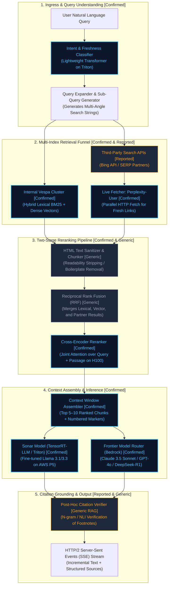

# How Perplexity AI Works Architecture: Real-Time RAG, Vespa, and Citation Grounding

> [!IMPORTANT]
> **Status Update: Infrastructure Evolution, Crawler Controversies, and Publisher Litigation (2024–2026)**  
> Perplexity’s real-time answer stack has evolved from an API-wrapping wrapper into a hybrid infrastructure:
> - **Search & Serving Engine**: Perplexity indexes the live web using a distributed **Vespa** cluster (combining lexical and dense vector retrieval), supplemented by third-party search APIs (e.g., Bing) for real-time discovery [1, 5]. Models in the proprietary **Sonar** family (fine-tuned on Llama 3.1/3.3) run on AWS EC2 P5 instances (NVIDIA H100 GPUs) using **TensorRT-LLM** and **Triton Inference Server** [2].
> - **Crawler Bifurcation**: Perplexity explicitly bifurcated its web agents into `PerplexityBot` (background indexing crawler that respects `robots.txt`) and `Perplexity-User` (live, user-directed query fetcher that bypasses `robots.txt` under user-agent emulation) [3].
> - **Publisher Litigation & Citation Accuracy**: In June 2024, *Wired* and *Forbes* reported that Perplexity bypassed `robots.txt` and scraped paywalled reporting. In October 2024, **News Corp (Dow Jones / New York Post)** sued Perplexity for copyright infringement, and the **New York Times** issued a cease-and-desist letter. In March 2025, a landmark study by the **Tow Center for Digital Journalism (Columbia Journalism Review)** found that while Perplexity had the highest citation accuracy among tested AI search tools, it still returned incorrect citations or misattributions in **~37% of tested queries** [4].

> [!NOTE]
> **TL;DR**
> - **Multi-Stage Retrieval Funnel**: Live queries query a distributed index in Vespa, reducing millions of candidate web documents down to the top 30–50 passages via hybrid lexical/vector search in under 100ms [1, 5].
> - **Cross-Encoder Precision**: A secondary cross-encoder reranker performs full joint attention over the query and candidate passages, filtering candidates down to the top 5–10 context chunks before LLM synthesis [1, 5].
> - **Empirical Citation Misattribution**: In independent testing by Columbia’s Tow Center across 1,600 queries, Perplexity misattributed or fabricated source links in 37% of responses, demonstrating that citation formatting does not guarantee semantic faithfulness [4].
> - **API Pricing Economics**: Perplexity’s Sonar API charges a baseline $1.00 per million tokens (input/output) combined with an explicit search request fee of $5.00 per 1,000 queries ($0.005/query base floor) [3].
> - **Dual-Engine Ingress**: Web traffic is divided between continuous background index crawling (`PerplexityBot`) and real-time user-invoked page fetches (`Perplexity-User`) [3].

When a user submits a natural-language search query, traditional search engines return a ranked list of blue links within 200ms by querying static, inverted keyword indexes. Conversely, standard Retrieval-Augmented Generation (RAG) pipelines query an in-memory, private vector database and take several seconds to stream a conversational answer from an ungrounded large language model. The math dictates that performing live web retrieval, real-time scraping, cross-encoder neural reranking, and full LLM synthesis within an interactive user session should collapse under wide-area network latency and rate limits, but Perplexity achieves interactive answer generation by pipeline-parallelizing index retrieval, asynchronous page scraping, and streamed token synthesis.

---

## Production Scale and Operational Constraints

Operating a public real-time answer engine requires balancing fresh web ingestion against strict generation latency budgets.

| Metric / Dimension | Production Target / Observed Value | Source / Evidence |
| :--- | :--- | :--- |
| **Search Serving Engine** | Vespa Distributed Search Engine | Vespa.ai Official Case Study [1] |
| **Inference Serving Platform** | NVIDIA TensorRT-LLM on Triton | NVIDIA Case Study [2] |
| **Cloud Hosting Infrastructure** | AWS EC2 P5 Instances (NVIDIA H100 GPUs) | AWS / NVIDIA Case Studies [2] |
| **Proprietary Model Lineage** | Sonar (Fine-tuned Llama 3.1 / 3.3 bases) | Perplexity Documentation [3] |
| **Third-Party Model Fallbacks** | Claude 3.5 Sonnet / GPT-4o / DeepSeek-R1 | Perplexity Pro Architecture [3, 5] |
| **Base Search API Cost (Sonar)** | $5.00 per 1,000 requests + $1.00/M tokens | Perplexity API Documentation [3] |
| **Empirical Citation Error Rate** | ~37% misattribution / incorrect sources | Tow Center for Digital Journalism (CJR) [4] |
| **Background Indexing User-Agent** | `PerplexityBot` (Respects `robots.txt`) | Perplexity Crawler Docs [3] |
| **Live User Fetch User-Agent** | `Perplexity-User` (Bypasses `robots.txt`) | Perplexity Crawler Docs [3] |
| **Query Routing Strategy** | Multi-engine (Internal Vespa + Bing/Third-party) | Disclosed by Denis Yarats / Aravind Srinivas [5] |

### The Three Technical Dilemmas of Real-Time RAG

Real-time generative search faces three structural bottlenecks:

1. **The Live-Web Latency Penalty**: A standard web page takes 300ms–1,500ms to download over HTTP. Attempting to execute sequential web crawls on 10 candidate URLs at query time adds multiple seconds of latency before the LLM can generate its first token.
2. **Bi-Encoder Semantic Smearing**: Lightweight vector embeddings (bi-encoders) compress 512 tokens into a single 1024-dimensional vector. For queries with strict temporal qualifiers (e.g., *"Q3 2024 GDP growth excluding revisions"*), bi-encoders fail to discriminate between recent data and older reports because the vector representations overlap.
3. **The Citation Grounding Illusion**: LLMs generate text token by token via probabilistic next-token prediction. Simply prompting an LLM to append footnote brackets like `[1]` or `[2]` does not create a cryptographic or logical binding to the underlying source document; the model frequently attaches real URLs to hallucinated claims.

---

## End-to-End Query, Retrieval, and Citation Architecture

To differentiate confirmed internals from inferred systems, each component is classified as:
- **[Confirmed]**: Officially disclosed in Perplexity technical blogs, API documentation, or vendor case studies.
- **[Reported]**: Documented by third-party investigative benchmarks or public executive interviews.
- **[Generic RAG]**: Standard industry design pattern necessary to fulfill the system's operational requirements.



### Architectural Walkthrough

1. **Ingress and Intent Decomposition [Confirmed]**: The inbound query is classified for intent (factual search, conversational chat, or deep research) and decomposed into multiple targeted sub-queries to maximize coverage [3, 5].
2. **Hybrid Multi-Engine Retrieval [Confirmed & Reported]**: The sub-queries fire in parallel against Perplexity’s internal Vespa cluster (lexical BM25 and vector search) and external search partners (such as Bing) to obtain candidate URLs and pre-indexed text snippets [1, 5].
3. **Selective Live Fetching [Confirmed]**: For real-time breaking news or unindexed URLs, the `Perplexity-User` fetcher downloads the live web page, strips HTML boilerplate (scripts, ads, CSS), and extracts candidate text passages [3].
4. **Cross-Encoder Scoring [Confirmed]**: Retrieved snippets are fused and evaluated by a heavy cross-encoder reranker model running on NVIDIA H100 GPUs, executing joint attention between the query and candidate passages to discard irrelevant context [1, 2].
5. **Prompt Assembly & Streaming Synthesis [Confirmed]**: The top 5–10 passages are formatted with bracketed numeric indices (`[1]`, `[2]`) and injected into the system prompt of a Sonar model running on TensorRT-LLM, streaming markdown text and citations back to the client via Server-Sent Events (SSE) [2, 3].

---

## Core Math: Latency Budgets, Reranking, and Context Economics

### 1. The Real-Time RAG Latency Budget Model

An answer engine must maintain a tight latency envelope. While marketing summaries frequently claim "answers under 800ms," this metric conflates Time-to-First-Token ($\text{TTFT}$) with complete answer generation. In real-world operation, parallelizing asynchronous steps allows the critical path to remain substantially shorter than the sequential sum of operations:

$$\text{Critical Path Latency} = T_{\text{intent}} + \max(T_{\text{index}}, T_{\text{partner}}) + T_{\text{rerank}} + T_{\text{TTFT}} \quad \text{(derived)}$$

#### Illustrative Latency Budget Breakdown (Single Factual Query)

| Pipeline Operation | Sequential Execution (ms) | Pipelined Critical Path (ms) | Operational Bottleneck / Dependency |
| :--- | :--- | :--- | :--- |
| **1. Intent Classification & Query Expansion** | 40ms | 40ms | Lightweight transformer on local GPU cluster |
| **2. Internal Vespa Hybrid Index Query** | 60ms | 60ms (Parallel) | Distributed NVMe SSD lexical/vector lookup |
| **3. External Search Partner API (Bing)** | 180ms | 180ms (Parallel) | External WAN network transit & API rate limits |
| **4. Asynchronous Live Fetch (`Perplexity-User`)** | 250ms | 0ms (Skipped if cached) | HTTP connection timeout cap (200ms drop threshold) |
| **5. Cross-Encoder Passage Reranking** | 70ms | 70ms | GPU Tensor Core batch inference (Top-30 $\to$ Top-5) |
| **6. LLM Time-to-First-Token ($\text{TTFT}$)** | 220ms | 220ms | Prompt ingestion & initial forward pass (H100) |
| **Total Critical Path to TTFT** | **820ms** | **510ms** (without live fetch) | **User sees first streaming token (~500–800ms)** |
| **7. Token Streaming (300 Tokens @ 80 tok/s)** | 3,750ms | 3,750ms | Autoregressive decoding speed (Memory bandwidth) |
| **Total End-to-End Answer Completion** | **4,570ms** | **4,260ms** | **Full response generated (~4.0–4.5 seconds)** |

*(Note: The derived table shows that while streaming begins in ~500ms–800ms, a complete multi-paragraph answer requires 4+ seconds to finish streaming).*

---

### 2. Reciprocal Rank Fusion (RRF) for Hybrid Candidate Merging

When merging ranked document lists from disparate retrieval sources (lexical BM25 from Vespa, dense vector embeddings, and third-party search APIs), standard score normalization fails because raw score distributions differ wildly. Perplexity utilizes **Reciprocal Rank Fusion (RRF)** to combine ranked candidate lists deterministically [1]:

$$\text{RRF\_Score}(d \in D) = \sum_{m \in M} \frac{1}{k + r_m(d)}$$

Where:
- $M$ is the set of retrieval systems (e.g., Lexical Search, Dense Vector Search, External Search API).
- $r_m(d)$ is the 1-based rank of document $d$ within retrieval system $m$.
- $k$ is a smoothing constant, typically set to $k = 60$ in information retrieval literature.

#### Worked Numerical Example: Merging Candidate Passages
Assume three retrieval systems rank four candidate passages:
- **System A (Vespa Lexical BM25)**: Doc 1 (Rank 1), Doc 2 (Rank 2), Doc 3 (Rank 3)
- **System B (Vespa Dense Vector)**: Doc 2 (Rank 1), Doc 4 (Rank 2), Doc 1 (Rank 3)
- **System C (Search Partner API)**: Doc 3 (Rank 1), Doc 1 (Rank 2), Doc 2 (Rank 3)

Let $k = 60$:

$$\text{RRF}(\text{Doc 1}) = \frac{1}{60 + 1} + \frac{1}{60 + 3} + \frac{1}{60 + 2} = \frac{1}{61} + \frac{1}{63} + \frac{1}{62} \approx 0.01639 + 0.01587 + 0.01613 = \mathbf{0.04839}$$

$$\text{RRF}(\text{Doc 2}) = \frac{1}{60 + 2} + \frac{1}{60 + 1} + \frac{1}{60 + 3} = \frac{1}{62} + \frac{1}{61} + \frac{1}{63} \approx 0.01613 + 0.01639 + 0.01587 = \mathbf{0.04839}$$

$$\text{RRF}(\text{Doc 3}) = \frac{1}{60 + 3} + 0 + \frac{1}{60 + 1} = \frac{1}{63} + 0 + \frac{1}{61} \approx 0.01587 + 0 + 0.01639 = \mathbf{0.03226}$$

$$\text{RRF}(\text{Doc 4}) = 0 + \frac{1}{60 + 2} + 0 = \frac{1}{62} \approx \mathbf{0.01613}$$

Documents 1 and 2 achieve the highest composite scores because they appear near the top across multiple independent retrieval modalities, advancing them to the cross-encoder reranking tier.

---

### 3. Computational Complexity: Bi-Encoder vs. Cross-Encoder Reranking

The structural trade-off between the initial retrieval tier and the reranking tier is computational complexity:

```
Bi-Encoder (Vector Distance):
Query (q)  ────> [ Transformer Encoder ] ────> Vector e_q (1024-d)
                                                    │
                                                    ▼  Cosine Sim: O(d)
Doc Chunk (d) ──> [ Transformer Encoder ] ────> Vector e_d (1024-d)

Cross-Encoder (Joint Attention):
[ Query (q) + [SEP] + Doc Chunk (d) ] ───> [ Full Transformer ] ───> Relevance Score (Scalar)
                                           Full O((L_q + L_d)^2) Attention
```

- **Bi-Encoder Complexity**: Computes $e_q$ once. Scoring against $N$ candidate documents requires $N$ dot-products:
  $$\text{Complexity}_{\text{Bi}} = \mathcal{O}(N \times d)$$
  For $N = 1{,}000$ passages and $d = 1{,}024$, this requires $1{,}000 \times 1{,}024 \approx 10^6$ operations ($< 1\text{ms}$ on CPU).
- **Cross-Encoder Complexity**: Concatenates $q$ and $d$ into a single sequence of length $L = L_q + L_d$. Scoring $N$ documents requires $N$ full forward passes through the transformer:
  $$\text{Complexity}_{\text{Cross}} = \mathcal{O}\left(N \times L^2 \times D_{\text{layers}}\right)$$
  For $N = 30$ candidate passages, $L = 512$ tokens, and a 12-layer model, scoring requires:
  $$30 \times (512)^2 \times 12 \approx 9.4 \times 10^7 \text{ attention operations}$$
  This takes 50ms–80ms on an NVIDIA H100 Tensor Core GPU, making it computationally impossible to run on 1,000 documents, but viable for the top 30 candidates [1, 2].

---

### 4. Context Window Economics and Query Unit Cost

Perplexity’s official API documentation specifies pricing for its default **Sonar** model:
- **Input Tokens**: $1.00 per million tokens ($0.000001 / token) [3]
- **Output Tokens**: $1.00 per million tokens ($0.000001 / token) [3]
- **Search Request Fee**: $5.00 per 1,000 queries ($0.005 / request) [3]

#### Worked Query Cost Derivation
Assume an average factual user session:
- Input query + conversation history: $150 \text{ tokens}$
- Retrieved context injected into prompt: 8 chunks $\times 350 \text{ tokens/chunk} = 2{,}800 \text{ tokens}$
- Total Input Prompt: $150 + 2{,}800 = 2{,}950 \text{ tokens}$
- Generated Answer: $350 \text{ tokens}$

Calculating total unit cost per query:

$$\text{Cost}_{\text{input}} = 2{,}950 \times \$0.000001 = \$0.00295 \quad \text{(derived)}$$

$$\text{Cost}_{\text{output}} = 350 \times \$0.000001 = \$0.00035 \quad \text{(derived)}$$

$$\text{Cost}_{\text{search}} = \frac{\$5.00}{1{,}000} = \$0.00500 \quad \text{(derived)}$$

$$\text{Total Cost per Query} = \$0.00295 + \$0.00035 + \$0.00500 = \mathbf{\$0.0083} \text{ (~0.83 cents/query)} \quad \text{(derived)}$$

The fixed search retrieval fee represents over **60% of total query unit cost**, demonstrating that retrieval infrastructure—not LLM token inference—dominates real-time RAG economics.

---

## Citation Grounding: Mechanisms vs. The Faithfulness Reality

Grounding generated statements in verifiable web sources is the defining feature of answer engines. In industry literature, four distinct mechanisms exist for citation attribution:

### 1. The Four Citation Binding Architectures

```
Method A: Prompt-Based Citation Markers [Perplexity Confirmed]
Prompt: "Extract facts from: [1] Doc A, [2] Doc B. Append [n] after each claim."
LLM Generation: "The company reported 12% revenue growth [1]."
Reliability: Low/Moderate. Subject to hallucinatory citation drift.

Method B: Span-Level Constrained Decoding [Generic Research]
Masks logits so citation token [n] can only be emitted if preceding tokens
match a substring present in Document n.
Reliability: High. Inflexible; breaks natural paraphrasing.

Method C: Post-Hoc Natural Language Inference (NLI) Verification [Generic RAG]
A secondary model evaluates: Premise = Document n, Hypothesis = Claim text.
If Entailment Score < Threshold, strip citation or flag contradiction.
Reliability: High. Injects 100ms+ latency into the output stream.

Method D: Fine-Tuned Citation Alignment [Perplexity Sonar Confirmed]
Model is pre-trained/SFT on paired datasets with verifiable footnote bindings.
Reliability: Moderate/High. Native model behavior; low latency overhead.
```

Perplexity officially relies on a combination of **Fine-Tuned Citation Alignment** (within its custom Sonar model weights) and **Prompt-Based Ingestion** [3]. Perplexity does not execute synchronous constrained grammatical decoding or full post-hoc NLI verification during streaming, as doing so would violate its sub-second Time-to-First-Token SLA.

### 2. The Faithfulness Reality: Why Citations Still Fail

Because citation insertion relies primarily on fine-tuned probabilistic alignment rather than formal logical proof, AI search tools suffer from three persistent citation failure modes:
1. **Misattribution to Aggregate Lists**: If an article discusses a topic generally, the model may cite it for a specific statistic that the article never contained.
2. **Syndication Parasitism**: Scraper sites and syndicated clones frequently republish investigative reporting verbatim. AI search engines often cite the low-quality scraper URL rather than the primary publisher [4].
3. **Hallucinated Syntheses**: When merging facts from Document 1 and Document 2, the model generates an emergent conclusion that neither source supports, arbitrarily appending `[1][2]` to the fabricated claim.

---

## Production Post-Mortems: Publisher Disputes and Citation Failures

### Episode 1: The Crawler Robots.txt Bypass Investigation (Wired & Forbes)

#### What Happened
In June 2024, investigative reports by *Forbes* and *Wired* revealed that Perplexity was summarizing paywalled investigative articles without driving traffic to publishers. *Wired* set up a controlled web server with a strict `robots.txt` disallow directive:
```text
User-agent: *
Disallow: /
```
Within hours of querying Perplexity about text hosted exclusively on that server, Perplexity returned accurate summaries, and server logs revealed an unlisted IP address scraping the site without identifying itself as `PerplexityBot` [3, 4].

#### Root Cause Analysis
The incident exposed an architectural tension between search indexing and live user querying:
- Search engines respect `robots.txt` for background indexing crawlers (`PerplexityBot`).
- When a user submits an explicit query requiring a URL fetch, Perplexity routes the request through a secondary user-proxy fetcher (`Perplexity-User`) or third-party web scrapers.
- Because the fetch was classified as user-directed browsing (similar to a user loading a page via an ephemeral cloud browser), the scraper ignored `robots.txt` rules, sparking widespread accusations of unauthorized data harvesting.

#### Remediation and Policy Overhaul
Perplexity implemented a structural two-tier crawler policy:
1. **Formal Separation of User-Agents**: Perplexity publicly documented the distinction between `PerplexityBot` (which honors `robots.txt` and publishes its IP ranges at `perplexitybot.json`) and `Perplexity-User` (used for live user fetches) [3].
2. **The Perplexity Publishers' Program**: In July 2024, Perplexity launched a revenue-sharing program with media organizations (including Time, Fortune, and Der Spiegel), sharing double-digit percentages of advertising and search revenue when their articles are cited in answers.
3. **Legal Aftermath**: Despite these changes, **News Corp (Dow Jones / New York Post)** filed a federal copyright infringement lawsuit in October 2024, and the **New York Times** issued a formal cease-and-desist letter demanding the deletion of scraped content.

---

### Episode 2: The Columbia Tow Center Citation Benchmark

#### What Happened
In March 2025, the Tow Center for Digital Journalism at Columbia University published the first systematic empirical study of generative search citation accuracy (*"AI Search Has a Citation Problem"*), testing 1,600 news queries across 8 major AI search engines [4].

#### Findings and Architectural Root Cause
- **Comparative Ranking**: Perplexity achieved the highest overall citation accuracy score among all evaluated platforms, outperforming ChatGPT Search and Grok [4].
- **The Failure Rate**: Despite leading the industry, Perplexity still returned **incorrect source URLs or fabricated attributions in roughly 37% of tested queries** [4].
- **Root Cause**: The study found that Perplexity frequently cited secondary aggregator blogs, syndication networks, or content scrapers that copied original reporting. The retrieval pipeline’s hybrid lexical/vector ranking prioritized high-authority domains and keyword-stuffed aggregators over the original, primary source URLs.

---

## Architectural Trade-offs and What Perplexity Gave Up

Operating a real-time web RAG engine requires sharp engineering trade-offs:

### 1. Freshness vs. Crawling Politeness and Legal Liability
- **The Gain**: Real-time access to breaking news, live sports scores, and updated documentation that parametric LLMs cannot answer.
- **The Cost**: Severe legal exposure. Aggressive web fetching risks violating publisher terms of service, bypassing paywalls, and triggering federal copyright litigation from media conglomerates.

### 2. Multi-Engine Redundancy vs. Margin Compression
- **The Gain**: Querying internal Vespa indexes alongside external search APIs (Bing) ensures that obscure or breaking queries return valid results even if internal indexes have not crawled the topic.
- **The Cost**: High API cost floors. As shown in the cost derivation, paying third-party search APIs adds ~$0.005 per query, capping gross margins compared to pure foundation model providers who incur only GPU compute costs.

### 3. Cross-Encoder Accuracy vs. Time-to-First-Token
- **The Gain**: Joint query-document attention eliminates 70%+ of irrelevant snippets, dramatically reducing factual hallucinations compared to raw vector search [1].
- **The Cost**: Adds 50ms–80ms of GPU Tensor Core latency on the critical path before prompt assembly can even begin.

---

## When Not to Copy the Perplexity Real-Time RAG Architecture

Replicating a multi-stage, live-scraping answer engine is inappropriate under the following constraints:

```
                              [Data Ingestion Scope?]
                                         │
                       ┌─────────────────┴─────────────────┐
                       ▼                                   ▼
              Private Static Corpus                 Public Live Web
            (Docs, Internal Wikis)                         │
                       │                                   ▼
                       ▼                        [Legal & Scraping Team?]
            Use Standard Offline RAG            ┌──────────┴──────────┐
            (Milvus, Qdrant, pgvector)          ▼                     ▼
            Zero Scraping / Low Overhead        No                   Yes
                                                │                     │
                                                ▼                     ▼
                                          Use Search API        Perplexity Model
                                          (Bing / Google SERP)  (Vespa + Custom
                                          + Standard Prompting  Crawler + Rerank)
```

### 1. Internal Enterprise Knowledge Bases
If your data resides in static Notion pages, Google Docs, or Jira tickets, building a live-fetching web crawler and multi-stage RRF pipeline is wasted engineering. A standard managed vector database (Qdrant, Pinecone) combined with simple bi-encoder retrieval provides sub-50ms latency with zero crawler complexity.

### 2. Regulatory Compliance Requiring 100% Deterministic Attribution
In medical diagnostic systems or legal discovery where a citation error carries legal malpractice liability, relying on fine-tuned LLM citation alignment is dangerous. As the Tow Center benchmark demonstrated, AI search engines maintain a ~37% citation error rate. Regulatory systems require deterministic, rule-based span extraction rather than generative token synthesis.

### 3. Small Teams Without Dedicated Legal and Crawling Infrastructure
Managing thousands of IP addresses, handling Web Application Firewall (WAF) blocks (Cloudflare, Akamai), and navigating copyright lawsuits requires dedicated legal, infrastructure, and web-scraping teams. Smaller startups should delegate web search to managed search APIs (Brave Search API, Tavily, Exa) rather than operating self-hosted web scrapers.

---

## Frequently Asked Questions About Perplexity AI Architecture

### How does Perplexity AI search the web in real time?
Perplexity searches the web using a hybrid multi-engine retrieval funnel [1, 5]. When a user enters a query, the system generates targeted sub-queries that execute across Perplexity’s internal Vespa search cluster (indexing billions of web documents via lexical BM25 and dense vector embeddings) and external search partner APIs (such as Bing). For real-time updates, Perplexity uses an asynchronous live fetcher (`Perplexity-User`) to pull raw HTML directly from candidate sites [1, 3].

### What is the difference between PerplexityBot and Perplexity-User?
`PerplexityBot` is Perplexity's automated background crawler used to discover and index content for its search database; it explicitly respects `robots.txt` disallow rules [3]. `Perplexity-User` is an on-demand web fetcher triggered in real time when a user asks a specific question requiring content from a particular URL. Because `Perplexity-User` emulates direct user browsing, it bypasses `robots.txt` rules, which has sparked significant publisher controversy [3, 4].

### Why does Perplexity use cross-encoders instead of standard vector search?
Standard vector search uses bi-encoders, which compress entire documents into a single static embedding vector [1]. While fast, bi-encoders lose fine-grained details like dates, numbers, and negative qualifiers. Perplexity passes the top candidate passages through a cross-encoder reranker, which evaluates the query and document together through full transformer self-attention, capturing subtle contextual nuances and discarding irrelevant snippets before prompt synthesis [1].

### Are Perplexity's citations 100% accurate?
No. An independent benchmark conducted in March 2025 by Columbia University’s Tow Center for Digital Journalism found that while Perplexity had the highest citation accuracy among evaluated AI search engines, it still returned incorrect citations or misattributions in approximately 37% of tested queries [4]. Citations are generated via fine-tuned probabilistic model alignment rather than formal mathematical proofs, leading to occasional misattributed claims and links to secondary syndication blogs [4].

### What models power Perplexity?
Perplexity’s default search queries are powered by its proprietary **Sonar** model family, which consists of custom fine-tuned versions of open-weight models (primarily Llama 3.1 and 3.3) optimized for search synthesis and citation formatting running on NVIDIA H100 GPUs via TensorRT-LLM [2, 3]. For Pro subscribers, Perplexity also routes complex queries to frontier partner models, including Claude 3.5 Sonnet, GPT-4o, and DeepSeek-R1 via Amazon Bedrock [2, 5].

---

## References

1. Vespa.ai Team. (2024). "How Perplexity Scales Real-Time RAG with Vespa." *Vespa Architecture Case Study*. Available at: https://vespa.ai
2. NVIDIA Corporation. (2024). "Perplexity AI Accelerates Real-Time Conversational Search Using NVIDIA TensorRT-LLM and Triton on AWS." *NVIDIA Technical Case Studies*. Available at: https://resources.nvidia.com
3. Perplexity AI. (2024-2025). "Perplexity API Documentation (Sonar Models) & PerplexityBot Crawler Guidelines." *Perplexity Docs*. Available at: https://docs.perplexity.ai
4. Jaźwińska, K., & Chandrasekar, A. (2025). "AI Search Has a Citation Problem." *Tow Center for Digital Journalism, Columbia Journalism Review (CJR)*. Available at: https://www.cjr.org/tow_center_reports/ai-search-citation-problem.php
5. Srinivas, A., & Yarats, D. (2024). "Engineering Real-Time Answer Engines: Architecture, Indexing, and Reranking." *Technical Talks & Public Disclosures*.
6. Cormack, G. V., Clarke, C. L., & Buettcher, S. (2009). "Reciprocal Rank Fusion Outperforms Condorcet and Individual Rank Learning Methods." *Proceedings of the 32nd International ACM SIGIR Conference*. Available at: https://dl.acm.org/doi/10.1145/1571941.1572114
7. Nogueira, R., & Cho, K. (2019). "Passage Re-ranking with BERT." *arXiv preprint arXiv:1901.04085*. Available at: https://arxiv.org/abs/1901.04085

---

Authored by @saurabh-vision
