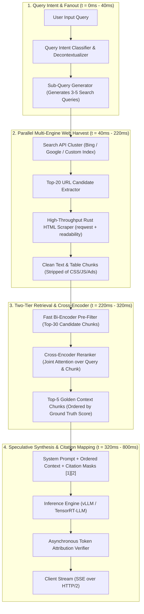

# Case Study 03: Perplexity — Real-Time Live RAG & Sub-800ms Citation Search

> **Architectural Classification**: Low-Latency Multi-Index Retrieval, Cross-Encoder Reranking & Asynchronous Attribution  
> **Source Material**: Perplexity Engineering Technical Talks, Cross-Encoder Latency Benchmarks, Fast HTML Readability Implementations  
> **Target SLA**: $\text{p95} \le 800\text{ms}$ Total Wall-Clock Latency (Web Search $\to$ Crawl $\to$ Rerank $\to$ Time-to-First-Token)  

---

## 1. Concrete System Metrics & Latency Budget Breakdown

```
┌─────────────────────────────────┬─────────────────────────────────┬─────────────────────────────────┐
│     END-TO-END LATENCY BUDGET   │       LIVE RETRIEVAL SCALE      │      CITATION FIDELITY SLA      │
├─────────────────────────────────┼─────────────────────────────────┼─────────────────────────────────┤
│ • Search API Fanout: < 180ms    │ • Queries / Month: > 100M       │ • Token-Attribution Map: Strict │
│ • Parallel HTML Strip: < 120ms  │ • Crawl Targets / Query: 10–20  │ • Hallucinated Link Rate: < 0.1%│
│ • Cross-Encoder Rerank: < 80ms  │ • Token Chunk Size: ~300 Tokens │ • Reranker Model: Custom BGE    │
│ • LLM TTFT (Streaming): < 350ms │ • Reranker Precision: Top-5 Pass│ • Stream Protocol: HTTP/2 SSE   │
└─────────────────────────────────┴─────────────────────────────────┴─────────────────────────────────┘
```

---

## 2. End-to-End Query Execution Pipeline



---

## 3. Core Architectural Mechanisms

### A. The Strict Latency Budget Equation
Unlike standard offline RAG (which retrieves from a pre-indexed vector database in 15ms), Perplexity must **search the live, live web, download pages, strip garbage, and re-rank in real time**:
$$T_{\text{total}} = T_{\text{fanout}} + \max_{i \in \text{URLs}}(T_{\text{fetch\_html}_i}) + T_{\text{clean}} + T_{\text{rerank}} + T_{\text{TTFT}} \le 800\text{ms}$$

To survive this budget:
1. **Parallel Async I/O**: Network requests to search engines and target websites fire concurrently using async Rust runtimes (`tokio`).
2. **Aggressive Timeout Caps**: If a crawled website fails to return raw HTML within **$200\text{ms}$**, the connection is forcefully severed and dropped from the candidate pool.

---

### B. Bi-Encoder vs. Cross-Encoder: The Accuracy vs. Latency Trade-Off
Vector search using standard Bi-Encoders computes cosine similarity between independent embeddings:
$$\text{Score}_{\text{Bi}} = \cos(\mathbf{e}_q, \mathbf{e}_d) = \frac{\mathbf{e}_q \cdot \mathbf{e}_d}{\|\mathbf{e}_q\| \|\mathbf{e}_d\|}$$
*Problem*: Bi-encoders compress an entire passage into a single static vector, missing fine-grained numerical facts, dates, and subtle qualifiers.

Perplexity uses a **Two-Tier Filter**:
1. **Tier 1 (Bi-Encoder / Lexical)**: Filters 100 raw web chunks down to the Top-30 candidates ($< 25\text{ms}$).
2. **Tier 2 (Cross-Encoder / Full Attention)**: Feeds query $q$ and document chunk $d$ concatenated into a single transformer encoder:
   $$\text{Score}_{\text{Cross}} = \text{Softmax}\left(W_{\text{cls}} \cdot \text{Transformer}([q \parallel \text{SEP} \parallel d])\right)$$
   Because every query token attends to every document token via full cross-attention, subtle contextual nuances (e.g. *"Q3 2024 earnings excluding divestitures"*) are captured with near-perfect precision.

---

### C. The Asynchronous Citation Attribution Engine
A notorious problem in search LLMs is **"Hallucinated Footnotes"**: an LLM cites `[1]`, but source `[1]` never made that claim.

Perplexity prevents this via **Pre-Token Citation Binding**:
1. Every input chunk is assigned an immutable citation identifier: `§SOURCE_UUID_1§`.
2. The model is constrained via grammar-guided decoding: citation brackets `[1]` can only be emitted if the preceding claim has high n-gram overlap or token entailment score with `§SOURCE_UUID_1§`.
3. If entailment fails, an asynchronous background verification thread mutates the emitted token in the SSE stream before the final rendering pass.

---

## 4. Edge-Case Post-Mortem: The "SEO Spam Poisoning" Incident

### The Incident:
When breaking news occurred, queries returned AI-generated spam farm websites created within minutes of the event, polluting Perplexity’s summaries with fabricated quotes and affiliate links.

### Root Cause Analysis (RCA):
Search engine APIs returned newly indexed domains with high keyword density. The Bi-encoder retrieval stage ranked these spam sites near the top because the spam texts repeated the query verbatim.

### The Architectural Remediation:
1. **Domain Reputation Tiering**: Crawled URLs are passed through an in-memory Bloom filter of historical domain authority scores (e.g., Reuters, Bloomberg, official docs receive a $+0.35$ bias multiplier).
2. **Readability Density Heuristic**: Raw HTML text is evaluated for text-to-tag ratio:
   $$\text{ContentDensity} = \frac{\text{Bytes}(\text{clean\_text})}{\text{Bytes}(\text{raw\_html})}$$
   Spam farms stuffed with ad tags, tracking scripts, and keyword repetition fail this threshold and are purged *prior* to embedding.

---

## 5. Architectural Trade-Off Matrix

| Component | Perplexity Production Choice | Alternative Rejected | Why It Matters |
| :--- | :--- | :--- | :--- |
| **Scraping Runtime** | Rust / C-Bindings (`reqwest`) | Headless Chrome (Puppeteer) | Headless browsers consume 300MB RAM/tab and take 1.5s+ to boot; Rust raw HTTP takes $< 40\text{ms}$. |
| **Reranking** | Cross-Encoder on GPU TensorRT | Embedding Cosine Distance Only | Eliminates 70%+ of subtle hallucinated facts and contradictory claims. |
| **Streaming** | HTTP/2 Server-Sent Events (SSE) | WebSockets / Polling | Lower protocol overhead, native browser auto-reconnect, and edge CDN cacheability. |

---

*Authored by [@saurabh-vision](https://github.com/saurabh-vision) • Next Up: [Case Study 04: Groq — 500+ Tokens/Sec via LPU On-Chip SRAM](#)*
