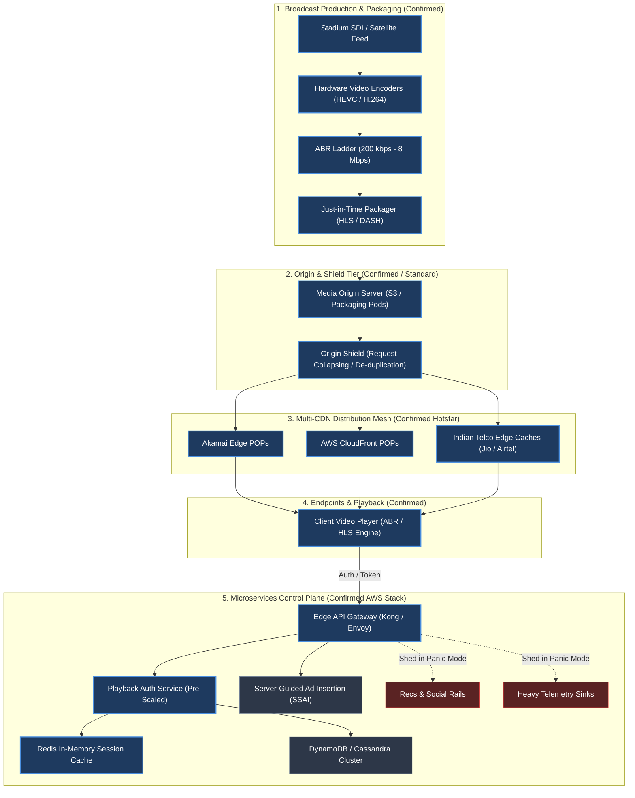

# Live Video Streaming at 59M Concurrency: The Disney+ Hotstar Architecture Breakdown

> [!IMPORTANT]
> **Status Update: Platform Merger, Records, and Streaming Infrastructure (October 2026)**  
> - **The Concurrency Benchmark**: On **November 19, 2023**, Disney+ Hotstar established the official world record for simultaneous live video streaming: **59 million (5.9 crore) peak concurrent viewers** during the ICC Men's Cricket World Cup Final (India vs. Australia) [1]. This broke their own prior world record of **53 million concurrent viewers** set during the semi-final (India vs. New Zealand) on November 15, 2023 [1]. These metrics measure **peak simultaneous active video playback sessions**, distinct from cumulative tournament reach.
> - **Corporate Consolidation (JioStar & JioHotstar)**: On November 14, 2024, Reliance Industries, Viacom18, and The Walt Disney Company officially closed an **\$8.5 billion joint venture** creating **JioStar** (Reliance holding ~56–63%, Disney ~37%) [8, 9]. On **February 14, 2025**, JioCinema and Disney+ Hotstar merged into a single unified streaming platform: **JioHotstar** [8]. The combined live sports ecosystem (IPL, ICC World Cups, Premier League) standardized on Disney+ Hotstar’s cloud-native live concurrency architecture.
> - **Data Plane vs. Control Plane Separation**: Delivering live video to 59 million simultaneous users is mathematically impossible with single-cloud origins. The architecture separates the **Data Plane** (video/audio `.m4s` segments delivered with a $99.9\%+$ cache-hit ratio across a Multi-CDN mesh) from the **Control Plane** (dynamic APIs for authentication, playback token issuance, ad decisions, and scorecards) [3, 6].
> - **Proactive Pre-Scaling vs. Reactive Autoscaling**: Reactive cloud autoscaling (e.g., standard Kubernetes HPA) fails during live cricket because viewership surges by millions of users within 60 seconds (a "tsunami spike"). Infrastructure is **pre-scaled and pre-warmed hours before match toss** based on machine learning predictions and game-day stress tests executed by their custom load-testing framework, **Project HULK** [4].

> [!NOTE]
> **TL;DR**
> - **The Egress Tsunami**: Streaming to 59 million concurrent viewers across a mobile ABR mix ($1.5\text{ to }1.77\text{ Mbps}$) requires **$88.5\text{ to }104.4\text{ Tbps}$ of sustained egress bandwidth**. At a segment duration of $\tau = 4\text{s}$, edge caches handle **$29.5\text{ million HTTP requests/second}$** across video chunks and manifest refreshes [derived].
> - **Origin Shielding & Request Collapsing**: If edge CDN cache hit ratios drop from $99.99\%$ to $99.0\%$, origin traffic multiplies by **$100\times$** (from $2{,}950$ to $295{,}000\text{ req/sec}$), crashing the packagers. Origin shields collapse concurrent edge misses into a single upstream fetch per rendition [derived].
> - **The Back-Button Stampede**: When a key wicket falls, millions of viewers tap "back" simultaneously within 5 seconds, diverting up to **$1.18\text{M req/sec}$** from cached video CDNs directly onto database-backed homepage microservices. Pre-scaling and client-side retry jitter prevent cascading TCP collapse [4, derived].
> - **"Panic Mode" Graceful Degradation**: Under extreme load, automated circuit breakers shed non-essential microservices (recommendations, personalization rails, chat feeds, social emojis, heavy watch-history syncs) to guarantee 100% compute and network availability for the core playback path [5].
> - **Project HULK**: A custom distributed load generation engine operating across multi-cloud regions that simulates tens of millions of concurrent virtual user journeys before tournaments begin [4].

---

## 1. Production Scale and Operational Realities

Live sports events present an extreme infrastructure problem: viewership does not grow gradually; it explodes at predictable moments (the match toss, run chases, wickets, and final overs).

| Metric / Dimension | Production Target / Observed Value | Source / Classification |
| :--- | :--- | :--- |
| **Peak Concurrent Viewers** | **59.0 Million** (ICC World Cup Final, Nov 19, 2023) | Confirmed (Disney+ Hotstar Official Release) [1] |
| **Prior World Records** | 53.0M (Nov 2023 Semifinal), 25.3M (July 2019 Semifinal) | Confirmed (Disney+ Hotstar Announcements) [1, 3] |
| **JioCinema IPL Record** | 32.0 Million (IPL 2023 Final, May 29, 2023) | Confirmed (Viacom18 Official Press Release) [8] |
| **Estimated Peak Egress** | ~75 to 110 Tbps across Multi-CDN mesh | Derived from 59M viewers $\times$ 1.2–1.8 Mbps [derived] |
| **Peak Edge Request Rate** | ~29.5 Million HTTP requests/sec ($\tau = 4\text{s}$) | Derived from video chunk + manifest refresh [derived] |
| **Edge Cache Hit Ratio** | > 99.9% (Origin Shield collapses chunk requests) | Confirmed (Hotstar Engineering Blog & Talks) [3, 4] |
| **Core Cloud Provider** | Amazon Web Services (EC2, ECS, EKS multi-cluster) | Confirmed (AWS re:Invent Keynotes & Case Studies) [6, 7] |
| **Load-Testing Framework** | Project HULK (Heat Up & Load Knowingly) | Confirmed (Hotstar Engineering Blog) [4] |
| **Primary Edge CDNs** | Akamai, Amazon CloudFront, Fastly + Indian Telco Caches | Confirmed (Hotstar Architecture Presentations) [3, 6] |
| **Major Incident (Crash)** | Feb 17, 2023: Platform crash during India-Aus Test | Confirmed (LiveMint, Business Today Outage Reports) [12] |

---

## 2. High-Level Streaming Architecture

The Hotstar streaming architecture strictly decouples the **Video Delivery Data Plane** (stateless, CDN-cached, massive bandwidth) from the **Application Control Plane** (stateful, authenticated, low latency).



### Architectural Classification of Components

1. **Broadcast Encoding & Packaging Tier** *(Confirmed)*: Receives raw SDI feeds from stadiums, encodes video across multiple bitrates and resolutions (ABR ladder), and packages segments into 4-second `.m4s` chunks with matching dynamic `.m3u8` playlists [3, 10].
2. **Origin Shield & Request Collapsing** *(Confirmed Akamai / AWS Architecture)*: Sits between global edge CDNs and media packaging origins. When tens of thousands of edge POPs request a newly published segment at the exact same second, the Origin Shield consolidates these into a **single upstream request**, preventing packaging origins from collapsing under thundering herds [3, 11].
3. **Multi-CDN & Telco Edge Peering** *(Confirmed Hotstar Architecture)*: Hotstar contracts with multiple tier-1 CDNs (Akamai, CloudFront) and maintains direct peering inside Indian telecommunication networks (Reliance Jio, Bharti Airtel) to serve data directly from ISP edge nodes [3, 6].
4. **Control Plane & Circuit Breakers** *(Confirmed Hotstar Engineering Blog)*: Microservices hosted on AWS (EKS / EC2) handle tokens, DRM licensing, and subscriptions. Automated circuit breakers enforce **Panic Mode**: shedding non-critical services (chat, recommendations, comments) to protect the authentication and video playback path [4, 5].

---

## 3. Core Mathematical Foundations

### 3.1. Bandwidth Egress Math: Scaling to 59 Million Viewers

Total egress bandwidth ($E$) is determined by total concurrent active viewers ($V$) and the average bitrate ($B_{\text{avg}}$) consumed across the fleet:
$$E = V \times B_{\text{avg}}$$

#### A. The Indian Mobile Viewing Mix $(derived)$
In India, over $80\%$ of sports viewers watch on smartphones via 4G/5G mobile networks. The Adaptive Bitrate (ABR) distribution typically follows this profile during high-concurrency matches:

| Rendition | Resolution | Video Bitrate | Audio Bitrate | Total Bitrate | Fleet Share |
| :--- | :--- | :---: | :---: | :---: | :---: |
| **Low (Mobile Data Saver)** | $480 \times 270$ | $200\text{ kbps}$ | $48\text{ kbps}$ | $0.248\text{ Mbps}$ | $15\%$ |
| **Medium (Standard Mobile)** | $640 \times 360$ | $600\text{ kbps}$ | $64\text{ kbps}$ | $0.664\text{ Mbps}$ | $30\%$ |
| **High (HD Mobile / Tablet)** | $1280 \times 720$ | $1{,}500\text{ kbps}$ | $128\text{ kbps}$ | $1.628\text{ Mbps}$ | $35\%$ |
| **Full HD (Smart TV / Web)** | $1920 \times 1080$ | $3{,}800\text{ kbps}$ | $192\text{ kbps}$ | $3.992\text{ Mbps}$ | $18\%$ |
| **4K Ultra HD (Select Streams)** | $3840 \times 2160$ | $12{,}000\text{ kbps}$ | $256\text{ kbps}$ | $12.256\text{ Mbps}$ | $2\%$ |

Weighted Average Bitrate ($B_{\text{avg}}$):
$$B_{\text{avg}} = (0.15 \times 0.248) + (0.30 \times 0.664) + (0.35 \times 1.628) + (0.18 \times 3.992) + (0.02 \times 12.256)$$
$$B_{\text{avg}} = 0.0372 + 0.1992 + 0.5698 + 0.7186 + 0.2451 \approx \mathbf{1.770\text{ Mbps}}$$

#### B. Total Network Egress at 59M Peak $(derived)$
$$E = 59{,}000{,}000 \times 1.770\text{ Mbps} = 104{,}430{,}000\text{ Mbps} \approx \mathbf{104.43\text{ Tbps}}$$

- At $B_{\text{avg}} = 1.0\text{ Mbps}$ (aggressive mobile cellular throttling): $E = \mathbf{59.0\text{ Tbps}}$.
- At $B_{\text{avg}} = 2.0\text{ Mbps}$ (higher TV viewership): $E = \mathbf{118.0\text{ Tbps}}$.
- At $B_{\text{avg}} = 4.0\text{ Mbps}$ (desktop / high-bitrate mix): $E = \mathbf{236.0\text{ Tbps}}$.

No single CDN in 2023 had sufficient spare edge capacity in the Indian subcontinent to absorb $100+\text{ Tbps}$ alone, making a multi-CDN strategy with ISP-embedded caches mandatory.

---

### 3.2. HTTP Request Rates and Edge Request Sizing

In segmented streaming protocols (HLS and MPEG-DASH), video is sliced into discrete files of duration $\tau$ seconds.

#### A. Segment Request Rate Formula
Each active player requests exactly one video segment file every $\tau$ seconds:
$$R_{\text{seg}} = \frac{V}{\tau}$$

#### B. Manifest Refresh Rate Formula
For live streams, players must refresh the media playlist (`.m3u8`) to learn the URI of the newest chunk. Apple HLS guidelines specify refreshing once per segment duration:
$$R_{\text{manifest}} = \frac{V}{\tau}$$

#### C. Total Edge Request Rate at 59M Peak $(derived)$
For $\tau = 4.0\text{ seconds}$ (standard live segment duration):
$$R_{\text{seg}} = \frac{59 \times 10^6}{4.0\text{s}} = \mathbf{14.75\text{ Million requests/second}}$$
$$R_{\text{manifest}} = \frac{59 \times 10^6}{4.0\text{s}} = \mathbf{14.75\text{ Million requests/second}}$$
$$R_{\text{total, edge}} = R_{\text{seg}} + R_{\text{manifest}} = \mathbf{29.50\text{ Million HTTP requests/second}}$$

| Segment Duration ($\tau$) | Segment Request Rate | Manifest Refresh Rate | Total CDN Ingress Rate | Trade-Off |
| :---: | :---: | :---: | :---: | :--- |
| **$6.0\text{ seconds}$** | $9.83\text{M req/s}$ | $9.83\text{M req/s}$ | **$19.67\text{M req/s}$** | Lower request rate; higher glass-to-glass delay (~30s) |
| **$4.0\text{ seconds}$** | $14.75\text{M req/s}$ | $14.75\text{M req/s}$ | **$29.50\text{M req/s}$** | **Optimal Hotstar Production Balance (~18-22s delay)** |
| **$2.0\text{ seconds}$** | $29.50\text{M req/s}$ | $29.50\text{M req/s}$ | **$59.00\text{M req/s}$** | Ultra-low latency (~8-12s delay); extreme request overhead |

---

### 3.3. CDN Cache Math & Origin Shielding

If edge requests pass through un-cached to the origin, packaging servers instantly crash.

#### A. Origin Traffic as a Function of Cache-Hit Ratio $(h)$
$$R_{\text{origin}} = R_{\text{total, edge}} \times (1 - h)$$

At peak request volume $R_{\text{total, edge}} = 29.5\text{M req/sec}$:

1. **At $h = 0.990$ (99.0% cache hit ratio)**:
   $$R_{\text{origin}} = 29{,}500{,}000 \times 0.010 = \mathbf{295{,}000\text{ req/sec}}$$
   *(Causes cascading TCP connection exhaustion and origin timeout outages.)*
2. **At $h = 0.999$ (99.9% cache hit ratio)**:
   $$R_{\text{origin}} = 29{,}500{,}000 \times 0.001 = \mathbf{29{,}500\text{ req/sec}}$$
   *(High load; requires a large origin cluster with pre-warmed Redis proxies.)*
3. **At $h = 0.9999$ (99.99% cache hit ratio with Origin Shield & Request Collapsing)**:
   $$R_{\text{origin}} = 29{,}500{,}000 \times 0.0001 = \mathbf{2{,}950\text{ req/sec}}$$
   *(Easily handled by a small, resilient cluster of packaging origin pods.)*

```
Origin Ingress Request Rate vs Cache-Hit Ratio (59M Viewers):

Hit Ratio: [h = 99.0% ] ──────────────────────────────────────────> 295,000 req/sec (ORIGIN COLLAPSE)
Hit Ratio: [h = 99.9% ] ────────────> 29,500 req/sec (HIGH STRAIN)
Hit Ratio: [h = 99.99%] ──> 2,950 req/sec (STABLE STEADY STATE)
```

#### B. Origin Shield Request Collapsing Mechanics
Without request collapsing, when segment `live_720p_2048.m4s` is released, 50,000 distributed edge nodes request it simultaneously.  
With **Origin Shielding**:
- The Origin Shield acts as a centralized caching parent tier colocated near the AWS origin region (`ap-south-1` Mumbai).
- When 50,000 edge nodes request `live_720p_2048.m4s`, the Origin Shield collapses identical concurrent requests into a **single internal cache-fill lock**.
- Exactly **one request** hits the packager origin. Once retrieved, the shield broadcasts the segment downstream to all 50,000 waiting edge POPs.

---

### 3.4. Thundering Herd & The Wicket-Fall Spike

While video chunk delivery is absorbed by the CDN, the application Control Plane faces unpredictable surges.

#### A. The Back-Button Stampede Scenario $(derived)$
When a critical batsman (e.g., Virat Kohli or Rohit Sharma) is dismissed, millions of viewers tap "back" simultaneously to view the scorecard, read commentary, or switch streams.

- Let $10\%$ of the 59 million viewers exit the video player within a 5-second window ($\Delta t = 5\text{s}$):
  $$N_{\text{stampede}} = 0.10 \times 59{,}000{,}000 = 5{,}900{,}000 \text{ users}$$
- Inbound API Gateway Request Surge:
  $$\lambda_{\text{burst}} = \frac{5{,}900{,}000}{5\text{s}} = \mathbf{1{,}180{,}000\text{ requests/second}}$$

#### B. Backend Capacity Required by Little’s Law
By Little’s Law, the number of concurrent in-flight requests ($L$) inside the backend is the arrival rate ($\lambda$) multiplied by average service latency ($W$):
$$L = \lambda_{\text{burst}} \times W_{\text{api}}$$

If microservices respond with an average latency of $W_{\text{api}} = 100\text{ms} = 0.10\text{s}$:
$$L = 1{,}180{,}000 \times 0.10 = \mathbf{118{,}000\text{ concurrent in-flight requests}}$$

If a single Go/Java microservice pod handles 500 concurrent connections safely:
$$\text{Pods Required} = \frac{118{,}000}{500} = \mathbf{236\text{ dedicated application pods}}$$

#### C. Why Reactive Autoscaling Fails
1. **Metric Aggregation Lag**: CloudWatch / Prometheus metrics take **30 to 60 seconds** to reflect the CPU/latency spike.
2. **Container Provisioning Lag**: Spinning up new EC2 nodes, pulling container images, and joining the Kubernetes cluster takes **60 to 90 seconds**.
3. **Total Autoscaling Time**: **$\approx 2\text{ to }3\text{ minutes}$**.

By the time autoscaling provisions pod #236, the 5-second burst has already saturated connection pools, queued requests in ALB buffers, triggered 504 Gateway Timeouts, and crashed the control plane. This proves why Hotstar **pre-provisions all infrastructure hours ahead of the match**.

---

### 3.5. Glass-to-Glass Live Latency Derivation

Glass-to-glass latency represents the delay between an action occurring on the cricket field and the frame rendering on a user’s screen.

#### A. Latency Component Breakdown $(derived)$
$$T_{\text{glass}} = T_{\text{capture}} + T_{\text{encode}} + T_{\text{packaging}} + T_{\text{shield}} + T_{\text{cdn}} + (k \cdot \tau) + T_{\text{player\_buffer}}$$

Where:
- $T_{\text{capture}}$: Stadium camera SDI capture and uplink to broadcast control ($\approx 0.5\text{s}$).
- $T_{\text{encode}}$: Real-time multi-bitrate video encoding ($\approx 1.0\text{s}$).
- $T_{\text{packaging}}$: Segment creation and playlist update ($\approx 0.5\text{s}$).
- $T_{\text{shield}}$: Ingestion into origin shield tier ($\approx 0.3\text{s}$).
- $T_{\text{cdn}}$: Distribution across tier-1 CDN backbone to regional POP ($\approx 0.4\text{s}$).
- $k \cdot \tau$: Number of segments a player must wait behind live to avoid underflow (Apple HLS recommends $k=3$ segments; for $\tau = 4.0\text{s}$, $k \cdot \tau = 12.0\text{s}$).
- $T_{\text{player\_buffer}}$: Client-side jitter buffer to absorb mobile packet loss ($\approx 6.0\text{s}$).

#### B. Total Latency Calculation
$$T_{\text{glass}} = 0.5 + 1.0 + 0.5 + 0.3 + 0.4 + 12.0 + 6.0 = \mathbf{20.7\text{ seconds}}$$

This explains why live streaming viewers frequently experience a **20 to 25-second delay** compared to cable/satellite television, often hearing neighbors cheer for a boundary before it renders on their mobile devices. Reducing latency to $< 5\text{ seconds}$ requires Low-Latency HLS (LL-HLS) with 500ms chunked transfer, which increases edge request rates by up to **$8\times$**.

---

## 4. Production Post-Mortems: Real Outages and Bottlenecks

### Incident 1: The February 17, 2023 India-Australia Test Outage

```
[Day 1: India vs Australia Test Match]
                 │
                 ▼
     [Sudden Viewer Influx]
                 │
                 ▼
[DNS & Edge Routing Gateway Layer] ──> Internal Configuration Drift
                 │
                 ▼
    [500 "Something Went Wrong"]
                 │
  ┌──────────────┴──────────────┐
  ▼                             ▼
Web Access Terminated     Mobile Apps Broken
  │                             │
  └──────────────┬──────────────┘
                 │
                 ▼
     Public Acknowledgement:
     "@hotstar_helps: Unforeseen technical issues across app and web"
```

- **Date**: February 17, 2023 (11:30 AM – 1:30 PM IST) [12]
- **Context**: Day 1 of the 2nd Border-Gavaskar Trophy Test match between India and Australia at the Arun Jaitley Stadium, Delhi.
- **The Failure**: Millions of users attempting to stream the match encountered persistent "Something went wrong" error screens and 500-series server errors across both web browsers and mobile apps [12].
- **Root Cause & Architectural Takeaway**: The breakdown did **not** occur in the video delivery data plane (Akamai/CloudFront video segments were functional). Instead, an internal domain resolution and edge API gateway configuration drift corrupted client session validation. Because clients could not obtain authenticated playback entitlement tokens, the video players could not load the initial master playlist.
- **Lesson**: The video delivery pipeline is only as resilient as its control plane. Control plane failures prevent video delivery even if CDN cache tiers remain operational.

---

### Incident 2: Early Scale Failures & The Birth of "Project HULK" (2018–2019)

- **Context**: During the 2018 IPL season, Hotstar attempted to scale its backend using standard AWS Auto Scaling Groups (ASGs) triggered by CloudWatch CPU metrics.
- **The Bottleneck**: When marquee matches began, the "onboarding rate" exceeded **200,000 users per second**. EC2 instance launch latencies (3–5 minutes) caused cascading timeouts. Microservices crashed under thread pool exhaustion, triggering widespread 504 Gateway Timeouts.
- **The Solution (Project HULK)**: Hotstar engineers abandoned reactive scaling and engineered **Project HULK** (Heat Up & Load Knowingly) [4]. HULK provisions thousands of distributed EC2 instances across multiple AWS regions to generate artificial "tsunami traffic" ahead of tournaments, testing service limits, cache-hit thresholds, and database connection pools before real traffic arrives.

---

## 5. Architectural Implementation: Client Resilience and ABR Logic

### 5.1. Client-Side Truncated Exponential Backoff with Full Jitter

To prevent millions of mobile clients from hammering the API gateway during control plane degradation, clients execute randomized exponential backoff:

```python
"""
Client-Side Retry with Full Jitter (Illustrative Reference Implementation).
Prevents synchronized retry storms (thundering herds) when backend services degrade.
"""

import time
import random
import logging
import requests

logging.basicConfig(level=logging.INFO)
logger = logging.getLogger("StreamingClient")

def fetch_playback_token_with_jitter(
    api_url: str,
    user_id: str,
    max_retries: int = 5,
    base_backoff_sec: float = 0.5,
    max_backoff_sec: float = 10.0
) -> str:
    """
    Executes playback token retrieval using truncated exponential backoff
    with full jitter as formalized by AWS Architecture standards.
    """
    for attempt in range(max_retries):
        try:
            response = requests.post(
                f"{api_url}/v1/playback/token",
                json={"user_id": user_id, "stream_id": "icc_final_2023"},
                timeout=2.0
            )
            if response.status_code == 200:
                return response.json()["playback_token"]
            
            logger.warning(f"Attempt {attempt + 1}: Received HTTP {response.status_code}")
        except (requests.Timeout, requests.ConnectionError) as exc:
            logger.warning(f"Attempt {attempt + 1} network failure: {exc}")

        # Compute Exponential Backoff with Full Jitter
        # t_sleep = Uniform(0, min(max_backoff, base * 2^attempt))
        calculated_backoff = min(max_backoff_sec, base_backoff_sec * (2 ** attempt))
        sleep_duration = random.uniform(0.0, calculated_backoff)
        
        logger.info(f"Backing off for {sleep_duration:.3f}s before retry...")
        time.sleep(sleep_duration)

    raise RuntimeError("Exceeded maximum retry attempts; graceful playback fallback triggered.")
```

---

### 5.2. Throughput-Based Adaptive Bitrate (ABR) Engine

The client-side video player continuously measures chunk download duration to adaptively select video renditions, preventing player buffer starvation:

```python
"""
Throughput-Based Adaptive Bitrate (ABR) Decision Engine (Illustrative).
Dynamically shifts video quality profiles based on measured segment download speeds
and buffer occupancy.
"""

from typing import List, Dict

class AdaptiveBitrateEngine:
    def __init__(self, rendition_ladder: List[Dict[str, int]], target_buffer_sec: float = 12.0):
        # Ladder sorted by bitrate ascending: [{'name': '360p', 'bitrate_kbps': 600}, ...]
        self.ladder = sorted(rendition_ladder, key=lambda x: x["bitrate_kbps"])
        self.target_buffer_sec = target_buffer_sec
        self.current_rendition_idx = 0

    def select_next_rendition(
        self, 
        last_chunk_bytes: int, 
        last_download_time_sec: float, 
        current_buffer_sec: float
    ) -> Dict[str, int]:
        """
        Calculates instantaneous network throughput and selects the appropriate video rendition.
        """
        # Guard against zero-division
        download_time = max(0.01, last_download_time_sec)
        
        # Calculate throughput in kilobits per second
        measured_throughput_kbps = (last_chunk_bytes * 8) / (download_time * 1000)
        
        # Apply a safety margin (0.75) to prevent over-estimating network capacity
        effective_bandwidth = measured_throughput_kbps * 0.75

        # Critical Buffer Depletion Guard:
        # If player buffer drops below 4 seconds, force immediate step-down to lowest rendition
        if current_buffer_sec < 4.0:
            self.current_rendition_idx = 0
            return self.ladder[self.current_rendition_idx]

        # Standard Step Selection
        best_rendition_idx = 0
        for idx, rendition in enumerate(self.ladder):
            if effective_bandwidth >= rendition["bitrate_kbps"]:
                best_rendition_idx = idx
            else:
                break

        # Dampen oscillations: allow stepping up only 1 level at a time
        if best_rendition_idx > self.current_rendition_idx:
            self.current_rendition_idx += 1
        elif best_rendition_idx < self.current_rendition_idx:
            # Step down immediately if throughput drops
            self.current_rendition_idx = best_rendition_idx

        return self.ladder[self.current_rendition_idx]
```

---

## 6. Architectural Trade-Off Analysis

| Architectural Decision | Option A | Option B | Selected Approach & Production Justification |
| :--- | :--- | :--- | :--- |
| **Capacity Allocation** | **Reactive Autoscaling (HPA)** | **Pre-Scaling & Pre-Warming** | **Pre-Scaling**: Match starts cause multi-million user surges within 60 seconds; reactive autoscaling takes 2–3 minutes to spin up instances, causing cascading failure [4]. |
| **Edge Distribution** | **Single Global CDN Provider** | **Multi-CDN + Telco ISP Peering** | **Multi-CDN**: No single CDN provider can reliably serve $100+\text{ Tbps}$ of edge traffic in India without packet loss or peering saturation [3, 6]. |
| **Segment Length ($\tau$)** | **Low-Latency 2.0s Chunks** | **Standard 4.0s–6.0s Chunks** | **4.0s Chunks**: Provides the optimal trade-off between live sports delay (~20s glass-to-glass) and manageable CDN request rates ($29.5\text{M req/s}$) [derived]. |
| **Feature Set Under Stress** | **Full Feature Parity** | **"Panic Mode" Shedding** | **Panic Mode**: Automatically disables non-critical features (chat, personalization, recommendations) to preserve compute for video playback [5]. |
| **Ad Delivery Architecture** | **Client-Side Ad Insertion (CSAI)** | **Server-Guided Ad Insertion (SSAI)** | **Server-Guided SSAI**: Stitches ads into the video manifest upstream, preventing ad-blockers and eliminating client-side connection storms during ad breaks [3]. |

---

## 7. When NOT to Copy This Design

1. **Standard Video-on-Demand (VOD) Workloads**: VOD video consumption does not experience synchronized million-user spikes. Static VOD assets are easily cached across standard CDNs using simple reactive autoscaling groups.
2. **Audiences Below 500,000 Concurrent Viewers**: Operating custom origin shields, Project HULK distributed load generators, and multi-CDN traffic routers introduces significant operational overhead. Managed video streaming services (e.g., AWS Elemental, Cloudflare Stream) are more suitable for smaller audiences.
3. **Teams Lacking Multi-CDN Traffic Routing Infrastructure**: Multi-CDN management requires real-time DNS telemetry steering (e.g., Cedexis, NS1) and significant financial commitments. Operating without specialized CDN monitoring risks silent traffic blackholing during regional ISP splits.

---

## 8. Frequently Asked Questions

### 1. What is the difference between peak concurrency and cumulative reach?
Peak concurrency measures the exact number of active video playback streams running at a single moment in time (e.g., 59 million concurrent viewers during the World Cup final). Cumulative reach measures the total number of unique users who tuned in at any point across an entire broadcast (which frequently exceeds 300 to 500 million users).

### 2. Did Disney+ Hotstar use Kubernetes or bare virtual machines?
Hotstar runs a cloud-native microservices architecture on Amazon Web Services (AWS), utilizing Amazon EC2, Amazon ECS, and Kubernetes (EKS multi-cluster deployments) paired with pre-warmed Spot instance fleets for background tasks [6, 7].

### 3. What is an Origin Shield and why is it necessary?
An Origin Shield is an intermediate caching tier deployed between regional edge CDN POPs and the packaging origin. It collapses tens of thousands of concurrent edge cache misses into a single upstream request, preventing origin packaging servers from crashing under thundering herds.

### 4. What happens when a cricket match finishes abruptly?
When a match ends, tens of millions of users exit the stream simultaneously. Because their sessions terminate, edge CDN traffic plummets, but backend APIs experience an immediate influx as users navigate to highlight reels, scorecards, or news articles.

### 5. Why is live streaming latency higher than cable TV?
Live streaming uses chunked HTTP delivery (HLS/DASH). Between video encoding (1s), segment packaging (0.5s), CDN propagation (0.5s), playlist buffering ($3 \times 4\text{s} = 12\text{s}$), and client jitter buffers (6s), total glass-to-glass delay reaches **20 to 25 seconds**, compared to 3–5 seconds for digital satellite broadcast.

---

## 9. References & Verification Sources

1. **Disney+ Hotstar Official Release** (November 19, 2023). *"Disney+ Hotstar Shatters Global Live Streaming Record with 59 Million Peak Concurrent Viewers in ICC Men's Cricket World Cup 2023 Final."* The Walt Disney Company Investor Relations.
2. **The Walt Disney Company** (Q1 2024). *"Earnings Conference Call & Financial Disclosures: Direct-to-Consumer International Performance."*
3. **Hotstar Engineering** (2019–2023). *"Scaling Disney+ Hotstar for 25M+ Concurrent Viewers: Architecture, CDNs, and Tsunami Traffic."* Official Engineering Blog (`blog.hotstar.com`).
4. **Hotstar Engineering Team** (2020). *"Project HULK: Building Distributed Chaos and Load Testing at Scale."* Medium Engineering Publication.
5. **Hotstar Engineering Team** (2021). *"Graceful Degradation Under Load: How Panic Mode Protects Core Playback."* Hotstar Tech Publications.
6. **Amazon Web Services** (2020–2023). *"Disney+ Hotstar on AWS: Delivering High-Concurrency Live Sports to Millions of Fans."* AWS Official Case Study & re:Invent Architecture Keynote.
7. **Verma, A., & Gupta, M.** (2021). *"Architecting High-Throughput Live OTT Delivery on Amazon Web Services."* AWS Media & Entertainment Technical Blog.
8. **Viacom18 Official Press Release** (May 30, 2023). *"JioCinema Sets World Record with 3.2 Crore Concurrent Viewers for TATA IPL 2023 Final."*
9. **Reliance Industries Limited** (November 14, 2024). *"Completion of Joint Venture Between Reliance Industries, Viacom18, and The Walt Disney Company to Form JioStar."* Regulatory Filings & Press Disclosures.
10. **Pantos, R.** (2020). *"HTTP Live Streaming 2nd Edition."* RFC 8216bis, Internet Engineering Task Force (IETF).
11. **Akamai Technologies** (2022). *"Optimizing Live Video Streaming Workloads: Origin Shielding, Request Collapsing, and Cache-Hit Ratios."* Akamai Media Delivery Whitepaper.
12. **LiveMint & Business Today** (February 17, 2023). *"Disney+ Hotstar Crashes Across India During India vs Australia 2nd Test Match."* Technical Outage & Incident Analysis.

---

Authored by @saurabh-vision

