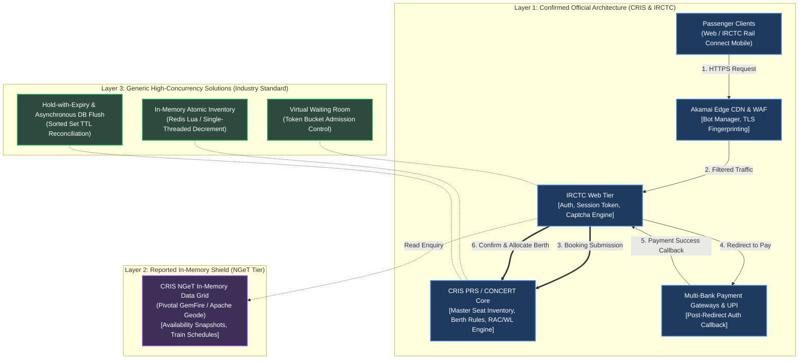

# How Extreme Concurrency Breaks Relational Databases: The Tatkal Inventory Problem

> [!IMPORTANT]
> **Status Update: Architecture, Rules, and System Modernization (October 2026)**  
> Indian Railways, the Centre for Railway Information Systems (CRIS), and IRCTC manage one of the highest-density digital ticketing environments in the world.
> - **Dual Tatkal Windows & Agent Restrictions**: Booking opens daily in two distinct tranches for trains departing the next day: **10:00 AM IST for AC classes** (2A, 3A, 3E, CC, EC) and **11:00 AM IST for Non-AC classes** (Sleeper - SL, Second Sitting - 2S) [4]. Authorized travel agents (B2B) remain strictly locked out during the first 30 minutes of each window (**10:00–10:30 AM** and **11:00–11:30 AM**) to reserve capacity for individual retail passengers [4].
> - **Next-Gen PRS Capacity Expansion**: Under an ongoing ₹182-crore infrastructure overhaul, Indian Railways is scaling its Passenger Reservation System (PRS) from its legacy capacity of **25,000–32,000 tickets per minute** up to a target capacity of **150,000 to 225,000 tickets per minute**, while scaling enquiry handling from 4 lakh to **40 lakh (4,000,000) enquiries per minute** [1, 5].
> - **The Payment Hold Reality**: Contrary to common software assumptions, **IRCTC does not hold or lock seat inventory while a user navigates external payment gateways** [4]. Inventory is officially committed in the CRIS PRS engine only *after* payment authorization succeeds, causing high-concurrency races where tickets slip to Waiting List (WL) or trigger automatic refunds during gateway delays.
> - **Bot & Fraud Defense**: IRCTC utilizes edge bot management (including **Akamai Bot Manager**) combined with mandatory Aadhaar KYC linking, dynamic behavioral challenges, and automated user-ID deactivations to block automated tout tools (e.g., "Real Mango", "Super Tatkal") [1, 3].

> [!NOTE]
> **TL;DR**
> - **The Contention Bottleneck**: In high-demand flash sales, placing relational database row locks (`SELECT ... FOR UPDATE`) on a finite seat counter creates a mathematical throughput ceiling: at 20ms per disk transaction, a single seat row can process at most **50 bookings per second**, causing connection pools to exhaust in milliseconds under thousands of concurrent requests [derived].
> - **CRIS vs. IRCTC Boundary**: IRCTC operates the public e-commerce web and mobile tier; the core **Passenger Reservation System (PRS)** and **CONCERT** master seat inventory live inside backend systems operated by **CRIS** (historically built on OpenVMS clusters with HP Reliable Transaction Router) [2].
> - **In-Memory Caching Shield**: In 2014, CRIS and IRCTC introduced the Next Generation e-Ticketing (NGeT) system, deploying **Pivotal GemFire** (now VMware Tanzu GemFire / Apache Geode) as a distributed in-memory data grid to absorb millions of read inquiries and shield the transactional reservation core [3].
> - **Atomic Inventory Mechanics**: Modern flash-sale architectures resolve inventory contention using single-threaded atomic operations (e.g., Redis Lua script with `DECRBY`) executing in $O(1)$ memory time ($<1\text{ ms}$), completely bypassing the retry storms and CPU thrashing inherent to optimistic Compare-And-Swap (CAS) loops [derived].
> - **Admission Control as Survival**: Because only $S$ seats can be allocated to $N$ users (where $S \ll N$), letting all $N$ requests hit transactional backend services guarantees system failure; admission control at the network edge must reject or queue $>95\%$ of traffic before it touches inventory state [derived].

Flash-reservation systems represent the most brutal workload in distributed systems: hundreds of thousands of users simultaneously compete for a scarce, strictly consistent set of a few hundred items at an exact millisecond boundary. Traditional database architectures assume transactions arrive randomly across a wide primary-key space, but a flash window funnels global concurrency into a single physical row. The natural instinct of software teams is to wrap seat allocation in a standard ACID relational transaction with pessimistic locking, but basic queuing theory proves that doing so guarantees complete connection pool exhaustion and cascading system collapse within milliseconds.

---

## Production Scale and Operational Realities

Managing nationwide passenger rail ticketing across India requires balancing extreme transaction surges against strict, zero-overbooking inventory constraints.

| Metric / Dimension | Production Target / Observed Value | Source / Classification |
| :--- | :--- | :--- |
| **Legacy Ticketing Capacity** | 25,000 – 32,000 tickets / minute | PIB / Ministry of Railways [1] |
| **Modernized PRS Target Capacity** | 150,000 – 225,000 tickets / minute | Ministry of Railways Statement [1, 5] |
| **Legacy Enquiry Capacity** | 400,000 enquiries / minute | Ministry of Railways Statement [1] |
| **Modernized Enquiry Target** | 4,000,000 enquiries / minute | PIB / Ministry of Railways [1, 5] |
| **Daily Online Ticket Volume** | ~1.2 Million to 1.5 Million tickets / day | Lok Sabha Unstarred Q&A [5] |
| **Digital Booking Share** | ~88% – 89% of all reserved tickets | Ministry of Railways [1] |
| **Peak Morning Windows** | 10:00 AM (AC) & 11:00 AM (Non-AC) | IRCTC Reservation Policy [4] |
| **Agent Gating Duration** | First 30 minutes of both Tatkal windows | IRCTC Official Rules [4] |
| **Master Inventory Location** | CRIS CONCERT / PRS Database | CRIS Architecture Disclosures [2] |
| **Front-End Caching Grid** | Pivotal GemFire (NGeT tier) | Industry Disclosures / Case Studies [3] |
| **Edge Bot Management** | Akamai Bot Manager & Cloud WAF | Ministry of Railways Disclosures [1] |

---

## Architectural Separation: Confirmed, Reported, and Generic Designs

To understand the Tatkal engineering problem, one must distinguish between three distinct layers of knowledge:



### Architectural Walkthrough (5 Core Stages):
1. **Edge Protection & Filtering (Confirmed)**: Client requests hit Akamai CDN edge nodes, which evaluate TLS handshakes, HTTP/2 frame properties, and device telemetry to drop volumetric DDoS floods and automated scalping scripts before they touch application servers [1].
2. **Web Front-End & Authentication (Confirmed)**: Legitimate requests pass to IRCTC's web tier for session validation, dynamic captcha evaluation, and passenger profile verification.
3. **In-Memory Inquiry Caching (Reported)**: Read queries for seat availability and train status are largely intercepted by the NGeT in-memory grid (Pivotal GemFire), shielding the core reservation database from millions of read inquiries [3].
4. **The Payment Gateway Detour (Confirmed)**: Unlike e-commerce sites that place a temporary hold on the inventory before checkout, IRCTC routes the user directly to external payment aggregators (cards, net banking, UPI) **without holding a seat in PRS** [4].
5. **Post-Payment Inventory Allocation (Confirmed)**: Once payment is successfully authorized and the webhook callback returns to IRCTC, a transactional request is dispatched to CRIS's backend PRS. If seats are still available, a confirmed berth is allocated and a PNR is issued; if inventory ran out while the user was at the bank, the ticket is placed on the Waiting List (WL) or rejected and queued for an automated refund [4].

---

## Core Mathematics of High-Contention Inventory

Why does high-concurrency booking fail when built on relational databases, and how does atomic memory management resolve the bottleneck?

### 1. Hot-Row Database Locking and Little's Law

Consider a database table storing train seat inventory:
```sql
-- The classic relational anti-pattern under flash concurrency:
BEGIN TRANSACTION;
SELECT seats_available FROM train_inventory 
WHERE train_id = 12951 AND travel_date = '2026-11-01' AND class = '3A' 
FOR UPDATE;

UPDATE train_inventory 
SET seats_available = seats_available - 1 
WHERE train_id = 12951 AND travel_date = '2026-11-01' AND class = '3A';
COMMIT;
```

When an exclusive row lock (`FOR UPDATE`) is acquired, subsequent transactions attempting to book a seat on that specific train must wait in a sequential lock wait-queue.

#### Mathematical Throughput Ceiling
If each database transaction holds the row lock for $t\text{ milliseconds}$ (encompassing disk write-ahead log flush, index updates, and network round-trips), the theoretical maximum booking throughput $T_{\text{max}}$ on that specific train row is strictly bounded:

$$T_{\text{max}} = \frac{1000}{t} \quad \text{bookings / second}$$

* For $t = 50\text{ ms}$ (typical spinning disk or remote cloud block storage):
  $$T_{\text{max}} = \frac{1000}{50} = 20 \text{ bookings / sec}$$
* For $t = 20\text{ ms}$ (standard cloud managed relational instance with SSD):
  $$T_{\text{max}} = \frac{1000}{20} = 50 \text{ bookings / sec}$$
* For $t = 5\text{ ms}$ (highly tuned local NVMe enterprise RDBMS):
  $$T_{\text{max}} = \frac{1000}{5} = 200 \text{ bookings / sec}$$

#### Connection Pool Exhaustion (Little's Law)
Suppose $N = 5{,}000$ concurrent users submit a booking request at exactly 10:00:00 AM for a single popular train. The requests enter the application server's connection pool (e.g., HikariCP configured with $C = 100$ connections).

By **Little's Law**, the average number of active concurrent requests in the database system $L$ is given by:

$$L = \lambda \cdot W$$

where $\lambda$ is the arrival rate and $W$ is the average response time.

If $T_{\text{max}} = 50\text{ bookings/sec}$, processing $N = 5{,}000$ requests sequentially requires:

$$W_{\text{queue}} = \frac{N}{T_{\text{max}}} = \frac{5{,}000}{50} = 100 \text{ seconds}$$

The 100th user in line waits $2\text{ seconds}$, the 1,000th user waits $20\text{ seconds}$, and the 5,000th user waits $100\text{ seconds}$. 

Because application server worker threads block while waiting for a connection from the pool, the connection pool becomes fully exhausted in:

$$t_{\text{exhaust}} = \frac{C}{\lambda} = \frac{100}{5{,}000\text{ req/sec}} = 0.02 \text{ seconds (20 milliseconds)}$$

Every subsequent incoming request across the entire web application—even for completely unrelated trains or read queries—fails immediately with `ConnectionPoolTimeoutException`, triggering cascading application server restarts.

---

### 2. Success Odds and the Necessity of Fast Edge Rejection

Suppose a train rake has $S = 120$ available Tatkal seats in 3-Tier AC, and $N = 30{,}000$ users attempt to book simultaneously within a 3-second window.

The global probability $P(\text{success})$ that an individual user secures a confirmed seat is:

$$P(\text{success}) = \frac{S}{N} = \frac{120}{30{,}000} = 0.004 = 0.4\%$$

The failure probability is:

$$P(\text{failure}) = 1 - P(\text{success}) = 99.6\%$$

#### The Architectural Implication:
Attempting to process all $30{,}000$ requests through heavyweight transactional pipelines wastes compute on an operation where **99.6% of requests must ultimately be rejected**. 

A properly designed flash-sale architecture must **reject or queue requests cheaply at the network edge**, preventing the 99.6% of inevitable losers from consuming scarce backend database CPU and memory resources.

---

### 3. Atomic Memory Operations: CAS Retry Storms vs. Single-Threaded Decrement

To eliminate database row-lock serialization, high-concurrency systems manage active counters in memory.

#### The Problem with Optimistic Locking (Compare-And-Swap / CAS)
In a CAS architecture (e.g., atomic variables in Java or distributed CAS in Memcached/Hazelcast), a thread reads the current value, computes the new value, and attempts an atomic swap:

```python
# CAS Loop Pattern (Under high contention, causes severe CPU thrashing)
def book_seat_cas(train_key, expected_seats):
    while True:
        current_seats = memory_store.get(train_key)
        if current_seats <= 0:
            return False  # Sold out
        
        # Atomic Compare-And-Swap: updates only if value has not changed
        success = memory_store.compare_and_swap(train_key, current_seats, current_seats - 1)
        if success:
            return True   # Seat secured
        # If CAS failed because another thread updated first, loop and retry!
```

#### Derivation of CAS Contention Overhead
If $M$ threads attempt a CAS operation simultaneously on the exact same counter, exactly **1 thread succeeds**, and $M - 1$ threads fail and retry.

In the second iteration, 1 of the remaining $M - 1$ threads succeeds, and $M - 2$ retry. Across all attempts until 1 seat is decremented, the total number of operations $O_{\text{CAS}}$ executed across CPU cores is:

$$O_{\text{CAS}} = \sum_{k=1}^{M} k = \frac{M(M + 1)}{2} \approx \frac{M^2}{2}$$

For $M = 1{,}000$ concurrent threads contending for the counter, the system generates:

$$O_{\text{CAS}} \approx \frac{1{,}000^2}{2} = 500{,}000 \text{ failed memory operations and cache-line invalidations}$$

This creates intense CPU cache-coherency bus traffic (MESI protocol invalidation storms), driving CPU utilization to 100% while accomplishing almost zero useful throughput.

#### The Single-Threaded Atomic Solution (Redis Lua Script)
Instead of optimistic retries across multiple threads, Redis executes commands inside a single-threaded event loop. A single Lua script executes atomically without any concurrency interleaved:

```lua
-- Atomic Decrement-If-Positive (Single-threaded execution in Redis)
-- KEYS[1]: Inventory key (e.g., "inventory:train:12951:3A")
-- ARGV[1]: Requested seat count (e.g., 1)

local available = tonumber(redis.call('GET', KEYS[1]))

if not available then
    return -2  -- Key does not exist / uninitialized
end

if available >= tonumber(ARGV[1]) then
    local remaining = redis.call('DECRBY', KEYS[1], ARGV[1])
    return remaining  -- Success: returns remaining seats (>= 0)
else
    return -1  -- Sold out / Insufficient inventory
end
```

#### Contention Complexity:
Because Redis processes commands sequentially from its multiplexed socket event loop (`epoll`), $M = 1{,}000$ incoming requests are queued in memory and executed one by one. Each script execution requires **one memory lookup and one decrement**:

$$O_{\text{single-threaded}} = M = 1{,}000 \text{ operations}$$

Contention complexity drops from **$O(M^2)$ in CAS to $O(M)$ in single-threaded atomic execution**, executing in $<1\text{ ms}$ total time without a single thread retry or lock collision.

---

### 4. Mathematical Model of Hold-With-Expiry

In e-commerce systems that support reservation holds (e.g., Ticketmaster or airline checkout), holding a seat while a user pays creates an artificial inventory distortion.

Let:
- $\lambda$: Arrival rate of booking requests (requests / second).
- $T_{\text{hold}}$: Payment window timeout (seconds, e.g., $180\text{ s}$).
- $\alpha$: Abandonment rate (fraction of users who do not complete payment, typically $0.30 \le \alpha \le 0.70$ during high traffic).
- $S$: Total initial seat inventory.

The number of seats locked in temporary "Pending Payment" state $S_{\text{held}}(t)$ at steady state is governed by Little's Law:

$$S_{\text{held}} = \lambda \cdot T_{\text{hold}}$$

If $\lambda = 50\text{ req/sec}$ and $T_{\text{hold}} = 180\text{ seconds}$:

$$S_{\text{held}} = 50 \times 180 = 9{,}000 \text{ seats demanded on hold}$$

If total train inventory is only $S = 120$ seats, the entire available inventory is locked within:

$$t_{\text{lockout}} = \frac{S}{\lambda} = \frac{120}{50} = 2.4 \text{ seconds}$$

#### The Ghost Inventory Problem:
If $\alpha = 0.50$ (50% of users abandon at the payment gateway or suffer bank failures), $60$ of the $120$ held seats will fail payment and eventually expire.

However, during the entire $180\text{-second}$ window:
1. Genuine buyers arriving at $t = 10\text{ seconds}$ are told: *"Seats Sold Out / Regret"*.
2. At $t = 180\text{ seconds}$, 60 seats abruptly reappear back in inventory.
3. Users who were turned away 2 minutes earlier have already closed their browsers.

> [!IMPORTANT]
> **Why IRCTC Avoids Hold-with-Expiry**:  
> This mathematical reality explains why **IRCTC/CRIS chose post-payment allocation** rather than pre-payment locking. With millions of users competing for thousands of trains across India, holding seats for 3–5 minutes during high bank-gateway failure rates would cause entire train rakes to sit frozen in temporary limbo while genuine passengers are rejected.

---

### 5. Admission Control: Token Bucket Rate Limiting

To guarantee that the backend inventory engine never exceeds its maximum safe processing capacity $C_{\text{safe}}$ (e.g., $5{,}000\text{ requests/sec}$), an admission control filter must be placed at the gateway layer.

```
Incoming Request Storm (λ = 50,000 req/sec)
                  │
                  ▼
       ┌─────────────────────┐
       │   Token Bucket      │ <─── Token Refill Rate (r = 5,000 tokens/sec)
       │ (Capacity B = 5,000)│
       └─────────────────────┘
         │                 │
         │ (Token Granted) │ (Token Denied / Bucket Empty)
         ▼                 ▼
  Admitted to Booking    Instant Rejection / "Try Again"
  (5,000 req/sec)        (45,000 req/sec dropped at edge in < 1ms)
```

The token bucket operates with two parameters:
- **Bucket Capacity ($B$)**: Maximum burst size allowed ($B = 5{,}000$ tokens).
- **Refill Rate ($r$)**: Sustained processing throughput ($r = 5{,}000$ tokens/second).

When an admission request arrives:
1. If $\text{tokens} \ge 1$: The token is consumed, and the user is forwarded to the reservation pipeline.
2. If $\text{tokens} < 1$: The request is **immediately dropped or presented with a static queue page** at the edge, returning an HTTP 429 or static JSON regret payload without consuming database connections or application memory.

---

## Production Post-Mortems: Real-World Failures and Abuse

Rather than hypothetical bugs, the Tatkal system’s operational history is defined by documented public incidents, forensic investigations, and regulatory enforcement.

### Post-Mortem 1: The "Real Mango" & Chrome Automation Bot Infiltration
* **The Incident**: In 2020–2022, the Railway Protection Force (RPF) and cyber crime units conducted nationwide raids uncovering illegal software suites—most notably **"Real Mango"**, **"Red Mirchi"**, and **"Super Tatkal"**—operating across illicit tout syndicates [1, 3].
* **The Mechanism**:
  1. *Form Pre-filling & DOM Tampering*: The software used browser extensions (Puppeteer/Chrome DevTools Protocol) to pre-inject passenger names, age, and travel details directly into the DOM in $<5\text{ ms}$ upon page load, bypassing human typing latencies.
  2. *Captcha Auto-Solving*: The bots integrated third-party OCR and automated audio/visual captcha bypass APIs to solve authentication challenges in $<200\text{ ms}$.
  3. *Coordinated Payment Sync*: The software pre-authenticated digital wallets or bank debit credentials, using mobile SMS scrapers to automatically extract and populate Two-Factor Authentication (OTP) codes without manual user interaction.
* **The Impact**: Illicit syndicates bought out hundreds of high-demand Tatkal quotas across major trunk routes (e.g., Delhi–Mumbai, Howrah–Delhi) within **sub-15 seconds** of the 10:00 AM opening, completely shutting out ordinary citizens relying on normal browser interfaces [1, 3].
* **The Architectural Remediation**:
  - *Dynamic Form Scrambling*: Input field IDs and form parameters are dynamically generated and cryptographically obfuscated on every render, preventing static script injection.
  - *Time-Gated Submission Policies*: The platform enforces server-side minimum time floors. A booking submission completed in $<25\text{ seconds}$ from window opening is flagged or rejected, ensuring script execution speed cannot bypass the physical limits of human interaction.
  - *Aadhaar-Linked Verification*: Expanding monthly booking allowances requires Aadhaar KYC verification, with mandatory OTP verification enforced during peak Tatkal quotas to dismantle bot farming networks [1].
  - *Edge Bot Detection*: Integration of **Akamai Bot Manager** to analyze client TLS fingerprints, HTTP header ordering, canvas rendering behavior, and mouse-movement jitter at the edge [1].

---

### Post-Mortem 2: The 10:00:00 AM Payment-Gateway Timeout Cascades
* **The Incident**: During festival booking periods (Diwali, Chhath Puja), thousands of retail passengers regularly experience the "Deducted Money, No Ticket" phenomenon [4].
* **The Mechanism (Post-Payment Race Condition)**:
  1. At 10:00:01 AM, a passenger views 15 available Tatkal berths on train 12301 and clicks *"Proceed to Pay"*.
  2. Because IRCTC does **not hold seats during payment**, the user is redirected to an external bank payment gateway.
  3. The bank's 3D-Secure OTP verification and network redirects take $45\text{ seconds}$.
  4. While the user is entering their OTP, 50 other passengers complete payment through faster UPI channels (which process in 3–5 seconds).
  5. By the time the bank's successful payment webhook arrives back at IRCTC at 10:00:48 AM, CRIS PRS inventory for train 12301 is $0$.
* **System Result**: The user's bank account is debited ₹3,500, but CRIS PRS cannot issue a confirmed ticket. The transaction either:
  - Generates a ticket on the **Waiting List (WL)**, or
  - Rejects the booking (if the user checked *"Book only if confirm berths are allotted"*), requiring an automated reconciliation batch job to initiate a multi-day refund process.
* **The Modern Engineering Mitigation**:
  - *IRCTC iPay AutoPay (Pre-Authorized Lien)*: IRCTC introduced UPI AutoPay and bank liens. Instead of debiting money immediately, the gateway places an authorized hold (lien) on the passenger's funds. If CRIS PRS successfully issues a confirmed seat, the lien is executed; if the seats sold out while the user was in the gateway, **the lien is released instantly**, eliminating the multi-day refund cycle and user distress [4].

---

## Architectural Trade-Off Matrix

Every architectural choice in high-concurrency inventory allocation requires explicit engineering compromises:

| Strategy | Trade-Off Made | What Was Gained | What Was Sacrificed |
| :--- | :--- | :--- | :--- |
| **Post-Payment Allocation (IRCTC Model)** | Inventory is allocated only after payment authorization succeeds. | Zero inventory locking waste; trains never sit frozen by abandoned checkout carts. | User frustration: passengers can pay successfully but receive a waitlisted ticket or refund. |
| **Pre-Payment Hold-with-Expiry (E-Commerce Model)** | Inventory is decremented for 180–300s during checkout. | Guaranteed seat if user pays before timeout; deterministic checkout UX. | Ghost inventory: up to 50% of stock is artificially blocked by failed payments and abandoned carts. |
| **Single-Threaded Atomic Decrement (Redis Lua)** | All counter mutations execute sequentially in memory. | $O(1)$ memory execution; complete elimination of database locks and CAS retry storms. | In-memory persistence vulnerability: requires append-only logs (AOF) or master-replica failover. |
| **Edge Admission Filtering (Token Bucket)** | Hard limit on requests permitted past the CDN/WAF. | Protects database and web tier from connection exhaustion and crash. | Immediate failure for 95%+ of users who receive rate-limit or queue screens without trying. |

---

## When NOT to Copy This Architecture

Engineers frequently over-engineer inventory systems by applying flash-sale patterns where standard database transactions are superior:

```
                            [Peak Concurrency on a Single Item?]
                                             │
                       ┌─────────────────────┴─────────────────────┐
                       ▼                                           ▼
                 < 10 req / sec                              > 500 req / sec
                       │                                           │
         ┌─────────────┴─────────────┐                             │
         ▼                           ▼                             ▼
[Relational Database ACID]  [Simple Read Replica]       [Strict Inventory Scarcity?]
Use PostgreSQL / MySQL      Use Read-Replica Cache                 │
BEGIN TRANSACTION ...       PostgreSQL with Redis Read       ┌─────┴─────┐
FOR UPDATE                  (Standard E-Commerce)            ▼           ▼
                                                            No          Yes
                                                             │           │
                                                             ▼           ▼
                                                       Eventual    In-Memory Atomic
                                                       Consist.    (Redis Lua / PRS)
                                                       (Oversell   + Edge Admission
                                                       Allowed)    (Flash Architecture)
```

### 1. Applications with Low Contention ($< 10\text{ req/sec}$ per item)
If your application sells products where transactions are spread across thousands of distinct SKUs (e.g., standard retail e-commerce), relational row locks (`SELECT ... FOR UPDATE`) are entirely adequate. Adding Redis Lua scripts, token buckets, and distributed reconciliation layers introduces massive operational complexity with zero user benefit.

### 2. Systems Where Eventual Consistency and Back-Orders Are Acceptable
In cloud SaaS seat licensing or warehouse retail, if two users purchase the last item simultaneously, the business can simply back-order the item or offer a secondary fulfillment path. Extreme-concurrency atomic locking is only required when **physical overbooking is legally or operationally impermissible** (e.g., physical passenger seats on a departing train).

### 3. Teams Without Operational Mastery of In-Memory Durability
Managing inventory in an in-memory data grid (Redis, Tanzu GemFire) requires rigorous operational disciplines: configuring Redis `appendfsync always` or `everysec`, operating Sentinel/Cluster replication, and managing split-brain network partition handling. If an in-memory node crashes without proper write-ahead logging or replication, inventory state is permanently lost.

---

## Frequently Asked Questions

### Why doesn't IRCTC hold seats for 3 minutes while users pay?
Holding seats during checkout works well for concerts or cinema ticketing where traffic is moderate, but it breaks down under Tatkal concurrency. If 50,000 users compete for 120 seats, locking seats for 3 minutes during typical 30–50% bank gateway dropouts would cause the entire train's inventory to sit frozen. Genuine passengers arriving seconds later would see zero availability, while dozens of expired seats would randomly reappear minutes later [derived].

### What is the exact difference between CRIS and IRCTC?
**IRCTC** (Indian Railway Catering and Tourism Corporation) is a public-sector enterprise that handles front-end commercial operations: consumer web/app portals, catering, tourism, and payment processing [1]. **CRIS** (Centre for Railway Information Systems) is the technical organization under the Ministry of Railways that designs, builds, and runs the core railway IT systems, including the master **Passenger Reservation System (PRS)** and CONCERT database where seat inventory actually lives [2].

### Did IRCTC use Hazelcast for its inventory?
No public source confirms Hazelcast in IRCTC’s architecture. When CRIS overhauled the e-ticketing tier with the Next Generation e-Ticketing (NGeT) platform in 2014, published case studies and technical disclosures documented the use of **Pivotal GemFire** (now VMware Tanzu GemFire / Apache Geode) as the distributed in-memory data grid [3].

### What was the legacy hardware behind CRIS CONCERT?
For decades, the core Indian Railways CONCERT reservation engine ran on enterprise **HP OpenVMS** clusters deployed across five regional hubs (Delhi, Mumbai, Kolkata, Chennai, Secunderabad) using HP Alpha and later Itanium servers, coordinated by **HP Reliable Transaction Router (RTR)** with application logic written in C and Fortran [2]. Recent modernizations have transitioned these legacy architectures toward modern cloud-native, microservice-based transaction engines [1, 5].

### How does atomic decrement in Redis prevent double-booking?
Redis processes commands inside a single-threaded execution loop. When an inventory decrement is executed via an atomic Lua script (`redis.call('DECRBY', key, count)`), no other command can execute or interleave between the check and the decrement. If the counter reaches zero, all subsequent calls instantly receive a sold-out flag in memory in $<1\text{ ms}$, preventing double-allocation without database locks [derived].

---

## References

1. Press Information Bureau (PIB), Ministry of Railways, Government of India. (2022–2025). "Technological Upgradation and Ticketing Capacity Overhaul of Passenger Reservation System (PRS)." *Official Press Releases & Rail Modernization Briefs*. Available at: https://pib.gov.in
2. Centre for Railway Information Systems (CRIS). (2018–2024). "CONCERT: Country-wide Network for Computerized Enhanced Reservation and Ticketing — Architecture and System Overview." *CRIS Technical Disclosures*. Available at: https://cris.org.in
3. Forbes & Pivotal Software Case Study. (2014). "Modernizing Indian Railways: How In-Memory Data Grids Power Next-Generation E-Ticketing (NGeT)." *Forbes Tech Disclosures & VMware Tanzu Archives*.
4. Indian Railway Catering and Tourism Corporation (IRCTC). (2024–2026). "Tatkal Scheme Rules, Timings, and Electronic Payment Policy." *Official IRCTC Booking Terms & Conditions*. Available at: https://irctc.co.in
5. Lok Sabha Secretariat, Parliament of India. (2023–2024). "Starred/Unstarred Questions on Ticketing Capacity, Concurrency, and PRS Server Overhaul." *Parliamentary Digital Archives*.
6. Redis Ltd. (2024–2026). "Redis Programmability, Lua Scripts, and Keyspace Notifications Timing Limitations." *Official Redis Documentation*. Available at: https://redis.io/docs/

---

Authored by @saurabh-vision
```
                            [Peak Concurrency on a Single Item?]
                                             │
                       ┌─────────────────────┴─────────────────────┐
                       ▼                                           ▼
                 < 10 req / sec                              > 500 req / sec
                       │                                           │
         ┌─────────────┴─────────────┐                             │
         ▼                           ▼                             ▼
[Relational Database ACID]  [Simple Read Replica]       [Strict Inventory Scarcity?]
Use PostgreSQL / MySQL      Use Read-Replica Cache                 │
BEGIN TRANSACTION ...       PostgreSQL with Redis Read       ┌─────┴─────┐
FOR UPDATE                  (Standard E-Commerce)            ▼           ▼
                                                            No          Yes
                                                             │           │
                                                             ▼           ▼
                                                       Eventual    In-Memory Atomic
                                                       Consist.    (Redis Lua / PRS)
                                                       (Oversell   + Edge Admission
                                                       Allowed)    (Flash Architecture)
```

### 1. Applications with Low Contention ($< 10\text{ req/sec}$ per item)
If your application sells products where transactions are spread across thousands of distinct SKUs (e.g., standard retail e-commerce), relational row locks (`SELECT ... FOR UPDATE`) are entirely adequate. Adding Redis Lua scripts, token buckets, and distributed reconciliation layers introduces massive operational complexity with zero user benefit.

### 2. Systems Where Eventual Consistency and Back-Orders Are Acceptable
In cloud SaaS seat licensing or warehouse retail, if two users purchase the last item simultaneously, the business can simply back-order the item or offer a secondary fulfillment path. Extreme-concurrency atomic locking is only required when **physical overbooking is legally or operationally impermissible** (e.g., physical passenger seats on a departing train).

### 3. Teams Without Operational Mastery of In-Memory Durability
Managing inventory in an in-memory data grid (Redis, Tanzu GemFire) requires rigorous operational disciplines: configuring Redis `appendfsync always` or `everysec`, operating Sentinel/Cluster replication, and managing split-brain network partition handling. If an in-memory node crashes without proper write-ahead logging or replication, inventory state is permanently lost.

---

## Frequently Asked Questions

### Why doesn't IRCTC hold seats for 3 minutes while users pay?
Holding seats during checkout works well for concerts or cinema ticketing where traffic is moderate, but it breaks down under Tatkal concurrency. If 50,000 users compete for 120 seats, locking seats for 3 minutes during typical 30–50% bank gateway dropouts would cause the entire train's inventory to sit frozen. Genuine passengers arriving seconds later would see zero availability, while dozens of expired seats would randomly reappear minutes later [derived].

### What is the exact difference between CRIS and IRCTC?
**IRCTC** (Indian Railway Catering and Tourism Corporation) is a public-sector enterprise that handles front-end commercial operations: consumer web/app portals, catering, tourism, and payment processing [1]. **CRIS** (Centre for Railway Information Systems) is the technical organization under the Ministry of Railways that designs, builds, and runs the core railway IT systems, including the master **Passenger Reservation System (PRS)** and CONCERT database where seat inventory actually lives [2].

### Did IRCTC use Hazelcast for its inventory?
No public source confirms Hazelcast in IRCTC’s architecture. When CRIS overhauled the e-ticketing tier with the Next Generation e-Ticketing (NGeT) platform in 2014, published case studies and technical disclosures documented the use of **Pivotal GemFire** (now VMware Tanzu GemFire / Apache Geode) as the distributed in-memory data grid [3].

### What was the legacy hardware behind CRIS CONCERT?
For decades, the core Indian Railways CONCERT reservation engine ran on enterprise **HP OpenVMS** clusters deployed across five regional hubs (Delhi, Mumbai, Kolkata, Chennai, Secunderabad) using HP Alpha and later Itanium servers, coordinated by **HP Reliable Transaction Router (RTR)** with application logic written in C and Fortran [2]. Recent modernizations have transitioned these legacy architectures toward modern cloud-native, microservice-based transaction engines [1, 5].

### How does atomic decrement in Redis prevent double-booking?
Redis processes commands inside a single-threaded execution loop. When an inventory decrement is executed via an atomic Lua script (`redis.call('DECRBY', key, count)`), no other command can execute or interleave between the check and the decrement. If the counter reaches zero, all subsequent calls instantly receive a sold-out flag in memory in $<1\text{ ms}$, preventing double-allocation without database locks [derived].

---

## References

1. Press Information Bureau (PIB), Ministry of Railways, Government of India. (2022–2025). "Technological Upgradation and Ticketing Capacity Overhaul of Passenger Reservation System (PRS)." *Official Press Releases & Rail Modernization Briefs*. Available at: https://pib.gov.in
2. Centre for Railway Information Systems (CRIS). (2018–2024). "CONCERT: Country-wide Network for Computerized Enhanced Reservation and Ticketing — Architecture and System Overview." *CRIS Technical Disclosures*. Available at: https://cris.org.in
3. Forbes & Pivotal Software Case Study. (2014). "Modernizing Indian Railways: How In-Memory Data Grids Power Next-Generation E-Ticketing (NGeT)." *Forbes Tech Disclosures & VMware Tanzu Archives*.
4. Indian Railway Catering and Tourism Corporation (IRCTC). (2024–2026). "Tatkal Scheme Rules, Timings, and Electronic Payment Policy." *Official IRCTC Booking Terms & Conditions*. Available at: https://irctc.co.in
5. Lok Sabha Secretariat, Parliament of India. (2023–2024). "Starred/Unstarred Questions on Ticketing Capacity, Concurrency, and PRS Server Overhaul." *Parliamentary Digital Archives*.
6. Redis Ltd. (2024–2026). "Redis Programmability, Lua Scripts, and Keyspace Notifications Timing Limitations." *Official Redis Documentation*. Available at: https://redis.io/docs/

---

Authored by @saurabh-vision
