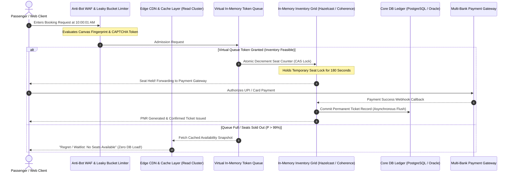

# Case Study 09: IRCTC Tatkal — Extreme Concurrency & In-Memory Lock Grids

> **Architectural Classification**: High-Contention Inventory Allocation & Virtual Queuing Under Extreme Bursts  
> **Source Material**: Centre for Railway Information Systems (CRIS) Technical Disclosures, High-Concurrency RDBMS Whitepapers  
> **Peak Concurrency SLA**: Handle **1+ Billion hits/minute** and allocate **28,000+ tickets/minute** in 10-minute flash windows  

---

## 1. Concrete System Metrics & Operational Constraints

```
┌─────────────────────────────────┬─────────────────────────────────┬─────────────────────────────────┐
│        BURST TRAFFIC SCALE      │       INVENTORY LOCK CONTENTION │       TRANSACTION TIME SLIDE    │
├─────────────────────────────────┼─────────────────────────────────┼─────────────────────────────────┤
│ • Peak Hit Rate: > 1B hits/min  │ • Available Seats / Train: ~120 │ • 10:00 AM IST: AC Class Tatkal │
│ • Bookings / Min: > 28,000      │ • Competing Users / Train: > 50k│ • 11:00 AM IST: Sleeper Tatkal  │
│ • Read-to-Write Ratio: 500 : 1  │ • Lock Window Timeout: 180s Max │ • Database Engine: In-Memory Grid│
└─────────────────────────────────┴─────────────────────────────────┴─────────────────────────────────┘
```

---

## 2. End-to-End Reservation Pipeline



---

## 3. Core Architectural Mechanisms

### A. The Pessimistic Locking Trap: Why Traditional RDBMS Crashes at 10:00 AM
In traditional web applications, booking a seat uses a database transaction:
```sql
-- The naive approach that melts servers at 10:00 AM:
BEGIN TRANSACTION;
SELECT seats_available FROM train_inventory WHERE train_id = 12951 FOR UPDATE;
UPDATE train_inventory SET seats_available = seats_available - 1 WHERE train_id = 12951;
COMMIT;
```
#### Why this fails catastrophically under Tatkal conditions:
1. For popular trains (e.g. Mumbai Rajdhani), **over 50,000 concurrent users** click *"Book"* at 10:00:01 AM for only **120 available seats**.
2. A pessimistic `FOR UPDATE` row lock forces 49,999 requests to queue behind a single database row lock.
3. Database connection pools (e.g., HikariCP) exhaust within 400ms, triggering cascading timeouts across all web app servers.

---

### B. The Architectural Remedy: In-Memory Data Grid (IMDG) & Compare-And-Swap (CAS)
IRCTC migrated seat allocation out of the relational database entirely into an **In-Memory Data Grid** (IMDG):
- Entire train inventory sits inside a distributed RAM cluster (Hazelcast / Oracle In-Memory).
- Allocation uses lock-free **Atomic Compare-And-Swap (CAS)** operations:
  $$\text{atomic\_cas}(\&seats, \text{expected\_val}, \text{expected\_val} - 1)$$
- Execution happens at **memory bus speed (< 50 microseconds)** without acquiring single disk I/O lock!
- Only after payment is acknowledged does a background worker flush the persistent PNR record to relational storage.

---

### C. CQRS: Read/Write Traffic Segregation
During Tatkal hours, **99.8% of user interactions are read requests** (*"Check train seat availability"*). Only 0.2% are actual booking transactions.
- **Query Path**: Read queries are routed exclusively to read-replica caches refreshed with a 10-second eventual consistency buffer.
- **Command Path**: The booking pipeline is isolated on dedicated worker pools. A user checking train status cannot starve connection pools from a user paying for a ticket.

---

### D. The 180-Second Payment Hold State Machine
When a seat is temporarily held:
1. The inventory grid decrements the seat count and issues a cryptographic reservation token with a **strict 180-second TTL**.
2. If payment confirmation webhook is received within 180s: State transitions to `CONFIRMED`.
3. If the user abandons payment or the bank fails: The TTL expires, the grid increments the seat counter atomically, and the seat is immediately offered to the next user in the virtual queue without manual intervention.

---

## 4. Edge-Case Post-Mortem: The "Tatkal Automation Extension Bot" Attack

### The Incident:
High-speed ticket scalpers used automated browser extensions (using Puppeteer/Selenium) to pre-fill passenger forms and execute payment flows in **sub-2 seconds**, buying out entire train coaches before legitimate human users could even load the CAPTCHA.

### Root Cause Analysis (RCA):
Forms were submitted via predictable HTTP POST requests. Because client-side form validations occurred before server submission, automated scripts could bypass form field focus events, keystroke delays, and DOM render delays.

### The Architectural Remediation:
1. **Dynamic Form Token Scrambling**: Form input IDs are cryptographically randomized on every page load (e.g., `passenger_name` becomes `_enc_field_98a7f1`).
2. **Behavioral Keystroke Dynamics**: The frontend tracks inter-keystroke timing intervals. If a 15-character name is filled in $< 5\text{ms}$ (instant clipboard paste / script injection), the request is flagged for secondary biometric / OTP challenge.
3. **Delayed Open Gate**: The "Pay" button is hardware-locked on the server side and will not accept submissions before $t = 10:00:35\text{s}$, giving human typing speeds equal access.

---

## 5. Architectural Trade-Off Matrix

| Strategy | IRCTC Tatkal Approach | Standard E-Commerce Approach | Why It Matters |
| :--- | :--- | :--- | :--- |
| **Inventory State** | In-Memory Distributed Grid (RAM) | Relational Database Row Locks (Disk) | Eliminates database row contention for 50k+ users competing for 120 seats. |
| **Read Consistency** | 10s Eventual Consistency on Reads | Strict Read-After-Write Consistency | Prevents 1 Billion availability queries from crashing the transactional database. |
| **Lock Expiration** | Atomic TTL with Dead-Letter Reclaim | Manual Database Cron Job Cleanup | Guarantees abandoned seats return to inventory in exactly 180 seconds. |

---

*Authored by [@saurabh-vision](https://github.com/saurabh-vision) • Next Up: [Scale Classic 03: Zerodha Kite — Sub-Millisecond Trading at 9:15 AM](#)*
