# How India's UPI Switch Orchestrates Real-Time Payments Without Distributed Locks

> [!IMPORTANT]
> **Status Update: Architecture, Scale, and Regulatory Controls**  
> The Unified Payments Interface (UPI), developed and operated by the National Payments Corporation of India (NPCI), is the world’s largest real-time retail payment network.
> - **Scale & Network Reach**: In **October 2024**, UPI processed **16,580 Million (16.58 Billion) transactions** in a single month with a gross value of **₹23.50 Lakh Crore (~$280B USD)** across **600+ live member banks** [1]. Daily transaction volumes regularly average **~535 Million transactions** [1].
> - **UPI Lite & UPI Lite X Expansion**: Under Reserve Bank of India (RBI) circular *RBI/2024-25/93*, the per-transaction limit for on-device **UPI Lite was increased to ₹1,000**, with the maximum wallet balance cap raised to **₹5,000** [3]. **UPI Lite X** operates over **Near Field Communication (NFC)**, enabling completely offline, contactless tap-and-pay transactions that settle asynchronously with bank ledgers [4].
> - **The April 12, 2025 Outage & API Hit Limits**: Following a major 5-hour nationwide degradation on April 12, 2025, NPCI determined that the disruption was not caused by switch core failure, but by a massive retry storm: Payment Service Provider (PSP) banks flooded NPCI with rapid loops of the **"Check Transaction Status" API** [5]. NPCI mandated strict rate controls: a mandatory **90-second minimum delay** before the first status poll, 45–60s retry intervals, and a hard ceiling of **three status checks per transaction** [5].
> - **Statutory Turnaround Time (TAT)**: Under RBI's harmonized TAT framework, any failed debit must be reversed within **$T + 1\text{ day}$** (where $T$ is the transaction date). Banks that fail to reverse funds within $T + 1$ are legally mandated to pay **₹100 per day in compensation** directly to the customer [3].

> [!NOTE]
> **TL;DR**
> - **The Distributed Commit Problem**: Moving money in real time across 600+ autonomous banking institutions cannot use Two-Phase Commit (2PC). If the switch held pessimistic locks across independent Core Banking Systems (CBS), a 2-second timeout at one major issuer bank would block connections nationwide and trigger systemic cascading failure [derived].
> - **Decoupled Orchestrated Saga**: UPI models payment as two separate sequential hops: a **Debit Leg** against the Remitter Bank, followed by a **Credit Leg** against the Beneficiary Bank. If the Credit Leg fails or times out, the system does not hold locks; it transitions into a **Deemed Approved** or **Pending** state and triggers an automated compensating reversal [2].
> - **Idempotency Architecture**: Duplicate requests from flaky cellular networks are intercepted using a **35-character alphanumeric `txnId`** generated at the Payer PSP layer, while settlement and chargebacks are anchored by a **12-digit numeric Retrieval Reference Number (RRN)** generated downstream [2]. 
> - **Throughput Math**: Handling 16.58 Billion transactions/month equates to an average throughput of **$\approx 6{,}190\text{ TPS}$** (or $\approx 6{,}396\text{ TPS}$ on a 30-day baseline), with peak diurnal bursts reaching **$\approx 18{,}570\text{ to }19{,}188\text{ TPS}$** across the national switch. Large public sector banks (e.g., SBI handling ~25% market share) must process peak debit throughputs exceeding **$\approx 4{,}642\text{ to }4{,}797\text{ TPS}$** on their internal account databases [derived].
> - **The "Bloom Filter" Myth**: A payment switch cannot rely on a Bloom filter as a standalone duplicate detector. At an $0.8\%$ false-positive rate, a Bloom filter on 535 million daily transactions would falsely reject **4.28 million valid payments per day**; idempotency requires deterministic primary-key index verification [derived].

Distributed systems textbooks teach that transferring money between two accounts requires a distributed ACID transaction to guarantee that money deducted from Account A is atomically credited to Account B. In real-world retail banking across 600+ sovereign financial institutions, executing a Two-Phase Commit across wide-area networks is mathematically impossible: network latency variance, heterogeneous core banking databases (Finacle, TCS BaNCS, Flexcube), and unexpected outages would freeze customer account rows nationwide. Instead, India’s UPI network executes hundreds of millions of daily payments without holding a single distributed lock, relying on an orchestrated saga pattern, deterministic idempotency keys, and multi-tier asynchronous reconciliation.

---

## Production Scale and Network Dimensions

Coordinating real-time retail payments across the Indian banking ecosystem imposes strict transactional and regulatory boundaries.

| Metric / Dimension | Production Target / Observed Value | Source / Evidence |
| :--- | :--- | :--- |
| **Monthly Transaction Volume** | 16,580 Million (16.58 Billion) | Confirmed (NPCI Official Statistics, Oct 2024) [1] |
| **Monthly Transaction Value** | ₹23,50,000 Crore (~$280B USD) | Confirmed (NPCI Official Statistics, Oct 2024) [1] |
| **Live Network Banks** | 600+ member banks | Confirmed (NPCI Product Data, 2024) [1] |
| **Average Daily Volume** | ~535 Million transactions | Derived from NPCI Monthly Volume ($16.58\text{B} / 31$) [1, derived] |
| **Average Transaction Throughput** | $\approx 6{,}190\text{ to }6{,}396\text{ TPS}$ | Derived ($16.58\text{B} / 2{,}678{,}400\text{s}$ or $2{,}592{,}000\text{s}$) [derived] |
| **Estimated Peak Throughput** | $\approx 18{,}570\text{ to }19{,}188\text{ TPS}$ (3.0x peak factor) | Derived from peak diurnal patterns [derived] |
| **End-to-End Client Timeout** | 30 seconds maximum | UPI Technical Specifications [2] |
| **UPI Lite Transaction Limit** | ₹1,000 per transaction | RBI Circular RBI/2024-25/93 [3] |
| **UPI Lite Wallet Ceiling** | ₹5,000 balance | RBI Circular RBI/2024-25/93 [3] |
| **Failed Transaction Auto-Reversal** | $T + 1\text{ day}$ (Turnaround Time - TAT) | RBI Harmonisation Framework [3] |
| **Customer Compensation Penalty** | ₹100 per day of delay beyond $T+1$ | RBI Statutory Directive [3] |
| **Central Switch Messaging Backbone** | Apache Kafka & In-Memory Routing Grids | NPCI Enterprise Architecture Disclosures [6] |

---

## Architectural Separation: Confirmed, Reported, and Generic Designs

To understand the UPI transaction lifecycle, we must explicitly categorize the architecture into three tiers:

```mermaid
sequenceDiagram
    autonumber
    actor Payer as Payer Client (App)
    participant PSP as Payer PSP Gateway [Confirmed]
    participant Switch as NPCI Central Switch [Confirmed]
    participant Remit as Remitter Bank CBS (Debit) [Confirmed]
    participant Ben as Beneficiary Bank CBS (Credit) [Confirmed]
    participant Store as Switch Routing State (In-Memory / Kafka) [Reported]
    participant Rec as Settlement & UDIR Batch (NTSL) [Generic Pattern]

    rect rgb(25, 45, 65)
        Note over Payer,Ben: Happy Path: Successful End-to-End Payment (< 3 Seconds)
        Payer->>PSP: 1. Authorize Payment (VPA, Amount, Encrypted MPIN via Common Library)
        PSP->>Switch: 2. ReqPay (txnId: 35 chars, refId, Payer VPA, Payee VPA, CredData)
        Switch->>Store: 3. Log In-Flight Txn State (Kafka / In-Memory Grid)
        Switch->>Remit: 4. ReqDebit (Validate MPIN in HSM, Lock Account, Deduct Balance)
        Remit-->>Switch: 5. RespDebit (00 - Success, Generates 12-digit RRN)
        Switch->>Ben: 6. ReqCredit (Credit Payee Account with RRN)
        Ben-->>Switch: 7. RespCredit (00 - Success)
        Switch->>Store: 8. Update State to COMPLETED
        Switch-->>PSP: 9. RespPay (00 - Success, RRN)
        PSP-->>Payer: 10. Instant Payment Confirmation
    end

    rect rgb(65, 30, 35)
        Note over Switch,Rec: Unhappy Path: Beneficiary Timeout -> Deemed Approval -> Auto-Reversal
        Switch->>Ben: 11. ReqCredit (Credit Payee Account)
        Note over Ben: Network Partition / CBS Hang (> 15s Timeout)
        Ben--xSwitch: 12. Socket Timeout / No Response
        Note over Switch: Enters DEEMED_APPROVED / PENDING State
        Switch->>Remit: 13. ReqReversal (Trigger Online Reversal / Refund)
        alt Remitter CBS Reversal Acknowledged
            Remit-->>Switch: 14. RespReversal (00 - Balance Restored)
            Switch-->>PSP: 15. RespPay (U69 - Payment Failed, Refunded)
        else Remitter Reversal Fails / Times Out
            Switch->>Rec: 16. Queue into End-of-Day Raw Reconciliation (NTSL)
            Note over Rec: UDIR auto-settles refund within RBI T+1 TAT Window
        end
    end
```



### Architectural Walkthrough (5 Core Stages):
1. **Credential Capture & Intent Packaging (Confirmed)**: The payer enters their UPI PIN inside their mobile app. The PIN is never touched by the consumer app (PhonePe, Google Pay); it is captured and encrypted by NPCI's **Common Library (CL)** SDK directly on the mobile OS using the Remitter Bank's Hardware Security Module (HSM) public key. The Payer PSP generates a unique **35-character alphanumeric `txnId`** and dispatches `ReqPay` to the NPCI switch [2].
2. **Address Resolution & Routing (Confirmed)**: If the payee is identified by a Virtual Payment Address (VPA, e.g., `merchant@upi`), the NPCI switch resolves the VPA against its central mapper cache to extract the Beneficiary Bank's IFSC and account number.
3. **The Debit Leg (Confirmed)**: The switch forwards `ReqDebit` to the Remitter Bank. The Remitter Bank routes the payload to its internal HSM to decrypt and verify the PIN, validates available funds, executes an ACID deduction against the user's account in its Core Banking System (CBS), generates a **12-digit numeric Retrieval Reference Number (RRN)**, and returns `RespDebit` (00 - Success) to NPCI [2].
4. **The Credit Leg (Confirmed)**: Upon receiving `RespDebit`, the switch issues `ReqCredit` containing the RRN to the Beneficiary Bank. The Beneficiary Bank credits the payee’s account and returns `RespCredit` (00 - Success) [2].
5. **Handling Timeouts & Deemed Approval (Confirmed)**: If the Beneficiary Bank times out ($>15\text{ seconds}$), the switch cannot know if the credit was committed. The transaction enters a **Pending / Deemed Approved** state. The switch automatically fires an online reversal (`ReqReversal`) back to the Remitter Bank. If online reversal fails, the mismatch is trapped in the end-of-day clearing batch files (NTSL) and resolved via UDIR within RBI's mandated $T+1$ window [2, 3].

---

## Core Mathematics of Real-Time Payment Switches

### 1. Throughput Derivation: Average to Peak Concurrency

Let the total monthly volume processed by the switch be $V$. In October 2024:
$$V = 16{,}580{,}000{,}000 \text{ transactions (16.58 Billion)}$$

Across October's 31 days, the total operating seconds $T_{\text{month}}$ is:
$$T_{\text{month}} = 31 \times 24 \times 3600 = 2{,}678{,}400 \text{ seconds}$$
*(On a standardized 30-day baseline: $T_{30} = 2{,}592{,}000\text{ seconds}$).*

The average national throughput $\text{TPS}_{\text{avg}}$ is:
$$\text{TPS}_{\text{avg, 31d}} = \frac{16{,}580{,}000{,}000}{2{,}678{,}400} \approx 6{,}190 \text{ TPS (derived)}$$
$$\text{TPS}_{\text{avg, 30d}} = \frac{16{,}580{,}000{,}000}{2{,}592{,}000} \approx 6{,}396 \text{ TPS (derived)}$$

#### Diurnal Peak-to-Average Ratio
Payment transactions follow human behavioral patterns: traffic is near zero between 2:00 AM and 5:00 AM and spikes intensely during lunch hours (12:00 PM – 2:00 PM) and evening commercial peaks (6:30 PM – 9:30 PM). 

Using an empirical retail payment peak-to-average multiplier $K_{\text{peak}} = 3.0$ (assumption based on industry diurnal curves):

$$\text{TPS}_{\text{peak}} = \text{TPS}_{\text{avg}} \times K_{\text{peak}} = 6{,}190 \times 3.0 \approx 18{,}570 \text{ TPS (derived)}$$
*(At 30-day baseline: $6{,}396 \times 3.0 \approx 19{,}188 \text{ TPS (derived)}$).*

#### Bank-Level Partitioned Concurrency
UPI traffic is heavily concentrated among India's top remitter banks. For example, the State Bank of India (SBI) processes approximately $25\%$ of total remitter debits across the network:

$$\text{TPS}_{\text{SBI, peak}} = 0.25 \times 18{,}570 \approx 4{,}642 \text{ TPS (derived)}$$
*(Or up to $0.25 \times 19{,}188 \approx 4{,}797 \text{ TPS}$).*

Similarly, HDFC Bank (~$10\%$ remitter market share) must sustain:
$$\text{TPS}_{\text{HDFC, peak}} = 0.10 \times 18{,}570 \approx 1{,}857 \text{ TPS (derived)}$$
*(Or up to $0.10 \times 19{,}188 \approx 1{,}919 \text{ TPS}$).*

This proves why core banking databases cannot process UPI transactions directly through legacy relational OLTP pathways without dedicated read-replica routing, connection pooling middleware, and specialized payment front-ends.

---

### 2. Timeout Budget and the State Machine

An end-to-end UPI payment must complete or fail deterministically within a strict client-facing SLA of $T_{\text{client}} = 30\text{ seconds}$.

```
[0.0s] Client Submits ReqPay
  │── (Network RTT: 0.3s) ──> [0.3s] Payer PSP Gateway
  │── (Network RTT: 0.2s) ──> [0.5s] NPCI Switch Ingress
  │── (Switch Routing: 0.1s) ──> [0.6s] ReqDebit Dispatched to Remitter
  │
  ├─► Remitter Bank CBS (SLA Timeout: 10.0s)
  │   - Account lock + balance check + HSM decrypt: 1.5s
  │── (Network RTT: 0.2s) ──> [2.3s] RespDebit Received at NPCI (Success)
  │
  │── (Switch Routing: 0.1s) ──> [2.4s] ReqCredit Dispatched to Beneficiary
  │
  ├─► Beneficiary Bank CBS (SLA Timeout: 10.0s)
  │   - Account lookup + credit commit: 1.2s
  │── (Network RTT: 0.2s) ──> [3.8s] RespCredit Received at NPCI (Success)
  │
  │── (Network RTT: 0.3s) ──> [4.1s] Payment Success Delivered to Client App
```

#### The Timeout Failure Budget
If the Beneficiary Bank CBS experiences latency exceeding $10\text{ seconds}$:
- $t = 2.4\text{s}$: `ReqCredit` dispatched.
- $t = 12.4\text{s}$: Beneficiary Bank socket times out at NPCI switch.
- $t = 12.5\text{s}$: Transaction transitions to `PENDING` state. NPCI immediately issues `ReqReversal` to Remitter Bank.
- Total elapsed time is $12.5\text{s}$, well within the $30\text{s}$ client timeout, preventing the user's mobile app from hanging indefinitely.

---

### 3. Idempotency Mathematics: Why Bloom Filters Fail for Payments

When a mobile network drops an HTTP ACK, the user or app automatically retries the payment request. To prevent double-debiting, the system must enforce strict idempotency.

#### The Transaction Identifier Schema
In accordance with NPCI technical specifications:
- **`txnId`**: A 35-character alphanumeric UUID generated by the Payer PSP:
  $$\text{txnId} = \text{PSP\_CODE} + \text{TIMESTAMP} + \text{RANDOM\_HEX (35 chars)}$$
- **`RRN`**: A 12-digit numeric identifier generated downstream by the switch/bank:
  $$\text{RRN} = \text{Julian Date (3 digits)} + \text{Hour (1 digit)} + \text{Sequence Number (8 digits)}$$

#### Database Idempotency Implementation
Idempotency is enforced by an atomic check-and-insert operation at the bank switch database:

```sql
-- Atomic Idempotency Enforcement in Core Banking Switch
BEGIN TRANSACTION;

-- Attempt to register the incoming transaction
INSERT INTO payment_transactions (txn_id, rrn, remitter_vpa, amount, status, created_at)
VALUES ('PSP12345678901234567890123456789012', '428112345678', 'user@upi', 1500.00, 'IN_PROGRESS', NOW())
ON CONFLICT (txn_id) DO NOTHING;

-- If insertion succeeded (ROW_COUNT == 1), proceed with debit
-- If insertion was skipped (ROW_COUNT == 0), transaction is a DUPLICATE RETRY!
SELECT status, rrn, response_code 
FROM payment_transactions 
WHERE txn_id = 'PSP12345678901234567890123456789012';

COMMIT;
```

#### Mathematical Proof: Why Bloom Filters Are Unacceptable for Payment Idempotency
Architects sometimes suggest using an in-memory Bloom filter to catch duplicate payment retries before querying the database.

Let:
- $m$: Size of Bloom filter bit array.
- $n$: Number of transactions stored per day ($n = 535{,}000{,}000$).
- $k$: Number of independent hash functions ($k = 7$).

The theoretical false-positive probability $P_{\text{fp}}$ of a Bloom filter is:

$$P_{\text{fp}} \approx \left( 1 - e^{-\frac{k \cdot n}{m}} \right)^k$$

Suppose the engineering team allocates standard compact filter sizing of $10\text{ bits per item}$ ($m = 5.35\text{ Billion bits} \approx 668.75\text{ Megabytes of RAM}$):

$$\frac{k \cdot n}{m} = \frac{7 \times 535{,}000{,}000}{5{,}350{,}000{,}000} = 0.70$$

$$P_{\text{fp}} \approx \left( 1 - e^{-0.70} \right)^7 \approx \left( 1 - 0.4966 \right)^7 = (0.5034)^7 \approx 0.00803 \quad (0.803\%)$$

#### The Devastating Real-World Consequence:
Across $535{,}000{,}000$ daily transactions, a false-positive rate of $0.803\%$ (or roughly $0.8\%$) means:

$$\text{False Rejections} = 535{,}000{,}000 \times 0.00803 \approx 4{,}296{,}000 \text{ payments / day (or } 535\text{M} \times 0.8\% = 4.28\text{M / day)}$$

Over **4.28 million legitimate, non-duplicate payments per day** would be falsely flagged as duplicates and rejected at the gate! 

> [!CAUTION]
> **Architectural Rule for Financial Switches**:  
> In retail payments, false positives are fatal. A Bloom filter can only be used as a *negative cache* (if Bloom filter returns 0, the request is definitely new), but any positive match **must always be verified against an authoritative primary key index** before returning a duplicate error [derived].

---

### 4. Why Two-Phase Commit (2PC) Fails Across Autonomous Banks

Consider a hypothetical design where NPCI coordinates a classic distributed Two-Phase Commit:

```
[NPCI Coordinator]                 [Remitter Bank CBS]             [Beneficiary Bank CBS]
        │                                  │                                  │
        │─── Phase 1: PREPARE (Lock) ────►│                                  │
        │─── Phase 1: PREPARE (Lock) ────────────────────────────────────────►│
        │                                  │ (Locks Remitter Row)             │ (Locks Payee Row)
        │◄── Vote: COMMIT ─────────────────│                                  │
        │                                  │                                  │ (CBS Freezes / Drop)
        │                                  │                                  x (NO RESPONSE)
        ▼                                  ▼                                  ▼
[NPCI BLOCKED]                    [REMITTER ROW LOCKED]              [UNKNOWN STATE]
* Coordinator waits on timeout     * Account row locked               * Payee row locked
* Network buffers fill up          * User cannot make other payments  * In-doubt transaction
```

#### The Blocking Flaw:
Under 2PC, once a participant votes `COMMIT` during Phase 1, it **surrenders autonomous control**: it cannot unilaterally abort or commit until the coordinator issues `GLOBAL_COMMIT` or `GLOBAL_ABORT`.

If the Beneficiary Bank crashes or network packets drop across the public WAN:
1. The Remitter Bank must **hold the customer's account balance row locked indefinitely**.
2. If 1,000 users transact through that bank during a network split, 1,000 database connections remain open and locked in CBS.
3. Within seconds, the bank’s connection pool saturates, bringing down the institution's ATM, net-banking, and branch operations.

#### The Saga Pattern Remedy:
UPI abandons distributed locking entirely:
- **Local Transaction 1 (T1)**: Remitter bank executes an immediate, atomic local commit (debiting money and releasing the row lock in $<50\text{ ms}$).
- **Local Transaction 2 (T2)**: Beneficiary bank executes an immediate, atomic local commit (crediting money).
- **Compensating Transaction (C1)**: If T2 fails or times out, an asynchronous compensating transaction (credit refund) is sent to T1 to restore balance consistency.

---

### 5. Multi-Tier End-of-Day Settlement and Reconciliation Math

Because distributed sagas allow temporary inconsistencies during network splits, consistency is restored via daily settlement and clearing files.

NPCI operates the National Payments Corporation of India Settlement Ltd. (NTSL), running multiple clearing cycles per day.

#### The Reconciliation Matching Equation:
Let:
- $S_{\text{Remit}}$: The set of all successful debit records generated by Remitter Bank raw log files for date $T$.
- $S_{\text{Ben}}$: The set of all successful credit records posted by Beneficiary Bank raw log files for date $T$.
- $S_{\text{Switch}}$: The authoritative transaction log maintained by the NPCI central switch.

For every transaction identified by its unique tuple $(\text{RRN}, \text{txnId})$:

$$\Delta_{\text{mismatch}} = \{ x \in S_{\text{Remit}} \mid x \notin S_{\text{Ben}} \land x \in S_{\text{Switch}}(\text{Debit}=\text{OK}) \}$$

#### The Worked Reconciliation Cycle:
1. At 11:59:59 PM, Remitter Bank uploads raw file `REM_DEBITS_20261030.txt` containing transaction:
   $$\text{Tuple: } (\text{RRN: } 428109123456, \text{ txnId: } \text{PSP876...}, \text{ Amount: } ₹2{,}500.00)$$
2. Beneficiary Bank uploads raw file `BEN_CREDITS_20261030.txt`. The record for $\text{RRN: } 428109123456$ is **absent** (credit timed out during network drop).
3. The NTSL batch reconciliation engine evaluates the intersection:
   $$\text{Status} = \text{Debit\_Success} \cap \text{Credit\_Missing} \implies \text{DEEMED\_REVERSAL\_REQUIRED}$$
4. NTSL automatically:
   - Deducts ₹2,500 from the Beneficiary settlement clearing account at the RBI.
   - Credits ₹2,500 to the Remitter Bank settlement clearing account.
   - Emits an automated UDIR adjustment instruction instructing the Remitter Bank CBS to refund the user's account before $T + 1\text{ day}$.

---

## Production Post-Mortems: Real-World Outages & Failure Modes

### Post-Mortem 1: The April 12, 2025 "Status Check" API Stampede Outage
* **The Incident**: On April 12, 2025, UPI suffered its longest major outage in recent history, spanning approximately **5 hours (11:40 AM to 4:40 PM IST)** [5]. Transaction success rates plummeted below $50\%$ nationwide across major apps including Google Pay, PhonePe, and Paytm [5].
* **The Mechanism (API Thundering Herd)**:
  1. An intermittent latency spike at a major public sector bank's core banking switch caused several thousand transactions to transition into `PENDING` status.
  2. Rather than using exponential backoff, consumer PSP apps and acquiring bank servers were configured with aggressive client polling loops.
  3. Tens of thousands of client apps simultaneously flooded the NPCI central switch with rapid-fire requests to the **"Check Transaction Status" API**, querying the same pending transactions multiple times per second.
  4. The inbound status inquiry volume overwhelmed the switch's API gateway ingress layer, starving network bandwidth and compute resources away from the primary `ReqPay` authorization pipeline [5].
* **The Architectural Remediation**:
  - *Mandatory Polling Floor (90 Seconds)*: NPCI issued an emergency operating circular barring banks and PSPs from issuing their first "Check Transaction Status" API call until at least **90 seconds** after transaction authentication [5].
  - *Strict Rate Windows*: Subsequent polling attempts were restricted to **45–60 second intervals**, with a hard ceiling of **at most three status checks per transaction** [5].
  - *Circuit Breakers*: Gateway-level ingress filters automatically drop status queries that violate the 90-second minimum interval, protecting the primary payment rails from downstream client retry storms.

---

### Post-Mortem 2: The March 31 Financial Year-End Ledger Lockout
* **The Incident**: On March 31 / April 1, UPI regularly experiences technical decline (TD) spikes as banks execute annual financial year-end accounting closures [5].
* **The Mechanism**:
  1. Commercial banks run massive, long-running batch reconciliation, interest capitalization, and balance sheet consolidation jobs directly against core banking database clusters.
  2. These heavy batch update locks degrade database IOPS and consume database thread pools.
  3. Real-time UPI `ReqDebit` and `ReqCredit` RPCs arriving at the bank switch exceed the internal CBS response SLA ($>5\text{ seconds}$), triggering cascading technical declines.
* **The Architectural Remediation**:
  - *UPI Lite Offloading*: Diverting sub-₹1,000 retail transactions away from core banking systems into on-device wallets [3].
  - *Isolated Payment Switch Ledgers*: Modern banks deploy dedicated low-latency front-office payment ledgers that record real-time debits and credits on isolated databases, synchronizing with the central core banking ledger asynchronously via Kafka event streams.

---

## UPI Lite and UPI Lite X: Decongesting Core Banking Rails

To prevent micro-transactions from overwhelming bank core banking systems, NPCI introduced the UPI Lite sub-tier.

```
Standard UPI Payment:
[User App] ──> [Payer PSP] ──> [NPCI Switch] ──> [Remitter CBS (Debit)] ──> [Beneficiary CBS (Credit)]
* 2 Full Core Banking Database Transactions for a ₹10 cup of chai!

UPI Lite Payment:
[User App / Local Encrypted Purse] ──> [NPCI Lite Switch] ──> [Beneficiary CBS (Credit)]
* Zero real-time debit against Remitter Core Banking System!
* Remitter balance is debited ONCE when loading the wallet; micro-payments deduct locally.
```

### 1. Operational Parameters & Limits
- **Per-Transaction Ceiling**: Up to **₹1,000 per transaction** (increased from ₹500 under RBI circular *RBI/2024-25/93*) [3].
- **Maximum Wallet Balance**: Up to **₹5,000** total balance maintained in the on-device purse at any point [3].
- **Zero-PIN Frictionless Flow**: Because liability is limited to the pre-funded wallet balance, transactions require no UPI MPIN entry, eliminating HSM decryption latency and bank server round-trips.

### 2. UPI Lite X: Fully Offline Contactless NFC
While standard UPI Lite requires an active cellular connection to dispatch the credit instruction, **UPI Lite X** operates entirely offline via device-to-device **Near Field Communication (NFC)** [4]:
1. The payer taps their smartphone against an NFC-enabled merchant terminal or another smartphone.
2. A cryptographic offline debit authorization token is exchanged over the peer-to-peer NFC radio link.
3. Both devices record the transaction locally in secure hardware storage.
4. When either device regains internet connectivity, the offline ledger logs are transmitted to NPCI for clearing and settlement [4].

---

## Architectural Trade-Off Matrix

| Strategy | Trade-Off Made | What Was Gained | What Was Sacrificed |
| :--- | :--- | :--- | :--- |
| **Decoupled Sagas vs. 2PC** | Debit and Credit are executed as separate asynchronous transactions. | Absolute system availability; zero distributed locks across 756 banks. | Temporary inconsistency; failed credits require asynchronous refunds. |
| **Post-Debit Reversal vs. Pre-Allocation** | Remitter account is debited before verifying beneficiary credit capability. | High-speed execution without blocking the remitter bank switch. | Customer distress when money is debited but beneficiary bank fails to credit. |
| **On-Device Wallets (UPI Lite)** | Small balances are stored locally without real-time core banking debit. | Eliminates ~50% of trivial micro-transaction load from bank mainframes. | Device loss risk; funds tied to a physical handset until revoked. |
| **Mandatory Polling Throttle (90s)** | Client apps cannot poll pending transaction status for 90 seconds. | Prevents switch-crashing API stampedes during bank latency spikes. | Degraded user feedback: users must wait 90 seconds to know transaction status. |

---

## When NOT to Copy This Design

Engineers frequently attempt to implement UPI-style decoupled sagas in contexts where simpler patterns are far superior:

```
                          [Number of Autonomous Organizations / Banks?]
                                                │
                          ┌─────────────────────┴─────────────────────┐
                          ▼                                           ▼
                    Single Entity                               Multi-Entity
                 (Internal Database)                        (External Banks / APIs)
                          │                                           │
            ┌─────────────┴─────────────┐                             │
            ▼                           ▼                             ▼
   [Transaction Scale?]         [Single Database?]           [Real-Time Locks Possible?]
   < 5,000 TPS                  PostgreSQL / MySQL                    │
   Use Standard ACID            BEGIN TRANSACTION;              ┌─────┴─────┐
   Relational Transactions      UPDATE accounts ...             ▼           ▼
   (No Sagas Needed!)           COMMIT;                        Yes          No
                                                                │           │
                                                                ▼           ▼
                                                           Two-Phase     Decoupled Sagas +
                                                           Commit (2PC)  Idempotency Keys +
                                                           (Private WAN) Reconciliation Batch
                                                                         (UPI Architecture)
```

### 1. Single-Organization Systems Operating on a Unified Database
If your system manages wallets or balances within a single company (e.g., Uber credits, internal corporate ledgers), **never use a decoupled saga**. A single ACID database transaction with row-level locks guarantees immediate consistency with zero reconciliation overhead.

### 2. Low-Volume Applications ($< 100\text{ TPS}$)
If your transaction volume is small, building out dead-letter queues, Deemed Approved state machines, raw file reconciliation parsers, and automated compensation workers is massive architectural over-engineering.

### 3. Organizations Without Automated Reconciliation and Dispute Workflows
The saga pattern fundamentally shifts complexity from *execution time* to *reconciliation time*. If your engineering team does not have the tooling, accounting pipelines, and customer support infrastructure to handle and settle pending transactions over a multi-day window, you must not deploy decoupled payment flows.

---

## Frequently Asked Questions

### Why doesn't UPI use Two-Phase Commit (2PC) across banks?
Two-Phase Commit requires the transaction coordinator to hold row locks on both the remitter and beneficiary accounts until both banks confirm. In an open network of 600+ independent banks running heterogeneous hardware across the public internet, a 5-second network delay at one bank would lock customer accounts nationwide, triggering cascading connection pool exhaustion across the entire banking system [derived].

### What is a "Deemed Approved" transaction in UPI?
A Deemed Approved (or Deemed Acceptance) status occurs when the Remitter Bank has successfully debited the payer's account, but the Beneficiary Bank fails to confirm or reject the credit within the technical timeout window ($10\text{–}15\text{s}$) [2]. The switch does not fail the transaction immediately; it flags it as pending, allowing the beneficiary bank to credit the account during end-of-day reconciliation or triggering an automated reversal if the credit cannot be completed [2, 3].

### What is the difference between `txnId` and `RRN`?
The **`txnId`** is a 35-character alphanumeric globally unique identifier generated at the very beginning of the transaction by the Payer PSP mobile app [2]. The **`RRN` (Retrieval Reference Number)** is a 12-digit numeric reference generated downstream by the payment system (switch/bank) used to uniquely trace the transaction across banking switches, raw settlement logs, and dispute resolution systems [2].

### Can a Bloom filter be used to enforce idempotency in a payment switch?
No. While Bloom filters are space-efficient, they suffer from a non-zero false-positive probability ($P_{\text{fp}} > 0$). At scale ($535\text{M transactions/day}$), an $0.8\%$ false-positive rate would cause over **4.28 million legitimate customer payments to be falsely rejected every single day** as duplicate transactions. Payment idempotency requires deterministic primary-key index verification [derived].

### What caused the major UPI outage on April 12, 2025?
NPCI’s root cause analysis confirmed that the April 12, 2025 outage was triggered by an API stampede: during an intermittent core banking slowdown, PSP apps and bank servers flooded the central switch with non-stop loops of the **"Check Transaction Status" API** [5]. The extreme status inquiry volume overwhelmed the switch ingress layer, leading NPCI to enforce a strict **minimum 90-second wait time** before any status polling is permitted [5].

---

## References

1. National Payments Corporation of India (NPCI). (2025–2026). "UPI Product Monthly Metrics & Live Bank Network Statistics." *Official NPCI Digital Payments Dashboard*. Available at: https://www.npci.org.in
2. National Payments Corporation of India (NPCI). (2023–2025). "Unified Payments Interface (UPI) Procedural Guidelines & Technical Specification Documents (TSD)." *NPCI Operational Circulars*. Available at: https://www.npci.org.in
3. Reserve Bank of India (RBI). (2019–2025). "Harmonisation of Turnaround Time (TAT) and Customer Compensation for Failed Transactions (DPSS.CO.PD No.629/02.01.014/2019-20) and Framework for Small Value Digital Payments in Offline Mode (RBI/2024-25/93)." *RBI Regulatory Bulletins*. Available at: https://www.rbi.org.in
4. National Payments Corporation of India (NPCI). (2024–2026). "UPI Lite and UPI Lite X Product Circulars: Offline NFC Tap-and-Pay Protocols." *NPCI Product Releases*.
5. Tech Industry & Financial News Outlets. (April 2025). "UPI Server Downtime Root Cause Analysis: NPCI Enforces 90-Second Status Check API Restrictions." *Financial Express, Business Standard, & Economic Times Tech Archives*.
6. Kanvaty, V., & Asbe, D. (2023–2025). "Architecting Resilient Real-Time Payments: The NPCI Technical Blueprint." *Engineering Interviews & Digital Public Infrastructure Disclosures*.

---

Authored by @saurabh-vision