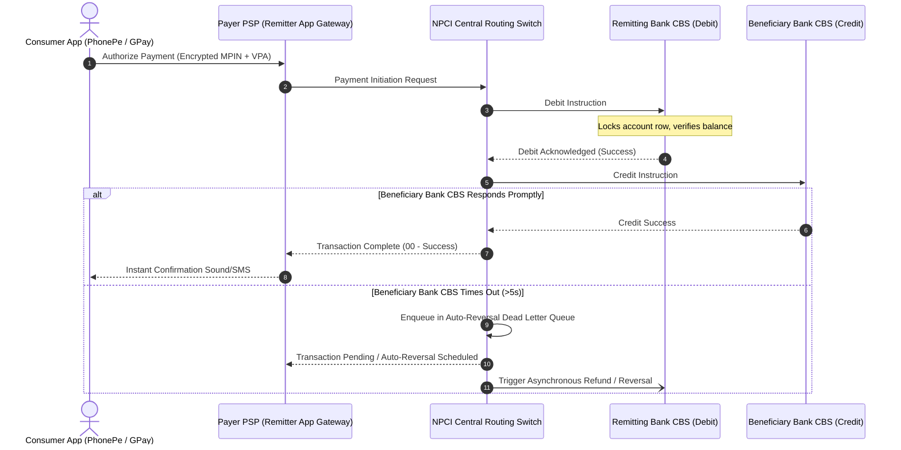

# Case Study 08: UPI & NPCI Central Switch — 15 Billion Transactions/Month

> How India's real-time payment switch coordinates 2-phase commits across 500+ legacy banking systems without database connection lockouts.

---

## 📊 Scale & Engineering Constraints
- **Transaction Volume**: Over **15+ Billion transactions per month** (> 5,000 TPS peak).
- **Heterogeneous Banking Systems**: Core Banking Solutions (CBS) range from modern cloud databases to 30-year-old on-prem mainframes.
- **Latency & SLA**: End-to-end payment confirmation must complete in **< 3 seconds** or trigger an instant deterministic rollback.

---

## 🏛️ System Architecture Overview

---

## ⚙️ Core Engineering Mechanisms

### 1. Stateless Central Routing (NPCI Switch)
If the central switch held persistent database locks for every in-flight transaction, a 2-second timeout at a single major bank (like SBI) would back up thousands of connections and cause a nationwide cascade failure.
- NPCI's core routing switch is designed to be **completely stateless**.
- In-flight transaction state is tracked in high-throughput in-memory datastores (Aerospike / Redis clusters) with strict TTLs.
- Once both legs (Debit + Credit) succeed or fail, permanent ledgers are asynchronously updated.

### 2. Idempotency Keys via Unique Transaction References (RRN)
Mobile networks drop packets constantly. If a user hits "Pay" on a flaky 4G connection and retries 5 times, how do we guarantee they aren't charged 5 times?
- Every UPI intent initiates a globally unique **Retrieval Reference Number (RRN)** generated at the client device with cryptographic salt.
- Banks check the RRN against an in-memory Bloom filter before executing any debit.
- Repeated requests with the same RRN return the cached transaction status without re-executing balance deduction.

### 3. Decoupling Debit and Credit Legs
Unlike traditional monolithic ACID transactions where Debit and Credit must commit simultaneously:
- UPI treats Debit and Credit as **two decoupled saga transactions** orchestrated by NPCI.
- If Debit succeeds but Credit fails (or times out), the transaction enters a deterministic **Deemed Approval / Auto-Reversal Queue**.
- An asynchronous reconciliation batch reconciles with the Reserve Bank of India (RBI) Real-Time Gross Settlement (RTGS) window at end-of-day.

---

## 💥 The Outage / Gotcha Post-Mortem
**The Festive Season Flash Peak**:
During Diwali shopping sales, millions of users hit UPI QR codes simultaneously, causing bank core banking systems (running on traditional relational databases) to run out of connection pools.
**The Fix**: **UPI Lite** was introduced—an on-device encrypted wallet allowing offline small-value transactions (< ₹500) without pinging the core banking system in real time, offloading **40%+ of peak network traffic**.

---

## 💡 Key Takeaway for Architects
> "When coordinating distributed transactions across hundreds of third-party systems you don't control, traditional 2-phase locking is suicide. Decouple into stateless sagas with idempotent dead-letter queues."

---

*Authored by [@saurabh-vision](https://github.com/saurabh-vision) • Next Up: [Case Study 09: IRCTC Tatkal Concurrency Engine](#)*

