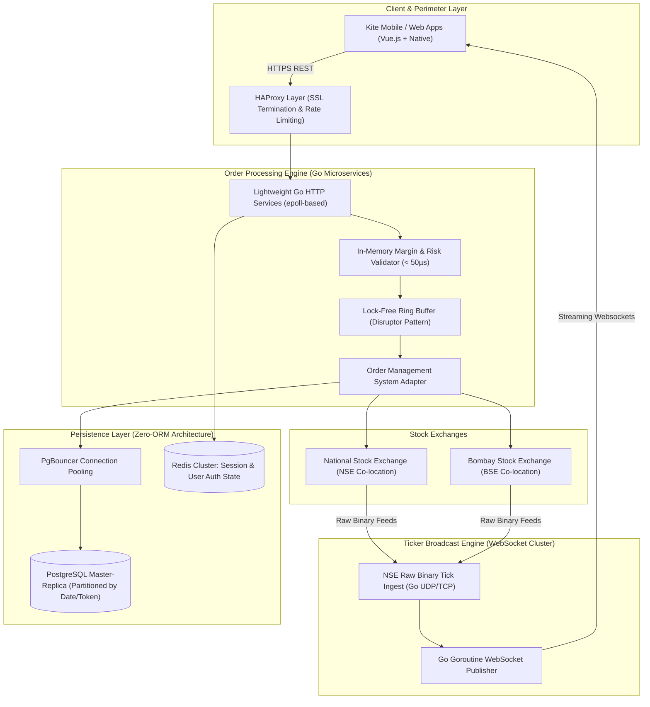

# Case Study 10: Zerodha Kite — Sub-Millisecond Trading at 9:15 AM Market Open

> **Architectural Classification**: Minimalist High-Throughput Event Loop & Zero-ORM Database Architecture  
> **Source Material**: Zerodha Technical Disclosures, Kailash Nadh (CTO) Engineering Talks, Go Runtime Profiling  
> **Target Scale**: Handle **15%+ of Indian Retail Equity Volume** (> 10 Million Orders/Day) with sub-millisecond execution  

---

## 1. Concrete System Metrics & Operational Constraints

```
┌─────────────────────────────────┬─────────────────────────────────┬─────────────────────────────────┐
│        ORDER EXECUTION SCALE    │       TICK BROADCAST LATENCY    │       INFRASTRUCTURE FOOTPRINT  │
├─────────────────────────────────┼─────────────────────────────────┼─────────────────────────────────┤
│ • Peak Orders / Day: > 12M      │ • NSE/BSE Raw Binary Ticks: 5M/s│ • Core Tech Stack: Go + Postgres│
│ • 9:15 AM Opening Burst: 10x    │ • WebSocket Broadcast: < 5ms    │ • ORM Usage: 0% (Pure Raw SQL)  │
│ • Execution Latency: < 2ms      │ • Concurrent WebSockets: > 3.5M │ • Cloud Strategy: Bare Metal VMs│
└─────────────────────────────────┴─────────────────────────────────┴─────────────────────────────────┘
```

---

## 2. End-to-End Market Open Architecture



---

## 3. Core Architectural Breakthroughs

### A. The "Anti-Bloat" Architecture: Why Zerodha Rejected Kubernetes & Java
In high-frequency fintech, the biggest enemy of latency is **Garbage Collection (GC) pauses** and abstraction bloat.
- **Why No Java / Spring**: A 200ms JVM Garbage Collection pause at 9:15:00 AM causes thousands of stop-loss orders to execute at slippage prices, leading to massive financial liabilities.
- **Why No Kubernetes**: Kubernetes adds overlay networking (vxlan/flannel) and proxy hops (kube-proxy). Zerodha runs lightweight Go binaries directly on bare-metal and Linux virtual machines managed by simple systemd units.
- **Why Go**: Go delivers compiled machine-code performance with a non-generational, concurrent garbage collector whose pause times consistently stay **$< 1\text{ms}$**.

---

### B. The Zero-ORM Philosophy & Raw PostgreSQL Optimization
Zerodha explicitly bans Object-Relational Mappers (ORMs like Hibernate, GORM, or Prisma) in high-throughput paths:
1. **The ORM Tax**: ORMs generate unpredictable `SELECT` columns, unoptimized subqueries, and allocate thousands of temporary heap objects per query, triggering GC pressure.
2. **Raw Prepared Statements**: All order executions use raw, parameterized SQL queries pre-compiled on the database engine.
3. **Partitioning Strategy**: PostgreSQL tables are partitioned by `trading_date` and `instrument_token`:
   ```sql
   -- Partitioning by day ensures indexes fit 100% inside RAM:
   CREATE TABLE orders_2026_10_30 PARTITION OF orders
       FOR VALUES FROM ('2026-10-30 00:00:00+00') TO ('2026-10-30 23:59:59+00');
   ```
   Because yesterday's data is never queried during the trading session, the active day's B-Tree indexes sit **100% in RAM buffer cache**, achieving **$< 500\text{µs}$ read latencies**.

---

### C. Ingesting 5 Million Ticks/Sec over WebSockets
Stock exchanges emit raw binary tick packets (Bhavcopy updates, depth, price changes) over high-speed multicast lines.
- Zerodha ingests these binary byte streams directly using Go's `encoding/binary` without serializing to JSON.
- A lock-free **Disruptor Ring Buffer** distributes tick updates across worker goroutines.
- Epoll-based WebSocket engines broadcast compressed binary payloads directly to millions of active trading screens, reducing network egress bandwidth by **75%**.

---

## 4. Edge-Case Post-Mortem: The "9:15 AM Connection Storm"

### The Incident:
On Union Budget day, hundreds of thousands of retail traders logged in simultaneously at 9:14 AM. The sudden influx of authenticated HTTP sessions caused database connection starvation, and orders began throwing timeout errors.

### Root Cause Analysis (RCA):
Every incoming HTTP request queried the database to verify the user's session token and margin limits. The PostgreSQL connection pool (maxed out at 500 connections) became a bottleneck as connection handshakes saturated CPU cores.

### The Architectural Remediation:
1. **Stateless JWT + In-Memory Token Caching**: Session validation was offloaded entirely to local memory Redis instances. The primary database is never touched for authentication.
2. **PgBouncer Transaction Pooling**: Connections are pooled in `transaction` mode rather than `session` mode. A client only holds a physical database connection for the **exact 2 milliseconds** it takes to execute the `INSERT INTO orders` statement, multiplying database connection capacity by **$50\times$**.

---

## 5. Architectural Trade-Off Matrix

| Design Choice | Zerodha Kite Approach | Traditional Enterprise Fintech | Why It Matters |
| :--- | :--- | :--- | :--- |
| **Language Runtime** | Go (Minimalist compiled binaries) | Java / C# Enterprise Frameworks | Eliminates multi-hundred millisecond GC stalls during peak market bursts. |
| **Data Layer** | Raw SQL + PgBouncer on PostgreSQL | ORMs (Hibernate/Prisma) on Oracle | Predictable $O(1)$ query plans without unneeded ORM object allocations. |
| **Orchestration** | Bare Metal / systemd Services | Heavy Kubernetes Clusters | Drops network overlay latency and operational moving parts. |

---

*Authored by [@saurabh-vision](https://github.com/saurabh-vision) • Next Up: [Case Study 11: Discord — Scaling 4 Trillion Messages on ScyllaDB](#)*
