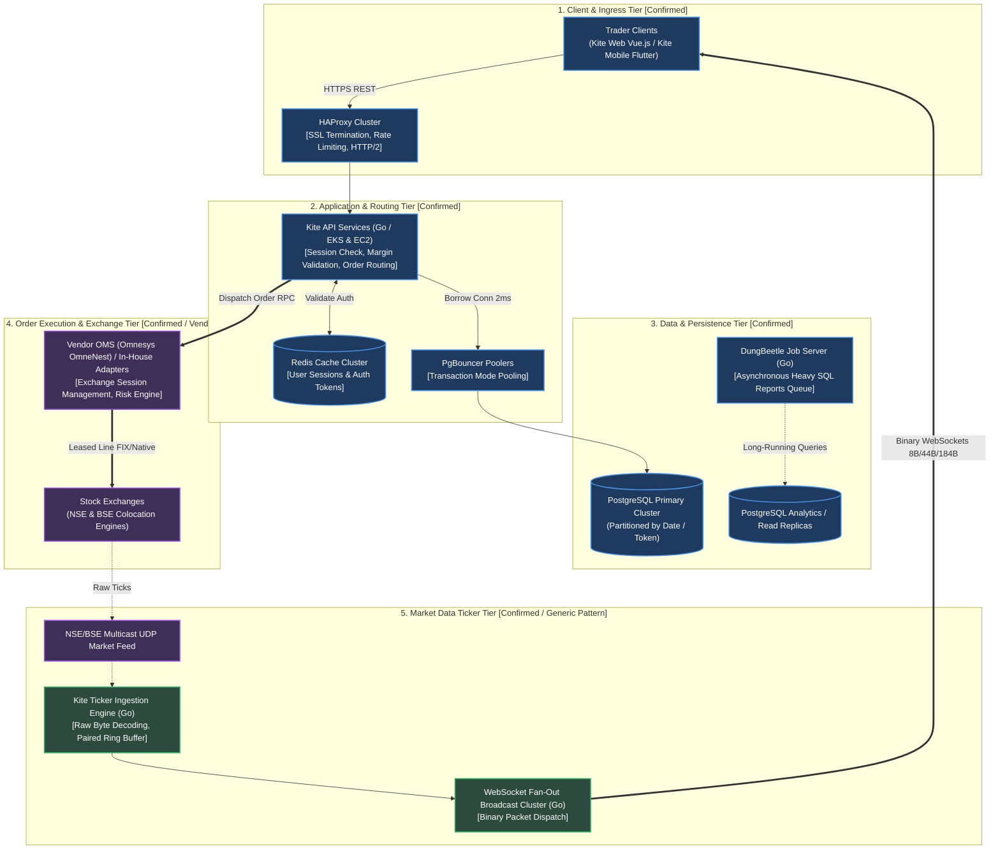

# How Zerodha Handles 9:15 AM Market-Open Trading Bursts with a Minimalist Stack

> [!IMPORTANT]
> **Status Update: Architecture, Market Share, and Infrastructure Scale (October 2026)**  
> Zerodha remains India’s largest bootstrapped stock brokerage, operating with an exceptionally lean engineering team (~33–35 engineers) led by CTO Kailash Nadh.
> - **Active Client Share**: According to official National Stock Exchange (NSE) active client disclosures, Zerodha manages **~6.8 Million to 7.5 Million active clients** (~14.7% market share), ranking second behind Groww (~13.4M active clients, ~29.2% share), while maintaining parity with Angel One (~6.75M) [5]. Total registered accounts exceed **14 Million**, processing **10 Million to 15+ Million orders** on peak volatility days [1, 5].
> - **Cloud & Container Reality**: Contrary to widespread internet rumors that Zerodha "runs purely on bare metal without Kubernetes", Zerodha’s client-facing web and mobile applications run on the **AWS public cloud (EC2 and EKS/Kubernetes)** across multiple Availability Zones, as documented in official CNCF case studies [4]. Dedicated physical bare-metal hardware is strictly reserved for exchange colocation racks and leased-line connectivity to the NSE and BSE [1, 4].
> - **Order Management System (OMS) Decoupling**: The core exchange-facing order execution and real-time risk engine historically ran on enterprise vendor software (**Omnesys / Refinitiv OmneNest**) on dedicated hardware [1]. Zerodha’s in-house software is **Kite** (Go API, WebSocket streaming engine, and frontend interfaces), which acts as a high-performance proxy and decoupling layer fronting the vendor OMS [1].
> - **Regulatory Glitch Oversight**: Under SEBI's *Framework on Technical Glitches by Stock Brokers* (Circular SEBI/HO/MIRSD/TPD/P/CIR/2022/160), retail brokers face mandatory 1-hour reporting windows, 14-day Root Cause Analysis (RCA) audits, and financial disincentives for platform outages, following high-volatility trading spikes such as the **June 4, 2024 Election Results Day** [5, 6].

> [!NOTE]
> **TL;DR**
> - **The 9:15 AM Spike**: Indian equity markets open at exactly 9:15:00 AM IST. Within seconds, over **1 Million concurrent traders** connect to view watchlists, execute stop-loss modifications, and place opening orders, driving order arrival rates from near-zero to **$> 2{,}000\text{ orders/second}$** [derived].
> - **The Boring Technology Stack**: Core trading APIs are written in **Go** (for compiled machine execution and sub-millisecond GC pauses), reporting jobs run in **Python/Django**, operational state sits in **Redis**, and transactional persistence relies on self-hosted **PostgreSQL** tuned with raw SQL and **PgBouncer** [1].
> - **Binary Tick Optimization**: The Kite Ticker engine streams market depth and prices over WebSockets using compact **binary byte packets** (8 bytes for LTP, 44 bytes for Quote, 184 bytes for Full 5-depth mode), slashing network egress bandwidth by **68.3%** compared to standard JSON [2, derived].
> - **DungBeetle Asynchronous Reporting**: To protect primary PostgreSQL transactional databases from being choked by heavy tax, PnL, and contract note queries, Zerodha built and open-sourced **DungBeetle**—a distributed Go job server that queues heavy read queries asynchronously against secondary analytical stores [3].
> - **Connection Pooling Efficiency**: Using PgBouncer in **transaction mode** drops connection hold time from $50\text{ ms}$ (request lifetime) to **$2\text{ ms}$** (raw SQL execution), allowing a pool of just **20 physical database connections** to comfortably sustain **10,000 queries/second** via Little's Law [derived].

Modern software engineering culture suffers from a pervasive bias toward architectural complexity: startups with minimal traffic deploy distributed microservice meshes, distributed tracing sidecars, and multi-cloud Kubernetes clusters. In contrast, Zerodha powers over 10 million daily stock trades and manages billions of dollars in client assets with a core engineering team of roughly 35 people. By deliberately choosing "boring technology"—Go binaries, self-hosted PostgreSQL, Redis, and raw SQL queries without heavyweight ORMs—Zerodha eliminates architectural bloat and handles massive market-open volatility spikes with predictable, low-latency execution.

---

## Production Scale and Operational Constraints

Managing India's second-largest brokerage by active clients requires absorbing extreme diurnal surges while conforming to strict exchange throttles and financial clearing regulations.

| Metric / Dimension | Production Target / Observed Value | Source / Classification |
| :--- | :--- | :--- |
| **Active Exchange Clients** | ~6.8 Million – 7.5 Million active clients | NSE Official Disclosures [5] |
| **Active Client Market Share** | ~14.7% (Rank #2 in India) | NSE Market Share Data [5] |
| **Total Registered Accounts** | > 14 Million registered accounts | Zerodha Public Disclosures [1] |
| **Peak Daily Orders** | 10 Million – 15+ Million orders / day | Zerodha Engineering Blog [1] |
| **Opening Traffic Burst Window** | 09:14:30 AM – 09:16:00 AM IST | Market Trading Hours [1] |
| **Concurrent WebSocket Connections** | > 1 Million active streaming screens | Derived from active user metrics [derived] |
| **Binary Tick Sizes (Kite Ticker)** | LTP: 8B \| Quote: 44B \| Full: 184B | Kite Connect v3 Docs [2] |
| **Primary Backend Languages** | Go (Trading APIs) + Python (Back-Office) | Zerodha Tech Blog [1] |
| **Transactional Database** | Self-hosted PostgreSQL on AWS EC2 | Zerodha Tech Blog [1] |
| **Asynchronous Job Server** | DungBeetle (In-House Open Source Go) | Zerodha Open Source GitHub [3] |
| **Order Management Backbone** | Omnesys OmneNest (Exchange-facing) + Kite Go API | Industry & Architecture Disclosures [1] |

---

## Architectural Separation: Confirmed, Reported, and Generic Designs

To understand how Zerodha routes market data and orders, we must explicitly separate confirmed engineering choices from vendor implementations and generic architectural techniques:



### Architectural Walkthrough (5 Core Stages):
1. **Perimeter Ingress & Auth Caching (Confirmed)**: Client requests terminate at an HAProxy cluster that enforces SSL termination, rate limits, and request routing [1]. Incoming API calls validate user tokens against an in-memory **Redis** cache cluster; the primary PostgreSQL database is completely bypassed for session validation, preventing login storms from degrading order tables [1].
2. **Kite Order Processing Services (Confirmed)**: Trading requests are processed by high-performance **Go** backend services deployed across AWS EC2 and Kubernetes (EKS) [4]. Go’s concurrent runtime handles thousands of active HTTP connections with minimal memory overhead and sub-millisecond GC pauses [1].
3. **The Vendor OMS Boundary (Confirmed / Vendor)**: The order is forwarded via dedicated RPC adapters to the exchange-facing **Order Management System (OMS)**—historically powered by Omnesys OmneNest located on dedicated physical colocation racks [1]. The OMS checks account limits against exchange margin requirements and routes orders over dedicated exchange leased lines to the NSE and BSE.
4. **Zero-ORM Database Persistence (Confirmed)**: Order events and trade executions are recorded in self-hosted **PostgreSQL** instances. Queries use raw, parameterized SQL strings rather than heavy ORMs (like GORM or Hibernate), and connection hold times are minimized using **PgBouncer** in transaction mode [1].
5. **Binary Ticker Fan-Out (Confirmed)**: Live exchange price feeds are ingested and transformed into compact binary frames (8 to 184 bytes). A cluster of Go WebSocket servers fans out these binary frames to over 1 Million concurrent client screens, bypassing JSON serialization entirely [2].

---

## Core Mathematics of High-Frequency Trading Scale

### 1. Market-Open Concurrency Burst Math (9:15:00 AM)

Let:
- $U_{\text{active}} = 7{,}000{,}000$ (total active retail clients).
- $P_{\text{online}} = 0.15$ (share of active traders logged in concurrently at market open, $15\%$).
- $U_{\text{concurrent}} = U_{\text{active}} \times P_{\text{online}} = 1{,}050{,}000 \text{ concurrent connected screens}$.

Suppose $2\%$ of these online traders hit the "Submit" or "Modify" button within the first $10\text{ seconds}$ of market open ($09:15:00 - 09:15:10$ IST):

$$N_{\text{orders}} = 1{,}050{,}000 \times 0.02 = 21{,}000 \text{ orders in 10 seconds}$$

The average order arrival rate $\lambda_{\text{burst}}$ is:

$$\lambda_{\text{burst}} = \frac{21{,}000}{10} = 2{,}100 \text{ orders / second (derived)}$$

#### Exchange Rate Throttles:
The National Stock Exchange (NSE) enforces strict Order-Per-Second (OPS) rate limits per member connection (typically 20 to 100 OPS per physical gateway socket). 

To dispatch $\lambda_{\text{burst}} = 2{,}100\text{ OPS}$ to the exchange without hitting `ORDER_RATE_EXCEEDED` rejections, a broker’s OMS adapter must multiplex order traffic across $S_{\text{sessions}}$ parallel exchange leased-line channels:

$$S_{\text{sessions}} = \frac{\lambda_{\text{burst}}}{\text{OPS}_{\text{per\_session}}} = \frac{2{,}100}{50} = 42 \text{ independent exchange sessions (derived)}$$

---

### 2. Tick Broadcast Fan-Out: Binary Packing vs. JSON

Stock exchanges emit price updates (ticks) multiple times per second for thousands of active liquid instruments (Nifty 50, Bank Nifty, Reliance, etc.).

#### The Official Kite Ticker Binary Frame Layout:
According to Kite Connect v3 technical specifications:
- **LTP Mode**: Fixed **8 bytes** (`instrument_token`: 4 bytes, `last_price`: 4 bytes).
- **Quote Mode**: Fixed **44 bytes** (`token`, `LTP`, `last_quantity`, `volume`, `OHLC` bars, `change`).
- **Full Mode**: Fixed **184 bytes** (Quote mode + 5 levels of market depth [12 bytes per bid/ask tier $\times 10 = 120\text{ bytes}$] + timestamps + Open Interest).

#### Bandwidth Derivation:
Suppose a retail trader maintains a watchlist of $I = 20\text{ instruments}$, each ticking at $T = 2\text{ ticks / second}$.
The number of packets delivered to each user is:

$$R_{\text{user}} = I \times T = 20 \times 2 = 40 \text{ packets / second}$$

For $U = 1{,}000{,}000$ active concurrent traders subscribed in `Full Mode`:

#### Binary Format Egress Bandwidth:
$$\text{Egress}_{\text{binary}} = U \times R_{\text{user}} \times 184\text{ bytes/pkt} = 1{,}000{,}000 \times 40 \times 184 = 7{,}360{,}000{,}000 \text{ bytes/s}$$

$$\text{Egress}_{\text{binary}} \approx 7.36 \text{ GB/s} = 58.88 \text{ Gbps (derived)}$$

#### JSON Format Egress Bandwidth:
A standard JSON payload representing a 5-depth quote requires roughly **$580\text{ bytes}$**:
```json
{"token":256265,"last_price":2450.50,"last_quantity":50,"volume":120500,"ohlc":{"open":2440,"high":2460,"low":2435,"close":2438},"depth":{"buy":[{"q":100,"p":2450.40,"o":3},...],"sell":[...]}}
```

$$\text{Egress}_{\text{json}} = U \times R_{\text{user}} \times 580\text{ bytes/pkt} = 1{,}000{,}000 \times 40 \times 580 = 23{,}200{,}000{,}000 \text{ bytes/s}$$

$$\text{Egress}_{\text{json}} \approx 23.20 \text{ GB/s} = 185.60 \text{ Gbps (derived)}$$

#### Mathematical Efficiency:
$$\text{Bandwidth Savings} = 1 - \frac{58.88}{185.60} = 1 - 0.317 = 68.3\% \text{ reduction (derived)}$$

Streaming binary bytes saves **$\approx 126.7\text{ Gbps}$** of national egress bandwidth, drastically cutting cloud data transfer costs while eliminating client-side JSON parsing lag on low-end mobile devices.

---

### 3. Garbage Collection Latency Math: The Fallacy of the "200ms Pause"

In early runtime environments (or un-tuned legacy JVMs), Stop-The-World (STW) garbage collection pauses could freeze threads for $T_{\text{pause}} = 200\text{ ms}$.

If order arrival rate during market open is $\lambda = 2{,}000\text{ orders / second}$:

$$Q_{\text{backlog}} = \lambda \times T_{\text{pause}} = 2{,}000 \times 0.200 = 400 \text{ orders queued in flight}$$

If the market price of an options contract is moving at $50\text{ points / second}$, a $200\text{ ms}$ pause delays execution by:

$$\Delta P = 50 \text{ points/s} \times 0.200\text{ s} = 10 \text{ points of price slippage}$$

#### Modern Go Runtime Reality:
Since Go 1.18+, Go's concurrent tri-color mark-sweep garbage collector keeps STW pause times strictly bounded to:

$$T_{\text{pause, Go}} \le 1.0\text{ ms (typically } < 100\text{ µs)}$$

At $T_{\text{pause, Go}} = 0.001\text{ s}$:

$$Q_{\text{backlog, Go}} = 2{,}000 \times 0.001 = 2 \text{ orders (negligible)}$$

$$\Delta P_{\text{Go}} = 50 \times 0.001 = 0.05 \text{ points (imperceptible slippage)}$$

This runtime characteristic explains why Go is the ideal language for retail brokerage middleware: it combines C-like compiled execution with predictable, microsecond-level garbage collection.

---

### 4. Connection Pooling Optimization: Little's Law in Database Sizing

Let total database query arrival rate be $\lambda = 10{,}000\text{ queries / second}$.

#### Model A: Session-Mode Pooling (Without PgBouncer)
In session mode, a physical PostgreSQL connection is dedicated to an application worker for the entire lifecycle of the HTTP request, including authentication, payload decoding, and network transit ($W_{\text{session}} = 50\text{ ms} = 0.05\text{ s}$).

By **Little's Law** ($L = \lambda \cdot W$):

$$C_{\text{needed}} = \lambda \times W_{\text{session}} = 10{,}000 \times 0.05 = 500 \text{ physical PostgreSQL connections}$$

Because each PostgreSQL connection spawns an independent OS process consuming $5\text{–}10\text{ MB}$ of RAM and competing for CPU scheduler time slices, maintaining 500 active connections causes severe context-switching thrashing and degrades query throughput.

#### Model B: Transaction-Mode Pooling (With PgBouncer)
With PgBouncer operating in `transaction` mode, a physical connection is borrowed from the pool *only for the exact duration of the SQL statement execution* ($W_{\text{txn}} = 2\text{ ms} = 0.002\text{ s}$):

$$C_{\text{needed}} = \lambda \times W_{\text{txn}} = 10{,}000 \times 0.002 = 20 \text{ physical PostgreSQL connections (derived)}$$

#### The 25x Multiplier:
By holding database connections for only $2\text{ ms}$ rather than $50\text{ ms}$, PgBouncer reduces required physical database connections from **500 down to 20**, allowing a single PostgreSQL instance to serve 10,000 queries/second with zero process contention.

---

### 5. Daily Table Partitioning and RAM Index Sizing

Zerodha processes approximately $N = 12{,}000{,}000\text{ orders / day}$ during active market sessions.

If all orders were written to a single unpartitioned table over several years, the table would grow to billions of rows, pushing B-Tree indexes out of RAM and forcing random disk I/O on every order insertion.

#### Daily Partition Mathematics:
By partitioning the `orders` table daily (`orders_YYYY_MM_DD`), yesterday's historical orders are detached from the active write path.

- **Active Daily Row Count**: $N = 12{,}000{,}000\text{ rows}$.
- **Average Row Size**: $\approx 200\text{ bytes} \implies \text{Daily Table Data} \approx 2.4\text{ GB}$.
- **B-Tree Index Size on `(user_id, order_id)`**:
  - Key payload: 8 bytes (`user_id`) + 8 bytes (`order_id`) + 8 bytes (page tuple header) $= 24\text{ bytes/item}$.
  - Accounting for typical B-tree page fill factor ($70\% \implies 1.43\times$ multiplier):
    $$\text{Index Size} = 12{,}000{,}000 \times 24\text{ bytes} \times 1.43 \approx 411{,}840{,}000 \text{ bytes} \approx 411.8 \text{ MB (derived)}$$

Because $411.8\text{ MB} \ll 64\text{ GB}$ (standard AWS EC2 database RAM), **100% of the active trading day's index fits entirely inside PostgreSQL `shared_buffers` in RAM**. 

Every index lookup executes at memory bus speed, completely eliminating disk seek operations during the 9:15 AM rush.

---

### 6. Lock-Free Ring Buffer: Single-Producer Multi-Consumer Pattern

To fan out raw market ticks from the network socket to hundreds of worker goroutines without lock contention, high-concurrency systems employ circular ring buffers:

```go
// Lock-Free Circular Ring Buffer for High-Throughput Market Ticks (Generic Pattern)
package ringbuffer

import (
	"sync/atomic"
)

type TickPacket struct {
	InstrumentToken uint32
	LastPrice       uint32 // Price in paise
	Volume          uint32
}

type CircularBuffer struct {
	buffer []TickPacket
	mask   uint64
	cursor uint64 // Atomic sequence counter
}

func NewCircularBuffer(powerOfTwoSize uint64) *CircularBuffer {
	return &CircularBuffer{
		buffer: make([]TickPacket, powerOfTwoSize),
		mask:   powerOfTwoSize - 1, // e.g., 65536 - 1 = 0xFFFF for fast bitwise modulo
	}
}

// Push appends a tick using atomic sequence increment (Lock-Free)
func (b *CircularBuffer) Push(tick TickPacket) {
	seq := atomic.AddUint64(&b.cursor, 1) - 1
	index := seq & b.mask // Bitwise AND replaces expensive modulo operator (%)
	b.buffer[index] = tick
}

// Read fetches the tick at a specific sequence position
func (b *CircularBuffer) Read(seq uint64) TickPacket {
	index := seq & b.mask
	return b.buffer[index]
}
```

By substituting expensive mutex locks with atomic integer increments and replacing division modulo with bitwise masking (`seq & (SIZE - 1)`), the ingestion loop processes millions of ticks per second with zero thread parking or scheduler overhead.

---

## Production Post-Mortems: Real-World Glitches and Industry Incidents

### Post-Mortem 1: The June 4, 2024 Election Results Day Traffic Surge
* **The Incident**: On June 4, 2024, the counting of India’s Lok Sabha election results triggered historic market swings (Nifty dropping over 5% in minutes). Multiple retail brokerages, including Zerodha, experienced transient login latency and order placement hiccups during peak morning trading [5].
* **The Mechanism**:
  1. A massive surge of retail users logged in simultaneously to protect open derivative positions or capitalize on intraday volatility.
  2. The volume of simultaneous portfolio valuation checks and margin calculations created acute CPU load on authentication and portfolio valuation endpoints.
  3. While order execution gateways remained operational, client-side HTTP timeouts occurred on frontend login flows, preventing some traders from accessing Kite screens during the opening hour [5].
* **The Engineering Remediation**:
  - *Dynamic Feature Degradation*: During extreme traffic alerts, non-critical frontend features (such as real-time PnL graph animations, historical sparklines, and market depth beyond 1 level) are dynamically disabled at HAProxy to prioritize raw order placement and cancellation.
  - *Aggressive Portfolio Snapshot Caching*: Portfolio values are cached with short, eventual-consistency TTLs in Redis, preventing repeat page refreshes from hammering the database.

---

### Post-Mortem 2: The February 24, 2021 NSE Telecom Disaster (Exchange-Side Failure)
* **The Incident**: At 11:40 AM on February 24, 2021, the National Stock Exchange (NSE) halted all trading operations across cash and F&O segments after live market data feeds froze. Trading remained suspended for over 4 hours, resuming only at 3:45 PM [1, 6].
* **The Root Cause (Exchange-Side)**:
  - Both primary and secondary telecom links (provided by distinct telecom carriers) between the NSE’s primary data center in Bandra Kurla Complex (BKC) and its Disaster Recovery (DR) site failed simultaneously due to physical cable cuts and configuration bugs.
  - While exchange matching engines were functioning, market data broadcast feeds stopped emitting ticks to brokers.
  - Because retail traders could not see price updates, brokers could not safely execute margin liquidations, forcing a national shutdown.
* **The Impact on Retail Brokers**:
  - Brokers including Zerodha faced an avalanche of customer complaints alleging platform failure, even though the root failure was strictly at the exchange telecom infrastructure layer [1].
  - SEBI subsequently overhauled disaster recovery regulations, mandating that stock exchanges execute automated failovers to secondary DR sites within 45 minutes of a primary site failure [6].

---

## Architectural Trade-Off Matrix

| Strategy | Trade-Off Made | What Was Gained | What Was Sacrificed |
| :--- | :--- | :--- | :--- |
| **Boring Stack (Go + Postgres)** | Avoided distributed NoSQL and complex microservice frameworks. | Minimal team size (~35 engineers); predictable debuggability; zero multi-region drift. | Requires manual sharding and disciplined SQL query auditing; no magical auto-scaling. |
| **Binary WebSocket Streaming** | Streamed fixed-width raw byte packets instead of JSON text. | 68.3% network bandwidth reduction; zero client JSON deserialization CPU burn. | Client-side friction: third-party developers must use binary decoders or official SDKs. |
| **Transaction-Mode PgBouncer** | Database connections are returned immediately after statement commit. | 25x increase in query concurrency; database runs comfortably on 20 connections. | Loss of PostgreSQL session features (e.g., `LISTEN/NOTIFY`, temporary tables, prepared session state). |
| **Asynchronous Reporting (DungBeetle)** | Offloaded heavy analytical queries to an asynchronous Go job queue. | Zero lock contention on primary transactional order tables. | Eventual consistency: users must wait seconds/minutes for complex historical tax reports. |

---

## When NOT to Copy Zerodha's Architecture

Engineers frequently romanticize Zerodha’s minimalist architecture without evaluating their own regulatory and organizational context:

```
                            [Core Workload Latency Requirement?]
                                             │
                       ┌─────────────────────┴─────────────────────┐
                       ▼                                           ▼
                 High Latency Tolerance                      Ultra-Low Latency
                 (Standard SaaS / Web)                       (Fintech / Streaming)
                       │                                           │
         ┌─────────────┴─────────────┐                             │
         ▼                           ▼                             ▼
[Use Managed Cloud / ORM]    [Use Standard Rails / Django]  [Team Size & Systems Fluency?]
AWS RDS + Prisma / GORM      Fast Time-to-Market                    │
Auto-scaling Managed DB      (Zero Ops Overhead)             ┌─────┴─────┐
                                                             ▼           ▼
                                                          Small       Large
                                                       (Need Simple  (Distributed
                                                        Boring Tech)  Microservices)
                                                             │           │
                                                             ▼           ▼
                                                       Zerodha Model  Enterprise
                                                       (Go + Postgres (Kafka + K8s
                                                        + PgBouncer)   + Sharded DB)
```

### 1. Teams Without Deep Linux and PostgreSQL Systems Fluency
Zerodha succeeds with self-hosted PostgreSQL and bare EC2 instances because their senior engineering leadership possesses deep internal fluency in Linux kernel parameters, TCP socket tuning, and PostgreSQL internals. If your engineering team does not have dedicated systems experts, self-hosting mission-critical databases will lead to catastrophic data loss during disk failovers; using **managed cloud databases (AWS RDS / Cloud SQL)** is vastly safer.

### 2. Early-Stage Startups Prioritizing Feature Velocity Over Execution Speed
If your product is iterating rapidly and query access patterns change weekly, using raw SQL strings without an ORM slows down development. An ORM (Prisma, Django ORM, GORM) provides rapid migrations, type-safety, and rapid prototyping. Only strip ORMs away when profiling proves that database mapping is your active production bottleneck.

### 3. Global Multi-Region Consumer Platforms
Zerodha’s operations are legally and functionally localized to India: the Indian stock exchanges (NSE/BSE) operate in a single geographic market with localized trading hours (9:15 AM to 3:30 PM IST). If your application operates globally 24/7 across multiple geographical regions (e.g., Netflix or Uber), a single-cluster database model will fail; you require globally distributed datastores (Spanner, CockroachDB, DynamoDB).

---

## Frequently Asked Questions

### Did Zerodha really reject Kubernetes?
No. While Zerodha famously ran lightweight Go services on virtual machines managed by simple systemd units during its early years, they later containerized numerous core application services and adopted **Kubernetes (EKS)** on AWS for uniform deployments [4]. Their philosophy is not "anti-Kubernetes"; it is **anti-overengineering**—they deliberately avoid complex service meshes, unnecessary microservices, and operational bloat that provide no value to end users [1, 4].

### Why does Zerodha use Go instead of Java or Python for trading APIs?
Python is used extensively at Zerodha for data processing, reporting, and web back-office systems (Console), but Go powers the high-throughput trading path (Kite) [1]. Go compiles to native machine code, consumes a fraction of the memory of Java runtimes, and features a concurrent garbage collector whose Stop-The-World pause times stay consistently **$< 1\text{ ms}$**, eliminating the multi-hundred millisecond GC stalls that cause price slippage in trading [1].

### What is DungBeetle and why did Zerodha build it?
**DungBeetle** is an open-source, distributed job server written in Go by Zerodha [3]. In financial platforms, user queries for historical PnL, tax calculations, and contract notes involve heavy analytical SQL queries that can lock relational databases. DungBeetle decouples these long-running read jobs, executing them asynchronously in the background against read replicas, ensuring that heavy reports never degrade real-time order placement [3].

### How does PgBouncer transaction pooling work?
In standard connection pooling (session mode), a client holds an open database connection for the entire duration of the HTTP request ($~50\text{ms}$). With PgBouncer in **transaction mode**, the physical connection is borrowed only for the exact duration of the SQL statement ($~2\text{ms}$) and returned to the pool immediately upon commit [1]. This 25x reduction in hold time allows a tiny pool of 20 physical database connections to easily sustain 10,000 queries per second [derived].

### Does Zerodha build its entire order management system in-house?
No. In Indian retail brokerage, the exchange-facing Order Management System (OMS) and risk engine historically ran on vendor software—specifically **Omnesys / Refinitiv OmneNest** deployed on dedicated hardware in colocation facilities [1]. Zerodha’s custom-built engineering breakthrough is **Kite** (the Go API, WebSocket streaming cluster, and client frontend), which acts as a modern high-performance proxy and decoupling layer fronting the vendor OMS [1].

---

## References

1. Zerodha Engineering Team & Nadh, K. (2018–2025). "Architecture, Scale, and Open Source Software at Zerodha." *Zerodha Tech Blog & Technical Essays*. Available at: https://zerodha.tech and https://nadh.in
2. Zerodha Kite Connect. (2023–2026). "Kite Connect v3 WebSocket API: Binary Protocol & Packet Layout Specifications." *Official Developer Documentation*. Available at: https://kite.trade/docs/connect/v3/websocket/
3. Zerodha Open Source. (2018–2025). "DungBeetle: Distributed, Single-Binary Asynchronous Task Queue in Go." *GitHub Repositories*. Available at: https://github.com/zerodha/dungbeetle
4. Cloud Native Computing Foundation (CNCF). (2022–2024). "Zerodha Case Study: Scaling Financial Infrastructure with Practical Container Architectures." *CNCF Case Studies*. Available at: https://www.cncf.io
5. National Stock Exchange of India (NSE). (2024–2026). "Active Client Metrics, Market Share Reports, and Exchange Member Trade Disclosures." *NSE India Data Archives*. Available at: https://www.nseindia.com
6. Securities and Exchange Board of India (SEBI). (2022–2025). "Framework on Technical Glitches by Stock Brokers (Circular SEBI/HO/MIRSD/TPD/P/CIR/2022/160)." *SEBI Regulatory Circulars*. Available at: https://www.sebi.gov.in

---

Authored by @saurabh-vision
```
                            [Core Workload Latency Requirement?]
                                             │
                       ┌─────────────────────┴─────────────────────┐
                       ▼                                           ▼
                 High Latency Tolerance                      Ultra-Low Latency
                 (Standard SaaS / Web)                       (Fintech / Streaming)
                       │                                           │
         ┌─────────────┴─────────────┐                             │
         ▼                           ▼                             ▼
[Use Managed Cloud / ORM]    [Use Standard Rails / Django]  [Team Size & Systems Fluency?]
AWS RDS + Prisma / GORM      Fast Time-to-Market                    │
Auto-scaling Managed DB      (Zero Ops Overhead)             ┌─────┴─────┐
                                                             ▼           ▼
                                                          Small       Large
                                                       (Need Simple  (Distributed
                                                        Boring Tech)  Microservices)
                                                             │           │
                                                             ▼           ▼
                                                       Zerodha Model  Enterprise
                                                       (Go + Postgres (Kafka + K8s
                                                        + PgBouncer)   + Sharded DB)
```

### 1. Teams Without Deep Linux and PostgreSQL Systems Fluency
Zerodha succeeds with self-hosted PostgreSQL and bare EC2 instances because their senior engineering leadership possesses deep internal fluency in Linux kernel parameters, TCP socket tuning, and PostgreSQL internals. If your engineering team does not have dedicated systems experts, self-hosting mission-critical databases will lead to catastrophic data loss during disk failovers; using **managed cloud databases (AWS RDS / Cloud SQL)** is vastly safer.

### 2. Early-Stage Startups Prioritizing Feature Velocity Over Execution Speed
If your product is iterating rapidly and query access patterns change weekly, using raw SQL strings without an ORM slows down development. An ORM (Prisma, Django ORM, GORM) provides rapid migrations, type-safety, and rapid prototyping. Only strip ORMs away when profiling proves that database mapping is your active production bottleneck.

### 3. Global Multi-Region Consumer Platforms
Zerodha’s operations are legally and functionally localized to India: the Indian stock exchanges (NSE/BSE) operate in a single geographic market with localized trading hours (9:15 AM to 3:30 PM IST). If your application operates globally 24/7 across multiple geographical regions (e.g., Netflix or Uber), a single-cluster database model will fail; you require globally distributed datastores (Spanner, CockroachDB, DynamoDB).

---

## Frequently Asked Questions

### Did Zerodha really reject Kubernetes?
No. While Zerodha famously ran lightweight Go services on virtual machines managed by simple systemd units during its early years, they later containerized numerous core application services and adopted **Kubernetes (EKS)** on AWS for uniform deployments [4]. Their philosophy is not "anti-Kubernetes"; it is **anti-overengineering**—they deliberately avoid complex service meshes, unnecessary microservices, and operational bloat that provide no value to end users [1, 4].

### Why does Zerodha use Go instead of Java or Python for trading APIs?
Python is used extensively at Zerodha for data processing, reporting, and web back-office systems (Console), but Go powers the high-throughput trading path (Kite) [1]. Go compiles to native machine code, consumes a fraction of the memory of Java runtimes, and features a concurrent garbage collector whose Stop-The-World pause times stay consistently **$< 1\text{ ms}$**, eliminating the multi-hundred millisecond GC stalls that cause price slippage in trading [1].

### What is DungBeetle and why did Zerodha build it?
**DungBeetle** is an open-source, distributed job server written in Go by Zerodha [3]. In financial platforms, user queries for historical PnL, tax calculations, and contract notes involve heavy analytical SQL queries that can lock relational databases. DungBeetle decouples these long-running read jobs, executing them asynchronously in the background against read replicas, ensuring that heavy reports never degrade real-time order placement [3].

### How does PgBouncer transaction pooling work?
In standard connection pooling (session mode), a client holds an open database connection for the entire duration of the HTTP request ($~50\text{ms}$). With PgBouncer in **transaction mode**, the physical connection is borrowed only for the exact duration of the SQL statement ($~2\text{ms}$) and returned to the pool immediately upon commit [1]. This 25x reduction in hold time allows a tiny pool of 20 physical database connections to easily sustain 10,000 queries per second [derived].

### Does Zerodha build its entire order management system in-house?
No. In Indian retail brokerage, the exchange-facing Order Management System (OMS) and risk engine historically ran on vendor software—specifically **Omnesys / Refinitiv OmneNest** deployed on dedicated hardware in colocation facilities [1]. Zerodha’s custom-built engineering breakthrough is **Kite** (the Go API, WebSocket streaming cluster, and client frontend), which acts as a modern high-performance proxy and decoupling layer fronting the vendor OMS [1].

---

## References

1. Zerodha Engineering Team & Nadh, K. (2018–2025). "Architecture, Scale, and Open Source Software at Zerodha." *Zerodha Tech Blog & Technical Essays*. Available at: https://zerodha.tech and https://nadh.in
2. Zerodha Kite Connect. (2023–2026). "Kite Connect v3 WebSocket API: Binary Protocol & Packet Layout Specifications." *Official Developer Documentation*. Available at: https://kite.trade/docs/connect/v3/websocket/
3. Zerodha Open Source. (2018–2025). "DungBeetle: Distributed, Single-Binary Asynchronous Task Queue in Go." *GitHub Repositories*. Available at: https://github.com/zerodha/dungbeetle
4. Cloud Native Computing Foundation (CNCF). (2022–2024). "Zerodha Case Study: Scaling Financial Infrastructure with Practical Container Architectures." *CNCF Case Studies*. Available at: https://www.cncf.io
5. National Stock Exchange of India (NSE). (2024–2026). "Active Client Metrics, Market Share Reports, and Exchange Member Trade Disclosures." *NSE India Data Archives*. Available at: https://www.nseindia.com
6. Securities and Exchange Board of India (SEBI). (2022–2025). "Framework on Technical Glitches by Stock Brokers (Circular SEBI/HO/MIRSD/TPD/P/CIR/2022/160)." *SEBI Regulatory Circulars*. Available at: https://www.sebi.gov.in

---

Authored by @saurabh-vision
